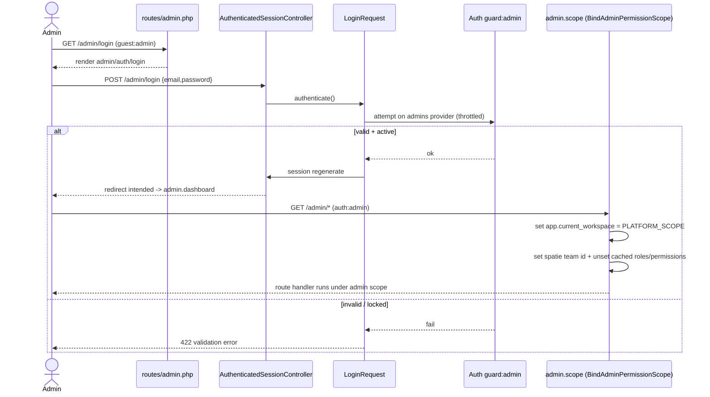

# Admin Auth (Two-Guard)

Module: [Admin Plane](./README.md) · Status: live · Updated: 2026-06-15

## Purpose

Authenticate internal staff on a dedicated `admin` guard that is isolated from the customer `web` guard. A staff member and a customer never share an identity, a session payload, or an RBAC namespace. This is the entry gate to the entire [admin plane](./README.md).

## Actors & permissions

- **Admin** (`App\Models\Admin`, guard `admin`) — internal staff. `status` is server-controlled (`active`/`locked`, BR-X12); a locked admin cannot pass auth.
- Admins hold spatie roles/permissions under `Admin::PLATFORM_SCOPE`; no workspace membership.
- Customers (`web` guard) cannot reach `/admin/*`; guests there are redirected to `admin.login`, not the tenant login.

See [crm-authorization-model.md](../../crm-authorization-model.md).

## Trigger / entry points

- `GET /admin/login` → `Admin\Auth\AuthenticatedSessionController@create` → `resources/js/pages/admin/auth/login.tsx`
- `POST /admin/login` → `@store` (validates via `App\Http\Requests\Admin\Auth\LoginRequest`)
- `POST /admin/logout` → `@destroy`
- Password reset: `Admin\Auth\PasswordResetLinkController`, `Admin\Auth\NewPasswordController` (broker `admins`)
- Route group: `routes/admin.php` (`guest:admin` for auth pages, `auth:admin` + `admin.scope` for the panel)

## Operational flow (step-by-step)

1. **Guest hits `/admin/login`** — `guest:admin` middleware lets unauthenticated requests through; an already-authenticated admin is redirected to `admin.dashboard`.
2. **Admin submits credentials** → `POST /admin/login`.
3. **`LoginRequest::authenticate()`** attempts `Auth::guard('admin')` against the `admins` provider; throttled; locked/invalid → validation error.
4. **On success** the session id is regenerated (fixation defense) and the request is redirected to the intended `admin.dashboard`.
5. **Every subsequent `/admin/*` request** passes `auth:admin` then `admin.scope` (`BindAdminPermissionScope`): it sets the SQL `app.current_workspace` to `PLATFORM_SCOPE`, points the spatie `PermissionRegistrar` team id at `PLATFORM_SCOPE`, and unsets any cached `roles`/`permissions` relations so capability checks reload under the admin scope.
6. **Logout** (`@destroy`) calls `Auth::guard('admin')->logout()`, invalidates the session, regenerates the CSRF token, and redirects to `/admin/login`.

## Data touched

- `admins` — read for auth (`email`, `password` hashed, `status`, `locale`, `timezone`). `status` excluded from mass assignment.
- `admin_password_reset_tokens` — password-reset broker (`admins`).
- spatie role/permission tables — read under `PLATFORM_SCOPE` for capability checks.
- Session — admin guard payload + regenerated id.

## State transitions

No domain state change on login/logout. `status` (`active`↔`locked`) is mutated out of band by platform tooling, not by this flow.

## Business rules applied

- **BR-X12** — `Admin::status` is server-controlled; a `locked` admin fails auth.
- Two-guard isolation — admin auth never touches the `web` guard or any workspace-scoped table.
- Guard-aware redirects — `/admin/*` guests/users redirect to admin endpoints, not tenant ones (`bootstrap/app.php`).

## Edge cases & error handling

| Scenario | Behavior |
|---|---|
| Authenticated admin opens `/admin/login` | Redirected to `admin.dashboard` (`guest:admin`). |
| Customer (web) opens `/admin/*` | Treated as guest on the admin guard → redirected to `admin.login`. |
| Locked admin logs in | Auth fails; generic validation error (no account-state leak). |
| spatie roles cached empty before scope bound | `admin.scope` unsets cached relations so checks reload correctly. |
| Brute-force login | `LoginRequest` rate-limits attempts. |

## Related

- [crm-authorization-model.md](../../crm-authorization-model.md) — two-guard model + admin RBAC.
- [workspaces-panel.md](./workspaces-panel.md) — the first screen behind auth.
- [`AuthenticatedSessionController`](../../../app/Http/Controllers/Admin/Auth/AuthenticatedSessionController.php) · [`BindAdminPermissionScope`](../../../app/Http/Middleware/BindAdminPermissionScope.php) · [`Admin`](../../../app/Models/Admin.php) · [`routes/admin.php`](../../../routes/admin.php)
