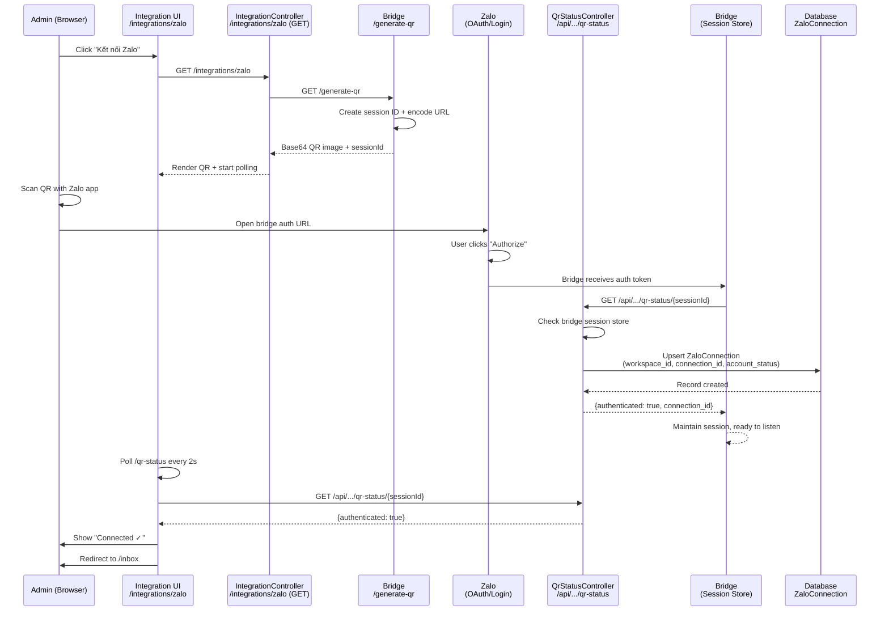

# Zalo Personal Connect (QR Login)

Module: `app/Modules/Integration` · Status: live (GĐ1) · Updated: 2026-06-28

## Purpose

Allow a tenant admin to connect a Zalo personal account to the workspace via QR login. Once connected, the Zalo bridge maintains an authenticated session and sends webhook messages inbound to the Inbox in real-time.

**Value:** Eliminates the need for Zalo OA (which requires business registration and approval); any personal Zalo account can be the inbox entry point. Simplifies Phase 1 onboarding.

## Actors & Permissions

- **Tenant admin** (`workspace.integrations.manage` or workspace owner) — initiate Zalo connect, view connection status.
- **Zalo bridge service** (Node.js, external) — maintains session, receives/forwards messages via webhook.
- **Non-admin workspace members** — view connected status in Inbox nav, cannot reconfigure.

Authorization: checked via `can('manage', Integration)` in controller (or implicit if workspace owner).

## Trigger / Entry Points

**UI Entry:** Settings → Tích hợp (Integrations) → Zalo card → "Kết nối" button.

**Route:** `GET /integrations/zalo` (IntegrationController::zaloConnect)
- Retrieves current connection status + generates QR.

**QR Generation:** Bridge endpoint `/generate-qr` (HTTP GET).
- Bridge returns Base64 QR image (encodes login URL + session ID).

**Callback:** Bridge polls `GET /api/integrations/zalo-personal/qr-status/{sessionId}` (QrStatusController).
- Returns `{authenticated: boolean, connection_id, workspace_id}` when scan + authorize complete.

**Webhook:** Bridge sends `POST /api/integrations/zalo-personal/webhook` when peer messages arrive.
- Handled by `ZaloPersonalWebhookController::handle()` (see [zalo-personal-inbox.md](../messaging/zalo-personal-inbox.md)).

## Operational Flow (Step-by-Step)

1. **Admin navigates to Integrations.**
   - Controller: `IntegrationController::index()`
   - Resolves `IntegrationCatalog::cards()` → returns array of available integrations (Zalo only, hardcoded).
   - Renders Inertia page `integration/index` with catalog.

2. **Admin clicks "Kết nối Zalo" (Connect Zalo).**
   - UI route: `/integrations/zalo` (GET).
   - Controller: `IntegrationController::zaloConnect()`.
   - Checks permission: `$this->authorize('manage', new Integration())`.
   - Fetches current `ZaloConnection` for workspace (if exists).
   - Calls bridge `/generate-qr` → receives Base64 QR image + session ID.
   - Renders Inertia page `integration/zalo` with QR display + polling logic.

3. **Admin scans QR with Zalo app.**
   - Zalo opens bridge auth URL (embeds session ID).
   - Bridge authenticates with Zalo OAuth (or login endpoint).

4. **Bridge receives auth token, calls callback endpoint.**
   - Bridge → `GET /api/integrations/zalo-personal/qr-status/{sessionId}`.
   - Controller: `QrStatusController::check()`.
   - Checks session in bridge store (Redis or memory).
   - If authenticated:
     - Extracts Zalo account info (account_id, connection_id).
     - Stores or updates `ZaloConnection` record (workspace_id, connection_id, account_status).
     - Returns `{authenticated: true, connection_id, workspace_id}`.
   - If not yet: returns `{authenticated: false}`.

5. **UI polls QR status (Inertia polling).**
   - Every 1–2 seconds: fetch `/api/integrations/zalo-personal/qr-status/{sessionId}`.
   - When `authenticated: true` → redirect to `/inbox` or show "Connected ✓".
   - Bridge now maintains session, ready to receive messages.

6. **Connection persisted.**
   - `ZaloConnection` record created with:
     - `workspace_id` (tenant scoped).
     - `connection_id` (unique Zalo account ID).
     - `account_status` ('active', 'suspended', etc.).
     - `circuit_open` (false initially; set to true if bridge health fails).
     - `circuit_error_count` (incremented on bridge failures; reset on success).

7. **Inbound webhook flow begins.**
   - Peer sends message via Zalo.
   - Bridge receives via WebSocket/Zalo API.
   - Bridge sends `POST /api/integrations/zalo-personal/webhook` with:
     - `connection_id`, `peer_uid`, `peer_phone`, `peer_name`, `message_text`, `source_id`, `X-Zalo-Personal-Bridge-Secret` header.
   - Handled by `ZaloPersonalWebhookController::handle()`.
   - See [zalo-personal-inbox.md](../messaging/zalo-personal-inbox.md) for inbound flow.

## Data Touched

**Models:**
- `ZaloConnection` — workspace_id, connection_id, account_status, circuit_open, circuit_error_count.
- `Workspace` — (read-only for scope binding).

**Audit:** No direct audit entries (CRUD is via UI); connection create/update logged implicitly in Controller action.

**RLS:** `ZaloConnection.workspace_id` enforced by `BelongsToWorkspace` trait.

## State Transitions

| State | Trigger | Next | Notes |
|-------|---------|------|-------|
| **Not Connected** | Admin visits `/integrations/zalo` | QR Displayed | No `ZaloConnection` record exists. |
| **QR Displayed** | Admin scans + authorizes | Bridge Authenticates | Session ID in bridge memory. |
| **Bridge Authenticates** | Bridge calls callback `/qr-status/{sessionId}` | **Connected** | `ZaloConnection` record created. |
| **Connected** | Bridge receives message | Message Ingested | Conversation + Message created. |
| **Connected** | Bridge health check fails (N errors) | **Circuit Open** | `circuit_open = true`, `circuit_error_count += 1`. |
| **Circuit Open** | Admin refreshes Zalo connect page | QR Displayed Again | Allows re-authenticate or clear circuit. |

## Business Rules Applied

1. **One connection per workspace per account** — `unique(workspace_id, connection_id)` (future: support multi-account per workspace → composite key revisit).
2. **QR session timeout** — bridge invalidates session after 10 min (or configurable). UI stops polling, shows "QR Expired" + "Retry" button.
3. **Circuit breaker** — if bridge returns 5 consecutive errors (503/429/403), mark connection unhealthy; fail-fast on send attempts until reset.
4. **Account suspension** — Zalo can suspend account; bridge detects and updates `account_status = 'suspended'`. App checks status before allowing send (→ 422).

## Edge Cases & Error Handling

| Scenario | Behavior |
|----------|----------|
| **QR expires without scan** | UI shows "QR Expired - Scan a new one"; retry button calls `/generate-qr` again. |
| **Network error during scan** | UI retries polling; if timeout > threshold, prompts user to refresh page. |
| **Bridge not running** | `/generate-qr` fails (HTTP connection error). UI shows "Bridge unreachable" message. |
| **Bridge auth fails (403)** | Bridge calls callback with `authenticated: false`. Polling loop exits; user sees "Auth failed - try again". |
| **Admin scans but closes page** | Polling stops; connection is still created in DB. When admin returns, sees "Connected ✓". |
| **Two admins connect simultaneously** | Race on `ZaloConnection` upsert; last write wins (idempotent). Both sessions work (bridge maintains independently). |
| **Account already connected in different workspace** | Allowed (same Zalo account ↔ multiple workspaces). Each workspace sees their own connection. |
| **Connection deleted via UI** | `ZaloConnection` soft-deleted. Inbound webhooks rejected (connection_id not found). |

## Related

- **Inbox inbound:** [zalo-personal-inbox.md](../messaging/zalo-personal-inbox.md) — message ingestion from webhook.
- **System architecture:** [system-architecture.md](../../system-architecture.md) § Integration Driver Pattern.
- **Authorization:** [../crm-authorization-model.md](../crm-authorization-model.md) § Workspace scope.

## Mermaid Diagram

---

## Testing Checklist

- [ ] Admin can access `/integrations/zalo` (authorized).
- [ ] QR generates + displays (bridge reachable).
- [ ] Scanning QR + authorizing creates `ZaloConnection` record.
- [ ] Polling detects authenticated state + redirects to Inbox.
- [ ] Inbound messages arrive after connection (see [zalo-personal-inbox.md](../messaging/zalo-personal-inbox.md)).
- [ ] Outbound send works (replies to conversations).
- [ ] Circuit breaker activates on bridge errors; fails sends gracefully (422).
- [ ] Delete/reconnect flow works; old messages still visible (idempotent).
