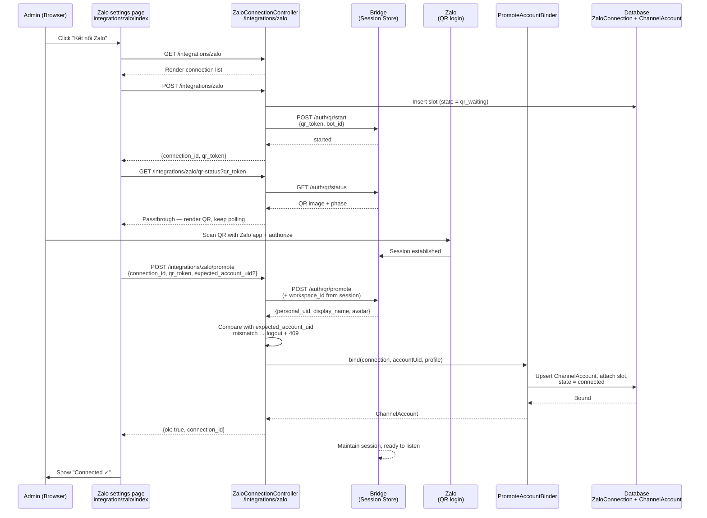

# Zalo Personal Connect (QR Login)

Module: `app/Modules/Chat` (channel adapter `app/Modules/Chat/Adapter/ZaloPersonal`) · Status: live (GĐ1) · Updated: 2026-07-26

## Purpose

Allow a tenant admin to connect a Zalo personal account to the workspace via QR login. Once connected, the Zalo bridge maintains an authenticated session and sends webhook messages inbound to the Inbox in real-time.

**Value:** Eliminates the need for Zalo OA (which requires business registration and approval); any personal Zalo account can be the inbox entry point. Simplifies Phase 1 onboarding.

## Actors & Permissions

- **Tenant admin** (`tenant.zalo.manage`) — initiate Zalo connect, view connection status.
- **Zalo bridge service** (Node.js, external) — maintains session, receives/forwards messages via webhook.
- **Non-admin workspace members** — view connected status in Inbox nav, cannot reconfigure.

Authorization: every `ZaloConnectionController` action opens with `abort_unless(auth()->user()?->can(TenantPermission::ZaloManage->value), 403)`.

## Trigger / Entry Points

**UI Entry:** Settings → Tích hợp (Integrations) → Zalo card → "Kết nối" button.

**Page:** `GET /integrations/zalo` (`ZaloConnectionController::index`)
- Lists the workspace's `ZaloConnection` slots with their state badge; the QR flow starts from this page.

**QR start:** `POST /integrations/zalo` (`ZaloConnectionController::store`).
- Allocates `connection_id` + `qr_token`, inserts a `qr_waiting` slot, then calls bridge `POST /auth/qr/start`.

**QR polling:** `GET /integrations/zalo/qr-status?qr_token=…` (`ZaloConnectionController::qr`).
- Proxies bridge `GET /auth/qr/status` — QR image + phase are passed through from the bridge.

**Promote:** `POST /integrations/zalo/promote` (`ZaloConnectionController::promote`).
- Proxies bridge `POST /auth/qr/promote`, then binds the slot to a `ChannelAccount`.

**Webhook:** Bridge sends `POST /api/integrations/zalo-personal/webhook` when peer messages arrive.
- Handled by `ZaloPersonalWebhookController::__invoke()` (see [zalo-personal-inbox.md](../messaging/zalo-personal-inbox.md)).

## Operational Flow (Step-by-Step)

1. **Admin navigates to Integrations.**
   - Controller: `IntegrationController::index()`
   - Resolves `App\Http\ViewModels\IntegrationCatalog::cards()` → returns array of available integrations (Zalo only, hardcoded).
   - Renders Inertia page `integration/index` with catalog.

2. **Admin clicks "Kết nối Zalo" (Connect Zalo).**
   - UI route: `/integrations/zalo` (GET).
   - Controller: `ZaloConnectionController::index()`.
   - Checks permission: `TenantPermission::ZaloManage`.
   - Loads the workspace's existing `ZaloConnection` slots with their state.
   - Renders Inertia page `integration/zalo/index`.

3. **Page requests a QR.**
   - `POST /integrations/zalo` → `ZaloConnectionController::store()`.
   - Allocates `connection_id` via `ZaloConnection::nextConnectionId()` plus a `qr_token` UUID, inserts the row with `state = 'qr_waiting'`.
   - Calls bridge `POST /auth/qr/start` with `{qr_token, bot_id: connection_id}` and the `X-Bridge-UI-Secret` header.
   - Bridge unreachable → the slot row is deleted again, response 503; bridge error response → deleted, 502.

4. **UI polls QR status.**
   - `GET /integrations/zalo/qr-status?qr_token=…` → `ZaloConnectionController::qr()`.
   - Proxies bridge `GET /auth/qr/status`; the bridge's body and HTTP status are passed through unchanged.

5. **Admin scans QR with Zalo app and authorizes.**
   - Bridge completes the Zalo login attached to that `qr_token`.

6. **UI promotes the slot.**
   - `POST /integrations/zalo/promote` with `{connection_id, qr_token, expected_account_uid?}` → `ZaloConnectionController::promote()`.
   - Proxies bridge `POST /auth/qr/promote`, also sending `workspace_id` taken from the authenticated session — that is what binds the slot to a workspace on the bridge side.
   - If `expected_account_uid` was sent (re-login of a known account) and the bridge returns a different `personal_uid` → fail closed: the new slot is logged out, response 409 `zalo_account_mismatch`, nothing is bound.
   - Otherwise `PromoteAccountBinder::bind()` runs a single transaction: find-or-create the `ChannelAccount` (`zalo_personal` + account uid), attach the slot to it, set `state = 'connected'`.
   - If that transaction throws after the bridge already promoted, the slot is logged out again so no orphan `connected` slot is left behind.

7. **Connection persisted.**
   - `ZaloConnection` row holds:
     - `workspace_id` (tenant scoped).
     - `connection_id` (bigint, unique cross-tenant — the bridge's slot key).
     - `channel_account_id` (the `ChannelAccount` this slot logged into).
     - `personal_uid`, `display_name`, `avatar_url` (profile returned by the bridge).
     - `state` (`disconnected` | `qr_waiting` | `connected` | `session_lost`) + `session_lost_reason`.
     - `last_connected_at`, `last_session_lost_at`, `last_qr_at`, `lock_version`.

8. **Inbound webhook flow begins.**
   - Peer sends message via Zalo.
   - Bridge receives via WebSocket/Zalo API.
   - Bridge sends `POST /api/integrations/zalo-personal/webhook` carrying `connection_id`, a `type` discriminator (`inbound` | `bridge_session` | `social_event`, anything else falls through to the relay-event path) and the event body, authenticated by the `X-Zalo-Personal-Bridge-Secret` header (`zalo.bridge.secret` → `VerifyZaloBridgeSecret`).
   - Handled by `ZaloPersonalWebhookController::__invoke()`, which resolves the workspace from `connection_id` over the privileged connection before binding `TenantScope`.
   - See [zalo-personal-inbox.md](../messaging/zalo-personal-inbox.md) for inbound flow.

## Data Touched

**Models:**
- `ZaloConnection` — workspace_id, connection_id, channel_account_id, personal_uid, display_name, avatar_url, state, session_lost_reason, last_connected_at, last_session_lost_at, last_qr_at, lock_version.
- `ChannelAccount` — created or reused on promote; its `status` follows the slot (`connected` / `session_lost` / `disconnected`).
- `Workspace` — (read-only for scope binding).

**Audit:** No direct audit entries (CRUD is via UI); connection create/update logged implicitly in Controller action.

**RLS:** `zalo_connections` carries a Postgres row-level security policy on `workspace_id` (migration `2026_06_28_800003_enable_rls_on_zalo_connections.php`). The webhook has no session, so it resolves `workspace_id` from `connection_id` over the `pgsql_privileged` connection first, then binds `TenantScope`.

## State Transitions

| State | Trigger | Next | Notes |
|-------|---------|------|-------|
| **No slot** | Admin requests a QR on `/integrations/zalo` | **`qr_waiting`** | Row inserted with a fresh `connection_id` + `qr_token`. |
| **`qr_waiting`** | Bridge `/auth/qr/start` unreachable or failing | Row deleted | `store()` rolls the slot back, so no dead slot is left behind. |
| **`qr_waiting`** | Admin scans, promote succeeds | **`connected`** | `PromoteAccountBinder` binds the slot to a `ChannelAccount`. |
| **`qr_waiting`** | Promote returns an account uid ≠ `expected_account_uid` | Slot logged out | 409 `zalo_account_mismatch`; nothing bound. |
| **`connected`** | Bridge receives message | Message Ingested | Conversation + Message created. |
| **`connected`** | Bridge posts `bridge_session` with `state: session_lost` | **`session_lost`** | `session_lost_reason` recorded; the account's gap window opens. |
| **`session_lost`** | Bridge restores the session (`session_ok`), or admin re-scans QR | **`connected`** | Gap window closes. |
| **`connected`** | Admin deletes the connection | Soft-deleted | Bridge logout first; `ChannelAccount.status` → `disconnected` once no live slot remains. |

## Business Rules Applied

1. **One live slot per Zalo account per workspace** — partial unique index `zalo_connections_ws_personal_uid_active_unique` on `(workspace_id, personal_uid)` over active rows only, so a soft-deleted slot never blocks a reconnect. Several different Zalo accounts per workspace are allowed.
2. **QR session timeout** — bridge invalidates session after 10 min (or configurable). UI stops polling, shows "QR Expired" + "Retry" button.
3. **Circuit breaker** — `ZaloHealthMonitor` counts bridge errors (`429`, `403`, `session_lost`, `rate_limited`, `forbidden`) per connection in the cache; ≥5 inside a 1-hour window opens the circuit and sends fail fast (`circuit_open`) until the window expires.
4. **Wrong-account guard** — a re-login sends `expected_account_uid`; a mismatch fails closed (409, new slot logged out) instead of silently rebinding the workspace to a different Zalo account.

## Edge Cases & Error Handling

| Scenario | Behavior |
|----------|----------|
| **QR expires without scan** | UI shows "QR Expired - Scan a new one"; retry button requests a fresh slot via `POST /integrations/zalo`. |
| **Network error during scan** | UI retries polling; if timeout > threshold, prompts user to refresh page. |
| **Bridge not running** | `POST /integrations/zalo` answers 503 ("bridge chưa chạy ở cổng 3710") and deletes the slot it had just inserted. |
| **Bridge auth fails** | `/integrations/zalo/qr-status` passes the bridge's non-OK status through; polling loop exits and the page offers a new QR. |
| **Admin scans but closes page before promote** | Slot stays `qr_waiting` and nothing is bound; requesting a new QR creates a fresh slot. |
| **Two admins connect simultaneously** | Each gets its own `connection_id` slot; the partial unique on `(workspace_id, personal_uid)` keeps only one live slot per Zalo account. |
| **Account already connected in different workspace** | Allowed (same Zalo account ↔ multiple workspaces). Each workspace sees their own connection. |
| **Connection deleted via UI** | Bridge logout, then `ZaloConnection` soft-deleted. Webhooks for that `connection_id` answer 202 `connection_not_mapped` (never 404 — inbound is always accepted). |

## Related

- **Inbox inbound:** [zalo-personal-inbox.md](../messaging/zalo-personal-inbox.md) — message ingestion from webhook.
- **System architecture:** [system-architecture.md](../../system-architecture.md) § Port / Adapter Driver Pattern.
- **Authorization:** [crm-authorization-model.md](../../crm-authorization-model.md) § Plane 2 — Workspace.

## Mermaid Diagram

---

## Testing Checklist

- [ ] Admin can access `/integrations/zalo` (holds `tenant.zalo.manage`); anyone else gets 403.
- [ ] QR generates + displays (bridge reachable); slot lands in `qr_waiting`.
- [ ] Scanning QR + promoting sets the slot to `connected` and binds a `ChannelAccount`.
- [ ] Re-login with a different Zalo account is refused with 409 `zalo_account_mismatch`.
- [ ] Inbound messages arrive after connection (see [zalo-personal-inbox.md](../messaging/zalo-personal-inbox.md)).
- [ ] Outbound send works (replies to conversations).
- [ ] Circuit breaker activates on bridge errors; fails sends gracefully (422).
- [ ] Delete/reconnect flow works; old messages still visible (idempotent).
