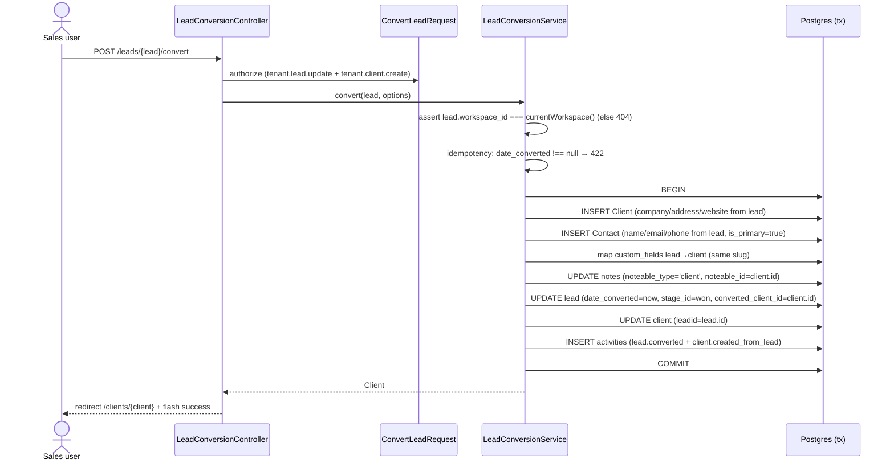

# Leads + Pipeline + Convert

Module: leads · Status: live · Updated: 2026-06-25

## Purpose

Manage sales leads through configurable pipeline stages (kanban board), with assignment, lost/junk tracking, and conversion to Client + Contact. Enables sales teams to track deal flow from initial contact to closed deal.

## Actors & permissions

| Actor | Permissions required |
|---|---|
| Admin / Sales Manager | `tenant.lead.view` (all) + full CRUD + convert |
| Sales Rep | `tenant.lead.view_own` — owns/assigned leads only, or is_public, or team |
| Viewer | No lead permissions — cannot access |

Visibility rule (G12): `tenant.lead.view` → sees all workspace leads. Otherwise: `assigned_to = self` OR `owner_id = self` OR `created_by = self` OR `team_id ∈ user's teams` OR `is_public = true`. Fail → `abort(404)` (non-enumeration).

## Trigger / entry points

| Trigger | Code entry |
|---|---|
| Create lead form | `POST /leads` → `LeadController@store` |
| Kanban drag-drop | `PATCH /leads/{lead}/stage` → `LeadStageController@update` |
| Assignment | `POST /leads/{lead}/assign` → `LeadController@assign` |
| Mark lost | `POST /leads/{lead}/lost` → `LeadStatusActionController@markLost` |
| Mark junk | `POST /leads/{lead}/junk` → `LeadStatusActionController@markJunk` |
| Restore | `POST /leads/{lead}/restore-status` → `LeadStatusActionController@restore` |
| Convert | `POST /leads/{lead}/convert` → `LeadConversionController@store` |

## Operational flow (step-by-step)

### 1. Create lead

1. User fills form: name, pipeline, stage, optional fields (email, phone, company, value, source, assigned_to, is_public, custom_fields).
2. `StoreLeadRequest` validates: `stage_id ∈ pipeline_id` (G8), pipeline/source scoped to workspace.
3. `LeadService::create()` (in `DB::transaction`):
   - Sets `lead_number = WorkspaceSequence::next('lead', ws_id)`.
   - Sets `owner_id = created_by = auth()->id()`.
   - `CustomFieldService::apply()` writes JSONB bag.
   - Saves lead.
   - Logs activity `lead.created`.
   - Fires `LeadCreated`.
   - If `assigned_to` set → calls `assign()` → fires `LeadAssigned` → listener sends notification.

### 2. Kanban drag-drop

1. User drags card from stage A to stage B.
2. React fires `PATCH /leads/{lead}/stage` with `{stage_id, order}`.
3. `MoveLeadStageRequest` validates: `stage_id ∈ lead.pipeline_id` (G8).
4. `LeadService::moveStage()`: reindexes leads in target stage, sets `stage_id + lead_order`, logs `lead.stage_changed`, fires `LeadStageChanged`.

### 3. Assignment

1. User clicks Assign button → selects team member from popover.
2. `POST /leads/{lead}/assign` with `{assigned_to}`.
3. `LeadService::assign()`: sets `assigned_to`, logs activity, fires `LeadAssigned`.
4. `SendLeadAssignedNotification` listener: finds assignee user, sends `LeadAssignedNotification` (DB + email via `TemplatedMailer::send('lead_assigned', ...)`).

### 4. Lost / Junk

1. User clicks "Mark as Lost" / "Mark as Junk".
2. `LeadService::markLost/markJunk()`: saves `last_stage_id = current stage_id`, sets flag, logs activity.
3. Lead exits normal kanban flow but is NOT deleted. Stage history preserved.
4. Restore: clears flag, restores `stage_id = last_stage_id`, clears `last_stage_id`, logs activity.

### 5. Convert Lead → Client + Contact



## Data touched

| Entity | Fields read | Fields written |
|---|---|---|
| `leads` | all fields | `date_converted`, `converted_client_id`, `stage_id` |
| `clients` | — | INSERT: `name`, `phone`, `website`, `currency`, `billing_*`, `owner_id`, `leadid` |
| `contacts` | — | INSERT: `first_name`, `last_name`, `email`, `phone`, `title`, `is_primary`, `client_id` |
| `notes` | `noteable_type`, `noteable_id` | re-point to client |
| `activities` | — | INSERT `lead.converted` + `client.created_from_lead` |

## State transitions

### Stage transitions

```
Open stage → Open stage   (drag-drop)
Open stage → Won stage    (convert)
Any stage  → [is_lost=true, last_stage_id=cached]  (markLost)
Any stage  → [is_junk=true, last_stage_id=cached]  (markJunk)
is_lost/is_junk → stage_id=last_stage_id, flags cleared  (restore)
```

### Lost/Junk guard: lost/junk leads do NOT disappear, they stay in pipeline but flagged. Visibility scope still applies.

## Business rules applied

- **G8**: `stage_id MUST belong to lead's pipeline_id`. Validated in FormRequest + Service. Stage from different pipeline → 422.
- **G7**: Convert is idempotent (second call → 422). Cross-workspace convert → 404. Client in convert must belong to same workspace.
- **G12**: Visibility = own OR team OR is_public OR `tenant.lead.view`. Non-enumeration: fail → 404 not 403.
- **Sequence**: `lead_number` auto-incremented per workspace (WorkspaceSequence, race-safe INSERT…ON CONFLICT).
- **Assignment notification**: sent even for self-assignment.
- **Convert**: lead is NOT deleted after conversion (preserved for history). `date_converted` prevents double-convert.

## Edge cases & error handling

| Case | Behavior |
|---|---|
| Stage deleted after lost (last_stage_id FK nullOnDelete) | restore() keeps current stage_id, clears flags |
| Lead already converted → `convert()` | abort(422) — idempotency guard |
| Cross-workspace convert | `LeadConversionService` asserts `lead.workspace_id === currentWorkspace()` → abort(404) |
| Stage from different pipeline in kanban move | ValidationException → 422 (G8) |
| No won stage in pipeline | convert() skips stage update (no crash) |
| Custom field slug not in client definition | silently skipped in mapCustomFields() |
| Note re-pointing | same workspace_id → RLS unaffected |

## Related

- Domain: [pipelines (P01)](../../system-architecture.md)
- Custom fields: [custom-fields-service](../platform/custom-fields.md)
- Clients: [clients-contacts](../clients/)
- Activity timeline: `HasActivities` trait + `ActivityLogger` (P04)
