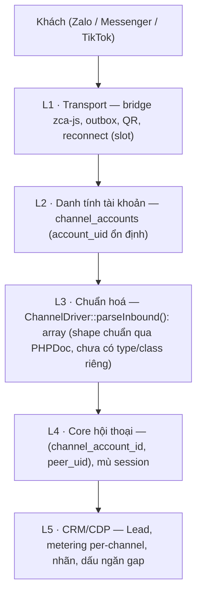
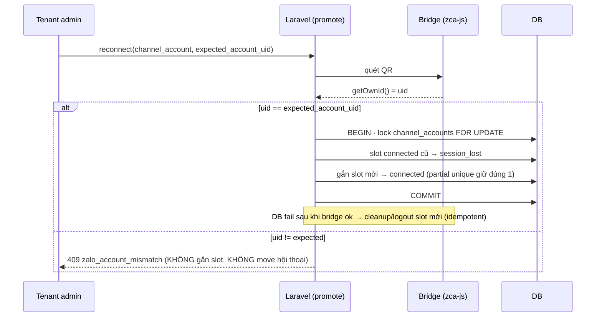

# Channel-Account Identity & Multi-Channel Relayer

Module: messaging · Status: **LIVE (GĐ1)** · Updated: 2026-07-04

> **Đã hoàn thành Phase 01–09** (all tests green: 667 PHP tests pass, 0 TypeScript errors, zalo-bridge node tests 6/6 pass, Pint clean). Tách danh tính tài khoản khỏi session (account-keyed, `channel_account_id` stable qua reconnect), inbox 5-lớp, dấu ngăn gap, core mù session. Hệ thống hiện tại: **không phân mảnh, không fork, không mất tin trong gap hẹp** (gap marker + fallback backfill feasible via `requestOldMessages`).
> Thực thi: [`plans/260704-inbox-multichannel-relayer/`](../../../plans/260704-inbox-multichannel-relayer/plan.md).

## Purpose
Đưa hội thoại từ nhiều kênh (Zalo cá nhân → Messenger → TikTok) về một mô hình chung, giải quyết 3 vấn đề của Zalo cá nhân mà **không** để đặc thù kênh rò lên lõi CRM:
1. **Phân mảnh** khi đăng nhập lại tài khoản (reconnect mint slot mới → tách hội thoại).
2. **Mất tin** khi ngắt–kết nối lại (zca-js không có API lịch sử 1-1).
3. **Khó mở rộng** kênh mới mà không sửa lõi.

## Actors & permissions
- **Khách** (ngoài hệ thống) nhắn vào một tài khoản kênh của tenant.
- **Nhân viên tenant** đọc/trả lời trong inbox; quyền theo [rbac-visibility](../platform/rbac-visibility.md).
- **Tenant admin** kết nối/kết nối lại tài khoản Zalo (quét QR).
Mọi truy cập scope theo workspace ([tenant-isolation](../platform/tenant-isolation.md), RLS).

## Kiến trúc 5 lớp
Nguyên tắc: mỗi lớp chỉ với tay xuống lớp ngay dưới; **danh tính cứng dần khi đi lên**; lõi (L4/L5) **mù session**.

## Data model (target)
Tất cả bảng mới workspace-scoped + **RLS ENABLE+FORCE** + thêm vào `RlsPolicyCoverageTest`.

| Bảng | Vai trò | Ghi chú |
|---|---|---|
| `channel_accounts` *(mới, core, L2)* | Danh tính "SIM" ổn định | `workspace_id, channel, account_uid (=getOwnId), display_name (tên Zalo tự động), avatar_url, status(needs_qr/connected/session_lost — `session_lost` có trong schema nhưng chưa code nào ghi; mất session hiện track qua `gap_started_at`/`gap_open`)`. Unique `(workspace_id, channel, account_uid)`. |
| `zalo_connections` *(đổi vai, module)* | Session slot "máy" | thêm FK `channel_account_id`; `state(connected/qr_waiting/session_lost)`. **Partial unique `(channel_account_id) WHERE state='connected' AND deleted_at IS NULL`** → đúng 1 slot sống. Core không đọc bảng này. |
| `conversations` *(đổi khoá, core, L4)* | Hộp thư per-peer per-account | **bỏ** `zalo_connection_id`, **thêm** `channel_account_id`; unique `(channel_account_id, peer_uid)`. |
| `conversation_events` *(mới, core, L4)* | Dấu ngăn mất tin | `kind=session_gap, gap_started_at, gap_ended_at`; unique `(conversation_id, kind, gap_started_at)` → idempotent; **KHÔNG** đụng metering/unread/preview. |
| `message_source_aliases` *(mới)* | Compat dedup xuyên migration | map `message_id ↔ legacy source_id`; backfill 100% TRƯỚC khi drop `zalo_connection_id`. |
| `lead_merge_conflicts` *(mới)* | Preflight migration | ghi nhóm `both_have_lead` để resolve tay; chặn swap unique khi còn conflict. |

## State transitions — vòng đời tài khoản (L2) + reconnect fail-closed
Chống #1 (phân mảnh) + #2 (rebind nhầm tài khoản). DB/Laravel là nguồn sự thật của `state`; bridge là side-effect phải reconcile.

## Operational flow — outbound (#4, core mù session)
1. Nhân viên bấm trả lời → `ChannelDriver::sendMessage(Conversation)` (chỉ có `channel_account_id`).
2. Module Zalo tự resolve: `channel_account → zalo_connections WHERE state='connected'` (đúng 1 nhờ partial unique).
3. Có slot sống → gửi qua slot đó → persist `direction=out` → `meterReply` (F1).
4. 0 slot sống → `not_connected("Tài khoản X cần quét lại QR")`. `resolveConnection` **bỏ** đọc `conversation.zalo_connection_id`.
> Đây là lý do **chỉ xoá `ZaloConversationMerger` SAU** khi đổi outbound: merger đang bí mật re-point con trỏ outbound.

## Operational flow — gap marker (#1)
- L1 phát biên gap (từ `sessionLostAt` → reconnect). L4 tạo `conversation_events(session_gap)` **trong cùng critical path TRƯỚC khi tin post-gap visible**.
- Đọc qua **endpoint stream hợp nhất** messages+events, cursor `(stream_at, stream_rank, id)` (stream_rank cố định theo kind), `stream_version`/conversation → chèn lịch sử làm đổi version → FE refetch window quanh gap. **FE không tự merge 2 nguồn.**

## source_id contract (MAJOR)
`source_id` sinh ở L3: Priority `msgId` (raw) → `cliMsgId` (prefixed `zps-cli:{channel}:{accountUid}:{threadId}:{cliMsgId}`) → content hash (không `connectionId`, không `accountUid`, chỉ `threadId\nfrom\nts\ncontent`). **Khóa thay đổi:** cũ hash theo `connectionId`; giờ KHÔNG (reconnect đổi connectionId → cũ tách tin thành 2 source_id — MAJOR bug cố định). Bảng `message_source_aliases` giữ tương thích với row cũ; ingest lookup alias trước tạo message (P06, live).

## Migration
Xem [plan P02](../../../plans/260704-inbox-multichannel-relayer/plan.md). Số liệu dev (spike 2026-07-04): 3 fork groups (6→3 conv, cùng 1 account), 0 lead conflict, 0 dup source_id, alias 100% khả thi. Thứ tự: tạo account từ slot có uid → gắn FK → backfill conv → merge duplicate + remap lead → backfill alias → preflight `both_have_lead` → partial unique + swap unique + drop `zalo_connection_id`. Bỏ qua 9 slot null-uid.

## Business rules applied
- **Metering per-channel, chỉ đếm khi tenant trả lời, luôn nhận inbound** — giữ nguyên ([conversation-metering.md](./conversation-metering.md)); re-key không đổi các invariant này (`channel_account` thuộc đúng 1 kênh).
- **Liên hệ nháp**: `contact_id IS NULL` giữ nguyên ([conversation-to-lead.md](./conversation-to-lead.md)).
- **RLS** mọi bảng mới ([tenant-isolation](../platform/tenant-isolation.md)).

## Edge cases & error handling
- **Rebind nhầm tài khoản** → 409, fail-closed, không trộn dữ liệu 2 tài khoản.
- **Split-brain 2 slot connected** → partial unique chặn ở DB (INSERT thứ 2 đụng 23505); nếu bị bypass qua dữ liệu lịch sử/SQL trực tiếp, `ZaloSendService::resolveConnection()` vẫn fail-closed `ZaloSplitBrainException` → `SendException` code `split_brain`.
- **Gap chèn muộn vào vùng stream đã tải** → `stream_version` đổi → FE refetch (spike #11).
- **Promote ok ở bridge nhưng DB fail** → cleanup/logout slot mới idempotent (spike #12).
- **Tin 1-1 mất trong gap** → **Gap marker dấu ngăn + fallback backfill feasible.** Spike #1b chứng minh `requestOldMessages(ThreadType.User, null)` khả thi (48+ tin 1-1 mới nhất). Hiện tại gap marker là cơ chế fallback khi active backfill chưa bật; nâng cấp reconnect thêm backfill là cải tiến tương lai (out-of-scope GĐ1).

## Related
- [messaging/README](./README.md) · [zalo-personal-inbox](./zalo-personal-inbox.md) · [outbound-send](./outbound-send.md) · [conversation-metering](./conversation-metering.md) · [conversation-to-lead](./conversation-to-lead.md)
- Domain: [crm-conversations-inbox](../../crm-conversations-inbox.md) *(vision cũ, một phần đã lệch code — bản này là target thật cho GĐ1)* · [crm-business-rules](../../crm-business-rules.md)
- Plan: [`plans/260704-inbox-multichannel-relayer/`](../../../plans/260704-inbox-multichannel-relayer/plan.md) · Reports: `plans/reports/reviewer-2026-07-0*-inbox-5-layer-design*.md`
