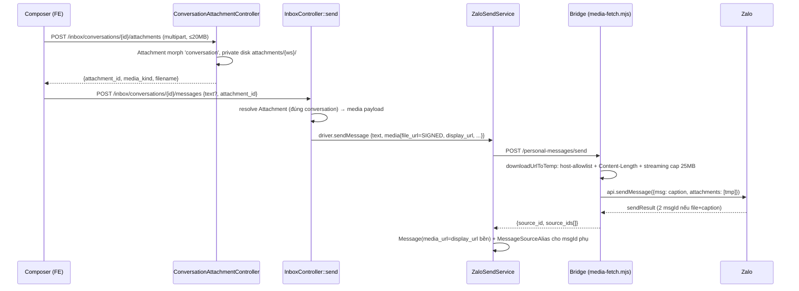

# Composer Media — Gửi ảnh/file từ portal

Module: messaging · Status: **LIVE (P04 — inbox-full-messaging-framework)** · Updated: 2026-07-04

## Purpose
Nhân viên gửi được ảnh/file/video/audio kèm caption từ inbox portal (thay vì phải cầm điện thoại). Chain backend (`ZaloSendService → bridge → Zalo`) đã có sẵn — phase này nối khúc UI + đường upload an toàn (A3: private disk + signed URL) + vá 2 lỗ Codex (byte-cap bridge, dedup 2 msgId).

## Actors & permissions
- **Nhân viên tenant**: upload + gửi media trong conversation mình xem được (`ConversationPolicy::update`).
- **Bridge** (máy): fetch file qua **signed URL TTL 15'** — không session, chữ ký chứa `ws` (workspace) + `attachmentKey`.
- Hiển thị media trong chat: mọi member xem được conversation (`ConversationPolicy::view`) — KHÔNG dùng `AttachmentPolicy::view` (uploader-only).

## Flow

## Quyết định thiết kế (đã chốt)
| Quyết định | Lý do |
|---|---|
| 2 bước upload→send (không multipart send) | send endpoint giữ JSON thuần, retry gửi không re-upload |
| **A3: private disk + signed URL** (`inbox.attachments.raw`, TTL 15', middleware `signed`, RLS bind từ param `ws` đã ký) | media = PII, không public vĩnh viễn |
| `media_url` lưu **display URL bền** (`inbox.attachments.show`, quyền = xem conversation) | signed URL hết hạn 15' → lịch sử chat không được chết |
| Cap tĩnh **20MB chung mọi loại** (portal 422) + bridge cap 25MB headroom | validate đã chốt — bỏ cap ảnh 10MB ảo |
| Bridge host-allowlist = host `LARAVEL_WEBHOOK_URL` + env `BRIDGE_FETCH_HOST_ALLOWLIST` (fail-closed) | chặn URL lạ/redirect memory-spike (Codex MED) |
| file+caption → zca tách 2 tin → bridge trả `source_ids[]`, đăng ký TẤT CẢ vào echo-dedup, Laravel ghi `message_source_aliases` kind=`multi_send` cho id phụ | echo thứ hai dedup vào CÙNG row — không tin trùng (Codex MED-7) |
| `inbox:prune-transient` daily: pending expired + attachment **upload-không-gửi** >48h (đã gửi giữ nguyên) | goal #3 — không bảng/disk phình vô hạn |

## Files
- BE: `app/Http/Controllers/Inbox/ConversationAttachmentController.php`, `InboxController::send`, `ZaloSendService::persistMessage`, `app/Console/Commands/PruneInboxTransient.php`, `Attachment::mediaKind()`
- Bridge: `services/zalo-bridge/src/media-fetch.mjs` (+ test), `index.mjs` (`bridgeSendTextOrMedia`, `registerAllOutboundSourceIds`)
- FE: `resources/js/components/inbox/message-composer.tsx` (đính kèm + paste ảnh + preview), `pages/inbox/index.tsx`
- Tests: `tests/Feature/Inbox/ComposerMediaTest.php` (9), `src/media-fetch.test.mjs` (8)

## Runtime evidence còn thiếu (checklist P12)
- [ ] Gửi 1 ảnh + 1 PDF từ portal → khách nhận trên app Zalo thật (cần re-promote QR slot — runbook A2)
