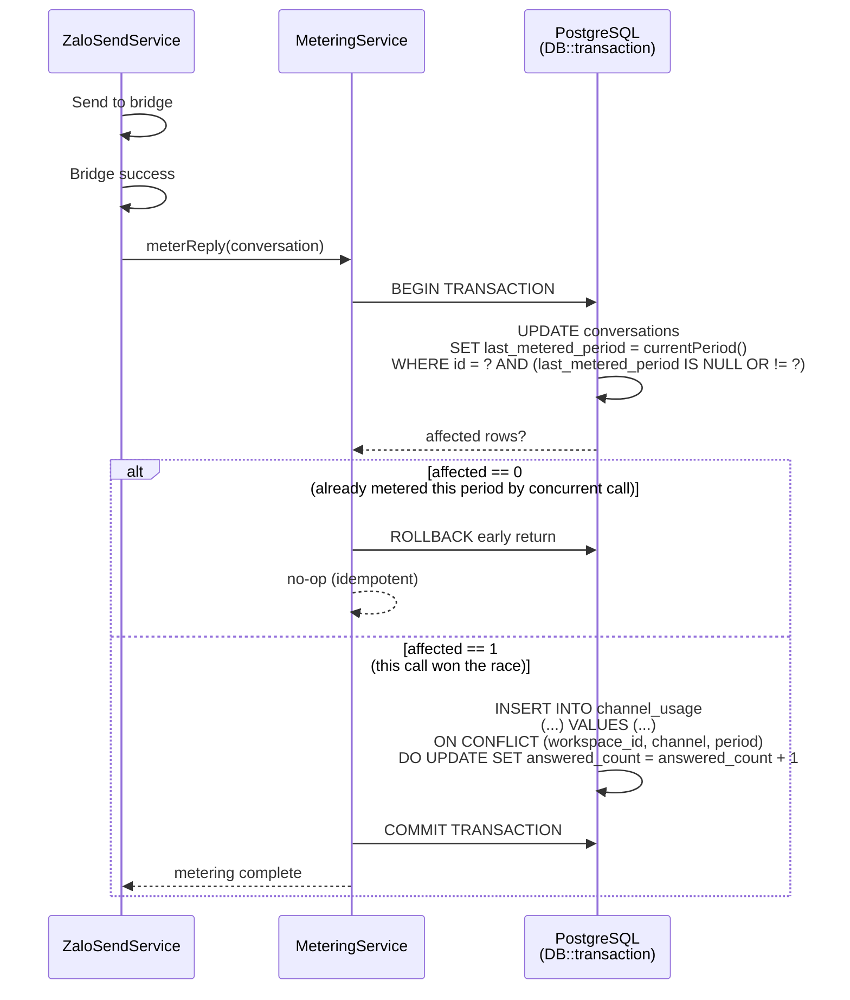

# Conversation Metering (Statistics)

Module: `App\Services\MeteringService` (plain Laravel — concrete class, no interface/contract, no `modules/` directory) · Status: live (GĐ1, no longer gates sends) · Updated: 2026-07-25

## Purpose

Race-safe count of outbound conversations per channel per month (compare-set atomic UPDATE + upsert) for billing analytics. **No quota gate enforced** — all sends are allowed; the `MeteringService` purely tracks usage via `channel_usage` table to accumulate data for future billing policies.

**Value:** Enables accurate conversation-based usage tracking without undercount race conditions, preserves historical billing data, and allows unrestricted send access for current GĐ1.

## Actors & permissions

- **System** (`ZaloSendService::send()`, `InboundMessageService::ingest()` for `direction='out'`) → calls `MeteringService` to meter conversations.
- **PostgreSQL** → enforces race-safe metering via a compare-set `UPDATE` + `ON CONFLICT DO UPDATE` upsert, both in one transaction.

Link: No user-facing permissions; internal system service.

## Trigger / entry points

**`App\Services\MeteringService`** (concrete class — billing core):
1. `meterReply(Conversation): void` — called by `ZaloSendService::send()` after a successful bridge send, and by `InboundMessageService::ingest()` for `direction='out'` payloads (wrapped in try/catch there — a metering failure never blocks message persistence). This is the **only active metering method** as of 2026-07-25.
2. `currentPeriod(): string` — `now('Asia/Ho_Chi_Minh')->format('Y-m')`.

**Removed methods (2026-07-25):** `assertCanSend()`, `canStartNew()`, and `canReplyOnExisting()` have been removed; they previously enforced quota gates that are no longer active. Quota enforcement logic has been completely removed from the codebase.

## Operational flow (step-by-step)

**Steps (`meterReply` flow — F1 race-safe, the only active metering flow):**
1. `ZaloSendService::send()` (after bridge success) or `InboundMessageService::ingest()` (for `direction='out'`, in a try/catch) calls `meterReply(conversation)`.
2. Everything below runs inside one `DB::transaction()`:
   - Compare-set: `UPDATE conversations SET last_metered_period = currentPeriod() WHERE id = ? AND (last_metered_period IS NULL OR last_metered_period != currentPeriod())`.
   - `affected === 0` → this conversation was already metered this period (by this call or a concurrent one) → **return immediately, never touches `channel_usage`** — idempotent, no double count.
   - `affected === 1` → this call won the race → `INSERT INTO channel_usage (...) VALUES (...) ON CONFLICT (workspace_id, channel, period) DO UPDATE SET answered_count = answered_count + 1`, same transaction.
3. If the upsert fails after the compare-set succeeds, the whole transaction rolls back — `last_metered_period` reverts too, so a retry later can still succeed (no permanent under-count).

**No quota gate:** As of 2026-07-25, there is no code that blocks sends based on remaining quota. All outbound sends are allowed; usage is tracked purely for analytics and future billing policies.

## Data touched

**Models:**
- `Conversation`
  - Reads: `id`, `channel`, `workspace_id`, `last_metered_period`
  - Writes: `last_metered_period` (compare-set inside the `meterReply` transaction, via `withoutGlobalScope('workspace')`)
  - RLS: global scope normally enforced; explicitly bypassed here since `meterReply` needs to run regardless of the caller's bound workspace context

- `ChannelUsage` (`channel_usage` table, internal, no RLS)
  - Reads (via `EntitlementService` for display only): `answered_count` for the current period
  - Writes: `answered_count` via atomic `ON CONFLICT` upsert
  - Columns: `id` (uuid), `workspace_id`, `channel`, `period` (`YYYY-MM`), `answered_count`, `created_at`, `updated_at`
  - Unique constraint: `(workspace_id, channel, period)`

**RLS scoping:**
- `Conversation` writes in `meterReply()` use `withoutGlobalScope('workspace')` — the metering write must succeed regardless of which workspace context (if any) the calling request has bound.
- `ChannelUsage` is an internal table with no RLS policy; every query filters by `workspace_id` explicitly instead.

## State transitions

- **`Conversation.last_metered_period`:** `null` (new) → `'YYYY-MM'` (first successful metered reply this period) → stays that value until a `meterReply()` call in a later period updates it again.
- **`ChannelUsage` row:** doesn't exist → created with `answered_count=1` on first metered reply for that `(workspace_id, channel, period)` → incremented on each subsequent one.

## Business rules applied

- **F1 (Race-safe metering):** Single DB transaction, compare-set `UPDATE` + `ON CONFLICT` upsert. Only one concurrent call per conversation per period can ever increment `channel_usage`; the rest no-op. Prevents under-count under concurrency, by construction rather than by locking.
- **F13/F20 (Inbound always accepted):** Inbound (`direction='in'`) never calls into `MeteringService` at all — not "fail-safe," genuinely no code path. Only `direction='out'` calls `meterReply()`, and even that call is wrapped in a try/catch in `InboundMessageService` so a metering failure can never block message persistence. Preserves lead capture regardless of any quota state (but quota is no longer enforced anyway).
- **F11 (Workspace isolation):** Every query filters by `workspace_id` explicitly (since several call sites deliberately bypass the RLS global scope).

Link: [crm-business-rules.md](../crm-business-rules.md) § F1, F11, F13, F20.

## Edge cases & error handling

| Scenario | Behavior |
|---|---|
| **`meterReply()` called twice concurrently for the same conversation** | Exactly one wins the compare-set; the other returns immediately without touching `channel_usage` — both calls "succeed" from the caller's point of view, only one counts. |
| **`channel_usage` upsert fails mid-transaction** | Whole transaction rolls back, including the `last_metered_period` compare-set — safe to retry later. |
| **`currentPeriod()` crosses a month boundary** | `now('Asia/Ho_Chi_Minh')->format('Y-m')` evaluated fresh on every call — no caching of "current period" anywhere in this service. |
| **Metering failure in try/catch block** | Call fails gracefully; message is still persisted and broadcast. Metering failure never blocks user communication (F13/F20). |

## Related

- [outbound-send.md](./outbound-send.md) — calls `meterReply()` after bridge success.
- [zalo-personal-inbox.md](./zalo-personal-inbox.md) — calls `meterReply()` (try/catch) for `direction='out'` payloads only; inbound never reaches this service.
- [plan-entitlements-grant.md](./plan-entitlements-grant.md) — `EntitlementService` now only reads usage for display; no longer enforces quota gates.
- [../system-architecture.md](../system-architecture.md) § Billing + Metering.
- [crm-business-rules.md](../crm-business-rules.md) § F1, F11, F13, F20.
