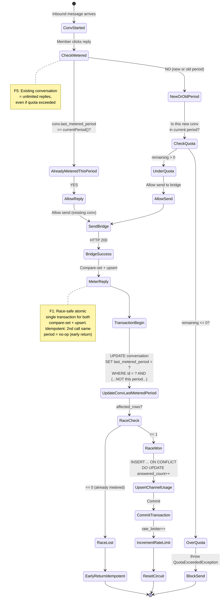

# Conversation Metering (Billing & Quota Gate)

Module: `billing` + `inbox` (contract) · Status: live (GĐ1) · Updated: 2026-06-28

## Purpose

Implement MeteringGate contract: race-safe count of outbound conversations per channel per month (compare-set atomic UPDATE + ON CONFLICT upsert), allow existing conversations unlimited replies (F5), block new conversations when over quota. Inbound NEVER blocked (F13/F20).

**Value:** Enables conversation-based billing without undercount race conditions, preserves lead capture under quota, and allows unlimited replies once conversation started.

## Actors & permissions

- **System** (ZaloSendService, InboundMessageService, OutboundMessageController) → calls MeteringGate to check/meter conversations.
- **EntitlementResolver** → resolves workspace quota (from workspace_purchases + plan).
- **PostgreSQL** (15+) → enforces race-safe metering via ON CONFLICT DO UPDATE.

Link: No user-facing permissions; internal system contract.

## Trigger / entry points

**Contract methods** (modules/inbox/src/Contracts/MeteringGate.php):
1. `assertCanSend(Conversation)` — called by ZaloSendService before HTTP bridge call; throw if quota exceeded on new conversation.
2. `canStartNew(string channel)` — called by OutboundMessageController; gate UI "send to new conversation" button.
3. `canReplyOnExisting(Conversation)` — contract method; currently not used (always allowed per F5).
4. `meterReply(Conversation)` — called by InboundMessageService + ZaloSendService after successful send; increments channel_usage.

**Implementation:** `modules/billing/src/Services/ConversationMeter.php` (bound in BillingServiceProvider).

**Fallback:** `modules/inbox/src/Channel/AllowAllMeteringGate.php` (no-op; used if billing disabled).

## Operational flow (step-by-step)



**Steps (assertCanSend flow):**
1. ZaloSendService calls `assertCanSend(conversation)` before bridge call.
2. ConversationMeter checks `conversation.last_metered_period == currentPeriod()`:
   - If YES → pass (F5: existing conversation, unlimited reply).
   - If NO → check quota.
3. ConversationMeter calls `canStartNew(channel)`:
   - Resolve workspace quota from EntitlementResolver (cache 5 min).
   - Query ChannelUsage for current period → calculate remaining = limit - used.
   - If remaining > 0 → pass; if remaining <= 0 → throw QuotaExceededException.

**Steps (meterReply flow — F1 race-safe):**
1. ZaloSendService or InboundMessageService calls `meterReply(conversation)` after successful bridge call.
2. ConversationMeter wraps in `DB::transaction()`:
   - Step 1a: UPDATE conversation SET last_metered_period = currentPeriod() WHERE id = conversation.id AND (last_metered_period IS NULL OR last_metered_period != currentPeriod()).
   - If affected_rows == 0 → conversation already metered this period (race lost or duplicate call) → early-return idempotent (do NOT upsert).
   - If affected_rows == 1 → this thread won race → proceed to step 2.
   - Step 2: Atomic INSERT ... ON CONFLICT (workspace_id, channel, period) DO UPDATE SET answered_count = answered_count + 1 on ChannelUsage.
3. Transaction commits atomically; if upsert fails after compare-set → entire transaction rolls back, conversation.last_metered_period reverted.
4. ZaloSendService increments SendRateLimiter counter (atomic Redis INCR if enabled, else in-memory).
5. ZaloSendService resets circuit-breaker error count (success indicator).

## Data touched

**Models:**
- `Conversation` (modules/inbox)
  - Reads: id, channel, workspace_id, last_metered_period
  - Writes: last_metered_period (atomic compare-set in meterReply transaction)
  - RLS: global scope enforced

- `ChannelUsage` (modules/billing)
  - Reads: answered_count, period (sum to calculate remaining)
  - Writes: answered_count (atomic ON CONFLICT upsert)
  - Columns: id (UUID), workspace_id, channel, period (YYYY-MM), answered_count, created_at, updated_at
  - Unique constraint: (workspace_id, channel, period)
  - No RLS (internal billing table)

- `WorkspacePurchase` (modules/billing)
  - Reads: plan_id, active status (via EntitlementResolver)
  - No writes in metering flow

**RLS scoping:**
- Conversation read/write enforces workspace_id global scope.
- ChannelUsage query bypasses RLS (withoutGlobalScope) but filters by workspace_id manually (F11-adjacent pattern: privileged read for metering).

## State transitions

- **Conversation.last_metered_period:** null (new) → 'YYYY-MM' (first reply this period) → stays 'YYYY-MM' until next month (when currentPeriod() changes).
- **ChannelUsage record:** (nonexistent) → ON CONFLICT INSERT with answered_count=1 → ON CONFLICT UPDATE answered_count++ (idempotent per period).

## Business rules applied

- **F1 (Race-safe metering):** Single DB transaction with compare-set UPDATE + ON CONFLICT upsert. Only 1 request per conversation per period can increment ChannelUsage; duplicate calls no-op (idempotent). Prevents under-count race.

- **F5 (Existing conversation always allowed):** If `conversation.last_metered_period == currentPeriod()` → `assertCanSend()` passes even if quota remaining = 0. Ensures unlimited replies on active conversation.

- **F9 (Metering transaction rollback):** If upsert fails after compare-set → transaction rolls back, conversation.last_metered_period reverted (no permanent state inconsistency). Retry later succeeds.

- **F13/F20 (Inbound always accepted):** ConversationMeter.meterReply() only called by InboundMessageService as fail-safe (try/catch). Inbound never blocked by gate.

- **F10 (No-op default binding):** BillingServiceProvider binds ConversationMeter override AllowAllMeteringGate only if billing module enabled. If billing disabled → AllowAllMeteringGate (no-op) used throughout.

- **F11 (Workspace isolation):** EntitlementResolver + ConversationMeter scoped to currentWorkspace() (bound at request entry). No cross-tenant quota leakage.

Link: [crm-business-rules.md](../crm-business-rules.md) § F1, F5, F9, F10, F11, F13, F20.

## Edge cases & error handling

| Scenario | Behavior |
|---|---|
| **Quota exceeded on new conversation** | assertCanSend() throw QuotaExceededException; ZaloSendService → Controller → 402 Payment Required. |
| **Conversation already metered this period** | canReplyOnExisting() / assertCanSend() pass (F5); meterReply() race lost → early-return (idempotent). |
| **meterReply() called twice concurrently** | DB compare-set enforces 1 winner; loser early-returns (no under-count). Both calls complete successfully (idempotent). |
| **ChannelUsage upsert fails mid-transaction** | DB transaction rolls back; conversation.last_metered_period NOT updated; retry later succeeds (safe). |
| **currentPeriod() straddles month boundary** | now('Asia/Ho_Chi_Minh')->format('Y-m') called at request time; period changes atomically once per day. Conversations metered just before midnight → period 'YYYY-MM'; next month's call → new period. |
| **EntitlementResolver cache miss** | Query WorkspacePurchase + plan; cache 5 min (TTL). If purchase changes → WorkspacePurchaseObserver calls forgetCache() (invalidate). |
| **Workspace quota = null (unlimited)** | remaining() returns PHP_INT_MAX; assertCanSend() always passes (no blocking). |
| **Conversation deleted** | FK cascade: if hard-deleted → subsequent meterReply() fails (conversation not found). Soft-delete recommended to preserve audit. |
| **ChannelUsage row creation fails** | Rare; if INSERT ... ON CONFLICT upsert fails → transaction rolls back. Retry succeeds. |

## Related

- [outbound-send.md](./outbound-send.md) — calls assertCanSend() before bridge.
- [zalo-personal-inbox.md](./zalo-personal-inbox.md) — calls meterReply() fail-safe after inbound.
- [plan-entitlements-grant.md](./plan-entitlements-grant.md) — EntitlementResolver quota source.
- [../system-architecture.md](../system-architecture.md) § Billing + Metering.
- [crm-business-rules.md](../crm-business-rules.md) § F1, F5, F9, F10, F11, F13, F20.

**Contract Methods (modules/inbox/src/Contracts/MeteringGate.php):**
```php
interface MeteringGate {
    public function canReplyOnExisting(Conversation $conversation): bool;
    public function canStartNew(string $channel): bool;
    public function meterReply(Conversation $conversation): void;
    public function assertCanSend(Conversation $conversation): void;
    public function currentPeriod(): string;
}
```

**Implementation Binding (modules/billing/src/Providers/BillingServiceProvider.php):**
- If billing enabled: `$this->app->bind(MeteringGate::class, ConversationMeter::class)`.
- Fallback (billing disabled): `AllowAllMeteringGate` (no-op).
