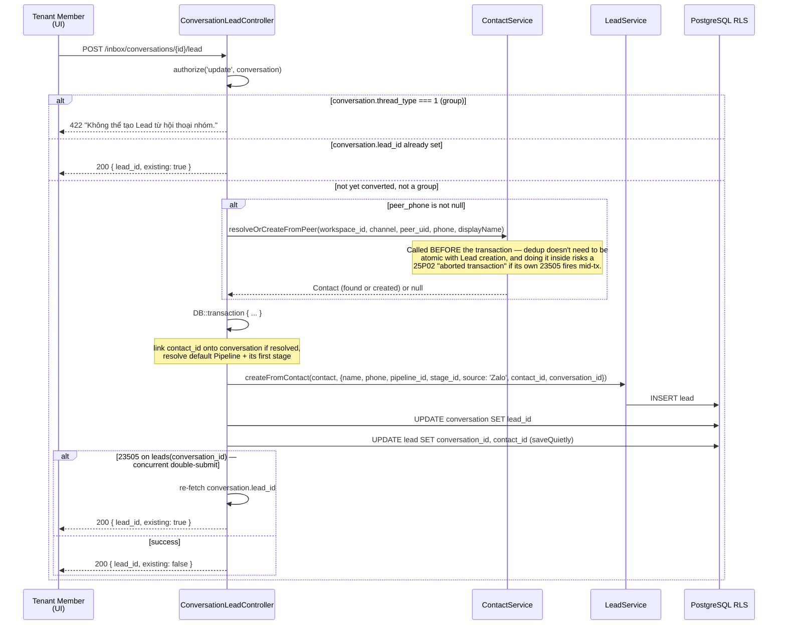

# Conversation to Lead

Module: `app/Http/Controllers/Inbox` + `app/Services` (plain Laravel — no `modules/` directory, no `IdentityResolver`/`LeadCreatorImpl` contract layer; this is a direct, synchronous implementation) · Status: live (GĐ1) · Updated: 2026-07-04

## Purpose

Convert an inbound Zalo conversation into a Lead: dedup the peer by phone number via `ContactService`, create the Lead via `LeadService`, and link everything bidirectionally (`Conversation.contact_id`, `Conversation.lead_id`, `Lead.conversation_id`, `Lead.contact_id`).

**Value:** Deduplicates inbound leads from the same phone number, ensures a 1:1 conversation-to-lead link, and gives the tenant a one-click path from "someone messaged us" to "this is a sales lead."

## Actors & permissions

- **Tenant member** with `update` permission on the conversation (`ConversationPolicy::update()`) → converts a conversation to a Lead via UI button.
- **System** (`ConversationLeadController::store()`) → acts on behalf of the member; enforces idempotency and the group-conversation guard directly (no separate contract layer).

Link: [crm-authorization-model.md](../crm-authorization-model.md) § Lead creation scope.

## Trigger / entry points

**Route** `POST /inbox/conversations/{conversation}/lead` (`routes/web.php`):
- Frontend: "Convert to Lead" button on the conversation thread.
- Controller: `app/Http/Controllers/Inbox/ConversationLeadController.php::store()`.
- Services used directly (no contract/interface indirection): `App\Services\ContactService::resolveOrCreateFromPeer()`, `App\Services\LeadService::createFromContact()`.

## Operational flow (step-by-step)

**Steps:**
1. Member clicks "Convert to Lead" on the conversation thread.
2. Controller authorizes via `ConversationPolicy::update()`.
3. **Group guard:** `thread_type === 1` (group conversation) → `422`, no lead ever created for groups.
4. **Idempotency:** `conversation.lead_id !== null` → returns the existing lead id immediately, no new Lead created.
5. If `peer_phone` is set, `ContactService::resolveOrCreateFromPeer()` runs — dedups by phone, returns a `Contact` (found or newly created) or `null`. This runs **before** the transaction below (not inside it) specifically to avoid a Postgres `25P02` aborted-transaction error if the contact dedup's own unique-constraint race fires mid-transaction.
6. Inside `DB::transaction()`: if a contact was resolved, link it onto the conversation (`contact_id`); resolve the workspace's default `Pipeline` (`is_default` first, else by name) and its first stage.
7. `LeadService::createFromContact()` creates the Lead with `name` (peer_name → peer_phone → "Liên hệ Zalo" fallback chain), `phone`, `pipeline_id`, `stage_id`, `source: 'Zalo'`, `contact_id`, `conversation_id`. If no real Contact was resolved, an unsaved stub `Contact` (peer_name/peer_phone only) is passed instead — `LeadService` only reads `fullName()`/`email`/`phone` off it.
8. Link back: `conversation.lead_id` set to the new Lead's id; `lead.conversation_id`/`lead.contact_id` set directly and saved quietly (bypassing fillable/observers).
9. **Race guard:** if a concurrent double-submit causes a `23505` on the `leads(conversation_id)` unique constraint, the controller catches it, re-fetches the conversation, and returns the lead the other request created instead of erroring.
10. Response is always `200` (not `201`) with `{ lead_id, existing: bool }` — there is no combined `{lead, conversation, contact}` payload; the frontend re-fetches as needed.

## Data touched

**Models:**
- `Conversation`
  - Reads: `id`, `thread_type`, `lead_id`, `peer_phone`, `peer_name`, `peer_uid`, `channel`, `workspace_id`, `contact_id`
  - Writes: `contact_id` (if resolved), `lead_id`
  - RLS: enforced

- `Contact` (`App\Models\Contact`, `App\Services\ContactService`)
  - Reads: dedup lookup by phone within the workspace
  - Writes: creates a new Contact row when no phone match exists (exact fields owned by `ContactService`, not duplicated here — see that service directly)

- `Lead` / `Pipeline` (`App\Models`, `App\Services\LeadService`)
  - Reads: default `Pipeline` for the workspace (`is_default` DESC, `name` ASC) and its first stage (`stage_order` ASC)
  - Writes: `name`, `phone`, `pipeline_id`, `stage_id`, `source`, `contact_id`, `conversation_id` — **no `assigned_to` is set by this flow**
  - RLS: enforced

**RLS scoping:**
- All reads/writes respect the `workspace_id` global scope bound by the tenant middleware before this controller runs.

## State transitions

- **Conversation:** `lead_id` goes from `null` → set once, permanently (idempotent — never re-created or re-linked).
- **Lead:** created directly into the workspace's default pipeline's first stage; no separate "new" pre-pipeline state.

## Business rules applied

- **F23 (Liên hệ nháp / draft contact):** A conversation can convert to a Lead even without a `peer_phone` — `contact_id` simply stays unlinked in that case; the Lead is still created (fallback name chain covers the missing contact).
- **Idempotency:** Enforced two ways — an application-level check (`conversation.lead_id !== null`) for the common case, and a DB-level unique constraint on `leads(conversation_id)` with a `23505` catch-and-refetch for the concurrent double-submit race.
- **Group-conversation guard:** `thread_type === 1` conversations can never become a Lead through this endpoint — enforced unconditionally before any other check.
- **Source tracking:** `Lead.source = 'Zalo'` (not `'zalo_personal'`) — tracks channel origin.

Link: [crm-business-rules.md](../crm-business-rules.md) § F23.

## Edge cases & error handling

| Scenario | Behavior |
|---|---|
| **Group conversation** (`thread_type === 1`) | `422 { message: "Không thể tạo Lead từ hội thoại nhóm." }` — checked before anything else. |
| **Conversation already linked to a lead** | `200 { lead_id, existing: true }` — no error, no duplicate creation. |
| **`peer_phone` is null** | Contact dedup step is skipped entirely; Lead is still created without a linked Contact (uses a stub built from `peer_name`). |
| **Concurrent double-submit** (two requests convert the same conversation at once) | Second request's `leads(conversation_id)` insert hits `23505` → caught → re-fetches and returns the first request's `lead_id` with `existing: true`. |
| **No default Pipeline exists for the workspace** | `pipeline_id`/`stage_id` are simply omitted from the Lead's create attrs (`array_filter` drops null values) — `LeadService` is responsible for whatever default that implies. |
| **Conversation deleted concurrently** | Route-model binding would 404 before the controller body runs. |

## Related

- [zalo-personal-inbox.md](./zalo-personal-inbox.md) — inbound message ingestion + conversation creation.
- [outbound-send.md](./outbound-send.md) — reply to a conversation.
- [channel-account-architecture.md](./channel-account-architecture.md) — account-keyed conversation identity this flow operates on.
- [crm-business-rules.md](../crm-business-rules.md) § F23.
