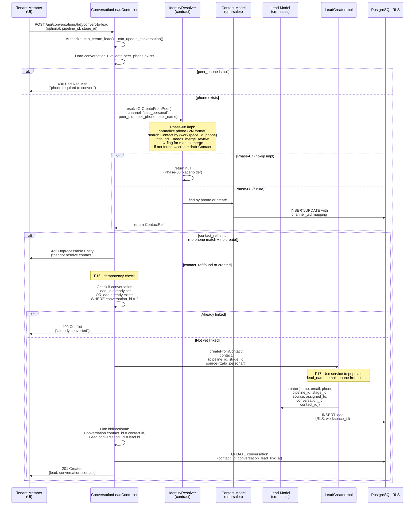

# Conversation to Lead (CDP Dedup)

Module: `inbox` + `crm-sales` (via `LeadCreator` contract) · Status: live (GĐ1, dedup contract only; impl Phase-08) · Updated: 2026-06-28

## Purpose

Convert inbound Zalo conversation to Lead via CDP identity resolution: resolve or create Contact by phone number (dedup), link bidirectionally (Conversation ↔ Lead), prevent duplicate leads per conversation, and prepare for Phase-08 CDP Layer 1 mergeIdentities flow.

**Value:** Deduplicates inbound leads from same phone across channels, ensures 1:1 conversation-to-lead link, and enables future omnichannel analytics (same person contacted via Zalo + Messenger = 1 contact).

## Actors & permissions

- **Tenant member** (`lead.manage`) → manually convert conversation to lead via UI button or API.
- **System** (ConversationLeadController) → acts on behalf of member, enforces tenant isolation + idempotency.
- **IdentityResolver contract** (Phase-08 impl) → resolves contact by phone or creates new draft contact.

Link: [crm-authorization-model.md](../crm-authorization-model.md) § Lead creation scope.

## Trigger / entry points

**API endpoint** `POST /api/conversations/{id}/convert-to-lead`:
- Frontend: "Convert to Lead" button on conversation detail.
- Controller: `modules/inbox/src/Http/Controllers/ConversationLeadController.php::store()`.
- Service: `LeadCreatorImpl` (contract-based, modules/crm-sales).
- Route: `modules/inbox/routes/web.php`.

## Operational flow (step-by-step)

**Steps:**
1. Member clicks "Convert to Lead" on conversation detail view.
2. Controller authorizes: member has `lead.manage` (create) + `conversation.update` (link).
3. Controller validates conversation.peer_phone exists; if null → 400 "phone required".
4. Controller calls `IdentityResolver::resolveOrCreateFromPeer()` contract (Phase-07: no-op; Phase-08: real impl):
   - Phone normalization (VN '0' prefix handling).
   - Search Contact by (workspace_id, phone) → partial unique constraint.
   - If found + flagged needs_merge_review → flag for tenant manual review; don't auto-merge.
   - If found + clean → return ContactRef.
   - If not found → create draft Contact (channel_uid mapping for Zalo).
5. If contact_ref is null (no match + no create possible) → 422 "cannot resolve contact".
6. Controller idempotency check (F15): does conversation.conversation_lead_link already exist? If yes → 409 "already converted".
7. Controller calls `LeadCreator::createFromContact()` (crm-sales service):
   - Populates lead.name, email, phone from contact (fallback to conversation peer_name if contact.name empty).
   - Sets lead.source = 'zalo_personal' (tracks channel origin).
   - Assigns to default stage + pipeline (or tenant-specified via request params).
   - Sets lead.conversation_id (backlink for audit + conversation thread access).
8. Service creates Lead in transaction (RLS enforced).
9. Controller updates Conversation.contact_id = contact.id + sets conversation_lead_link_at timestamp.
10. Controller returns 201 Created with Lead + updated Conversation + Contact (for FE to update cache).

## Data touched

**Models:**
- `Conversation` (modules/inbox)
  - Reads: id, peer_phone, peer_name, zalo_connection_id, workspace_id
  - Writes: contact_id (FK to Contact), conversation_lead_link_at (timestamp)
  - RLS: enforced

- `Contact` (modules/crm-sales)
  - Reads: (workspace_id, phone) lookup
  - Writes: (Phase-08) channel_uid mapping, name, email, phone, display_name, needs_merge_review flag
  - RLS: enforced

- `Lead` (modules/crm-sales)
  - Writes: name, email, phone, pipeline_id, stage_id, source, assigned_to, conversation_id (backlink), contact_id (FK)
  - RLS: enforced

**RLS scoping:**
- All reads/writes respect workspace_id global scope (binded at controller entry).

## State transitions

- **Conversation state:** "open" → "open" (state unchanged; only adds contact_id + lead link).
- **Contact state:** (Phase-08) "draft" → "matched" or "needs_merge_review" (depends on dedup result).
- **Lead state:** "new" → "stage_id" (assigned to pipeline stage per request or default).

## Business rules applied

- **F15 (Idempotency):** Partial unique constraint `leads(conversation_id)` ensures 1 lead per conversation. Duplicate convert request → 409 Conflict.

- **F2 (Phone-based dedup):** IdentityResolver uses phone as primary key for dedup (SĐT = khóa chính). Same phone across channels → same Contact.

- **F23 (Draft contact state):** Conversation without peer_phone → cannot convert (no dedup anchor). Leaves contact_id = null (Liên hệ nháp).

- **F17 (Source tracking):** Lead.source = 'zalo_personal' (tracks channel origin for analytics + future routing rules).

- **F11 (Workspace isolation):** IdentityResolver scoped to workspace_id; no cross-tenant contact leakage.

- **F18 (Conversation-Lead bidirectional link):** Conversation.contact_id + Lead.conversation_id create audit trail (who contacted whom, when).

Link: [crm-business-rules.md](../crm-business-rules.md) § F2, F15, F17, F18, F23.

## Edge cases & error handling

| Scenario | Behavior |
|---|---|
| **peer_phone is null** | 400 "phone required to convert to lead"; UI prompts member to edit conversation peer info first. |
| **Conversation already linked to lead** | 409 Conflict; UI shows "already converted, view lead" link. |
| **IdentityResolver returns null** (Phase-08 placeholder) | 422 "cannot resolve contact"; UI prompts "Phase-08 will auto-resolve; contact support for manual mapping". |
| **Phone resolves to multiple contacts** | Phase-08: flag needs_merge_review on both contacts (don't auto-merge). Tenant manually reviews + confirms merge. |
| **Contact.needs_merge_review = true** | Phase-08 impl: set flag, notify tenant; lead creation waits for tenant confirmation (backlog task). |
| **Member loses permission mid-request** | Authorization re-check at controller; returns 403 if membership revoked. |
| **Conversation deleted by tenant** | FK constraint: cannot update conversation.contact_id (soft-delete recommended). Returns 404. |
| **Pipeline / stage_id invalid** | LeadService validation; returns 422 "invalid stage for pipeline". |
| **Assigned_to user invalid** | LeadService validation; returns 422 "assigned user not member of workspace". |
| **Duplicate lead creation (race)** | DB unique constraint on leads(conversation_id) → second request fails; controller catches constraint error → 409. |

## Related

- [zalo-personal-inbox.md](./zalo-personal-inbox.md) — inbound message ingestion + conversation creation.
- [outbound-send.md](./outbound-send.md) — reply to conversation.
- [../sales/leads-pipeline-convert.md](../sales/leads-pipeline-convert.md) — lead state management + conversion workflow.
- [../crm-domain-definition.md](../crm-domain-definition.md) § Contact, Lead, Conversation.
- [../system-architecture.md](../system-architecture.md) § CDP Layer 1 (Phase-08) + IdentityResolver contract.
- [crm-business-rules.md](../crm-business-rules.md) § F2, F15, F17, F18, F23.

**Phase-08 Dependents:**
- `IdentityResolver::resolveByPhone()` implementation (dedup by phone + handle merge reviews).
- `mergeIdentities()` for manual contact merge approval flow.
