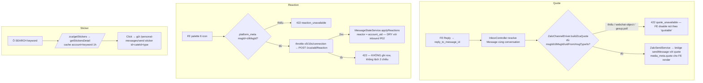

# Outbound Interactions — Quote-reply · Reaction · Sticker

Module: messaging · Status: **LIVE (P06a — inbox-full-messaging-framework)** · Updated: 2026-07-04
Seen-sync (P06b) TÁCH RIÊNG — chờ spike rate P09, default OFF (A4 founder).

## Purpose
Chat 2 chiều thật từ portal: trả lời trích dẫn, thả/gỡ cảm xúc, gửi sticker. Đây là các **caller ĐẦU TIÊN của dispatcher generic `/zca`** (điều kiện GO build report P10-P12: B1 workspace_token + test 403).

## Ranh giới đường đi (OUTBOUND_SEND đã chốt — không phá)
| Hành động | Đường | Lý do |
|---|---|---|
| text / media / **sticker** / **quote** | `/personal-messages/send` (outbox durable + echo-dedup + metering) | OUTBOUND có nội dung |
| **addReaction** / getStickers / getStickersDetail / findUser | dispatcher `/zca/:method` (workspace_token B1, rate-limit) | action non-outbound non-metered |

## Flow + gate (Codex HIGH-1: gate meta, KHÔNG optimistic)

## Quyết định đã theo (validate)
- Sticker picker = **ô search** (zca KHÔNG có API browse pack); cache theo keyword; map `cate_id`→`cateId`.
- Reaction ghi DB **SAU** dispatcher 2xx; echo reaction từ Zalo về tự khớp (idempotent monotonic P02).
- Permission reaction = `tenant.zalo.manage`; KHÔNG đụng nhóm destructive.
- Quote cần text (zca bắt buộc msg content khi quote).
- `quotable` trong stream = tin có platform_meta (tin cũ pre-P01/backfill → FE disable trung thực).
- Throttle reaction ≤5/10s/connection (tinh chỉnh sau spike P09) — rủi ro #1 khóa acc.
- ZaloInteractionService đặt trong module ZaloPersonal (Rule 16 — plan ghi Services/Inbox nhưng service này thuần đặc thù Zalo; core không import).

## Vận hành
Test tài khoản thật cần **re-promote QR** slot (binding workspace) — slot cũ trả `workspace_binding_missing` 403 (runbook A2).

## Files
- BE: `ZaloInteractionService` (client /zca duy nhất — verifyPeerPhone P05 cũng dùng), `MessageInteractionController`, `InboxController::send` (+reply_to/sticker), `ZaloChannelDriver::{buildZcaQuote,buildQuoteDisplay}`, `ZaloSendService` (+quote/sticker payload)
- Bridge: `bridgeSendTextOrMedia` (+sticker qua sendSticker, +quote qua sendMessage), `personal-messages.mjs` passthrough
- FE: `message-bubble.tsx` (hover actions + palette), `message-composer.tsx` (reply bar + sticker search panel), `chat-thread.tsx`, `pages/inbox/index.tsx`
- Tests: `tests/Feature/Inbox/OutboundInteractionTest.php` (9)
