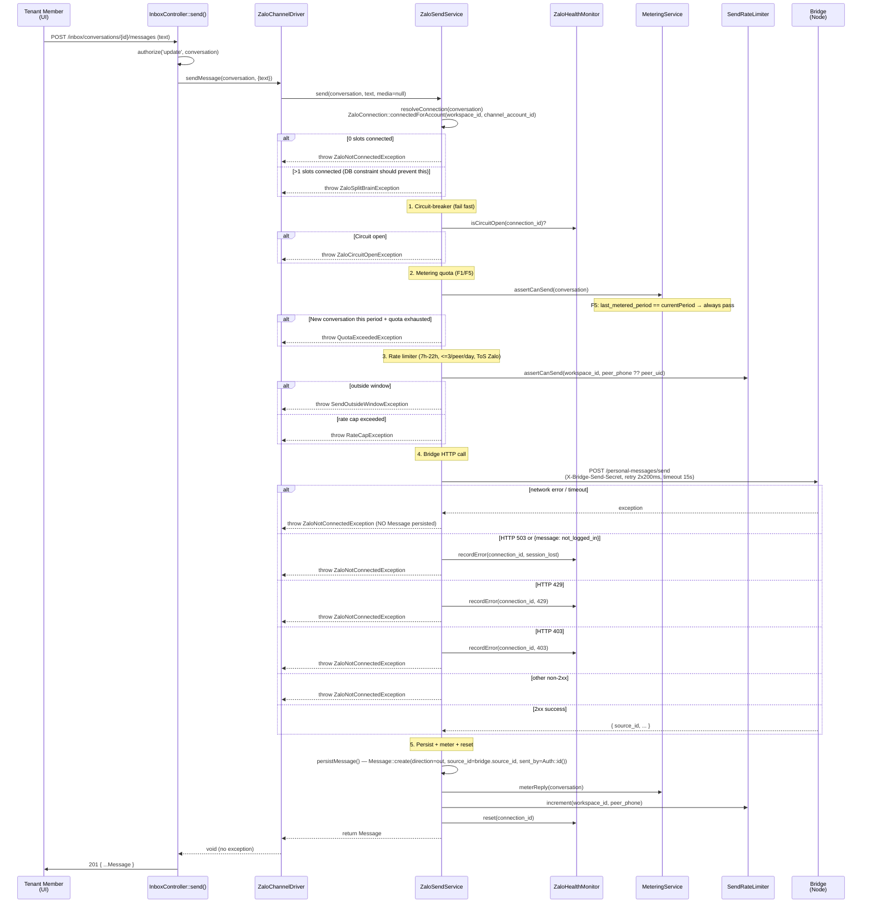

# Outbound Send (Zalo Personal)

Module: `app/Http/Controllers/Inbox` + `app/Modules/Integration/Chat/ZaloPersonal` (plain Laravel — no `modules/` directory since the 2026-06-28 refactor) · Status: live (GĐ1) · Updated: 2026-07-04

## Purpose

Reply to inbound Zalo conversations via `ZaloSendService::send()`: resolve the account's live connection → circuit-breaker → metering quota → rate limiter → bridge HTTP call → message persist → meter reply. Implements fail-safe metering (quota gate never blocks an already-metered conversation; only blocks brand-new conversations when over quota, per F5/F13).

**Value:** Ensures outbound compliance (rate limits, metering for billing) while maintaining optimistic UX (never fail mid-conversation once it's already been metered this period).

## Actors & permissions

- **Workspace member** with `update` permission on the conversation (`ConversationPolicy::update()`, team-based visibility) → can send replies.
- **System** (`InboxController::send()`) → acts on behalf of the authenticated member; validates text, then delegates to the channel driver.

Link: [crm-authorization-model.md](../crm-authorization-model.md) § Inbox scope.

## Trigger / entry points

**Route** `POST /inbox/conversations/{conversation}/messages` (name `inbox.send`, `routes/web.php`):
- Frontend form: text only (media not yet wired on this endpoint).
- Controller: `app/Http/Controllers/Inbox/InboxController.php::send()`.
- Driver dispatch: `ChannelManager::driver($conversation->channel)->sendMessage()` → `ZaloChannelDriver::sendMessage()` → `ZaloSendService::send()`.

## Operational flow (step-by-step)

**Any exception from any step** propagates up through `ZaloChannelDriver::sendMessage()`, which wraps each into a channel-agnostic `App\Contracts\SendException` with an `error_code` (`circuit_open`, `outside_window`, `rate_cap`, `not_connected`, `split_brain`), and `InboxController::send()` catches it uniformly — **every failure returns HTTP `422`**, distinguished only by the JSON body's `error_code` (FE picks the toast message from this code, not from the HTTP status). `QuotaExceededException` is a plain `\RuntimeException` (not yet wrapped as a `SendException`) caught separately in the controller by class-name substring match — also `422`, `error_code: quota_exceeded`.

**Steps:**
1. Member submits reply text via UI form (media not yet supported on this endpoint).
2. Controller authorizes via `ConversationPolicy::update()`; empty text → `422` before any driver call.
3. `ZaloChannelDriver::sendMessage()` delegates to `ZaloSendService::send()`.
4. Service resolves the conversation's live connection via `channel_account_id` (`ZaloConnection::connectedForAccount()` — exactly one connected slot expected; the DB partial-unique index makes 0 or 1 the only reachable outcomes via the app, `>1` is a defense-in-depth branch).
5. Circuit-breaker check (`ZaloHealthMonitor::isCircuitOpen()`) — open → fail fast, no bridge call.
6. Metering quota check (`MeteringService::assertCanSend()`) — F5: a conversation already metered this period always passes, even at 0 remaining; only a brand-new conversation over quota throws.
7. Rate limiter check (`SendRateLimiter::assertCanSend()`) — 7h–22h window + max 3 messages per peer phone/day (Zalo ToS).
8. HTTP POST to bridge `/personal-messages/send` (15s timeout, 2×200ms retry). Non-2xx / timeout → `ZaloNotConnectedException`, **no Message row created**.
9. On bridge success: persist `Message` (`direction=out`, `source_id` = bridge's `source_id` field, `sent_by = Auth::id()`), meter the reply, increment the rate limiter, reset the circuit breaker.
10. Controller returns `201` with the newly-created Message on success, or `422` with an `error_code` on any failure.

## Data touched

**Models:**
- `Conversation`
  - Reads: `id`, `channel_account_id`, `peer_phone`, `peer_uid`, `workspace_id`, `thread_type`, `last_metered_period`
  - Writes: `last_metered_period` (via `MeteringService::meterReply()`), `last_message_at`, `last_message_preview`, `stream_version`
  - RLS: enforced on all writes

- `Message`
  - Writes: `direction='out'`, `type`, `body`, `media_url`, `media_meta`, `source_id` (from the bridge response's `source_id` field — not a remapped `message_id`), `platform_sent_at`, `sent_by`
  - RLS: inherited via conversation FK

- `ZaloConnection`
  - Reads (via `connectedForAccount()`): `workspace_id`, `channel_account_id`, `state = 'connected'`, `deleted_at IS NULL` — no other fields (no `account_status`/`account_health` columns are read here; circuit-breaker state lives in cache, not this table)
  - No writes in the send flow itself

- `ChannelUsage`
  - Writes: `answered_count` increment via compare-set + upsert (F1 atomicity)
  - Columns: `workspace_id`, `channel`, `period`, `answered_count`, `updated_at`

**RLS scoping:**
- All model writes respect the `workspace_id` global scope (bound at the tenant middleware layer before this controller runs).

## State transitions

Conversation state: no change (conversation remains open after reply); lead/pipeline status is managed separately.

`Message.direction`: new row created with `'out'` on successful send.

## Business rules applied

- **F1 (Race-safe metering):** `MeteringService::meterReply()` uses a compare-set atomic update + upsert in a single transaction. Idempotent: same conversation, same period → counted once only (see `tests/Feature/Billing/MeteringRaceTest.php`).
- **F3 (Circuit-breaker):** `ZaloHealthMonitor` tracks bridge failures per connection in cache (not a DB column). After enough errors → circuit opens, sends fail fast without calling the bridge. Reset on successful send.
- **F4 (Bridge fail-fast timeout):** HTTP timeout 15s, retry 2×200ms on network failure. Timeout/network error → throw, no Message persisted (the bridge, not this service, owns retry from its side via the outbox).
- **F5 (Existing conversation always allowed):** `last_metered_period == currentPeriod` → `assertCanSend()` passes even at 0 quota remaining. Only blocks brand-new conversations when over quota.
- **F8 (Rate limit + window):** `SendRateLimiter` enforces 7h–22h (Asia/Ho_Chi_Minh) + max 3 messages per phone number per day.
- **F13/F20 (Inbound never blocked):** Inbound acceptance is never gated by quota at all (only outbound is gated, via F5). See [zalo-personal-inbox.md](./zalo-personal-inbox.md).

Link: [crm-business-rules.md](../crm-business-rules.md) § F1, F3, F4, F5, F8, F13, F20.

## Edge cases & error handling

| Scenario | Behavior |
|---|---|
| **Empty text** | `422 { message: "Nội dung không được để trống." }` — before any driver call. |
| **Integration module missing/disabled** | `422 { error_code: channel_unavailable }`. |
| **0 connected slots for the account** | `ZaloNotConnectedException` → wrapped `SendException(not_connected)` → `422`. |
| **>1 connected slots for the account** (should be DB-impossible via the app) | `ZaloSplitBrainException` → `SendException(split_brain)` → `422`. |
| **Circuit breaker open** | `SendException(circuit_open)` → `422`. |
| **Quota exceeded (new conversation, period over)** | `QuotaExceededException` (not yet a `SendException`, caught separately by class-name check) → `422 { error_code: quota_exceeded }`. |
| **Outside 7h–22h window** | `SendException(outside_window)` → `422`. |
| **Rate cap (3 msg/phone/day)** | `SendException(rate_cap)` → `422`. |
| **Bridge session lost (503 / not_logged_in)** | `SendException(not_connected)` → `422`; health monitor records the error. |
| **Bridge rate-limited (429) / forbidden (403)** | Same as above — `422`, health monitor records. |
| **Bridge timeout / network error** | `422`; **no Message persisted**; member can retry. |
| **Every error above is distinguished only by `error_code` in the JSON body — the HTTP status is uniformly 422, never 402/409/429/503.** | |

## Related

- [zalo-personal-inbox.md](./zalo-personal-inbox.md) — inbound message ingestion.
- [conversation-metering.md](./conversation-metering.md) — metering gate contract + implementation.
- [channel-account-architecture.md](./channel-account-architecture.md) — account-keyed connection resolution this flow relies on.
- [system-architecture.md](../system-architecture.md) § Billing + Metering.
- [crm-business-rules.md](../crm-business-rules.md) § F1, F3, F4, F5, F8, F13, F20.
