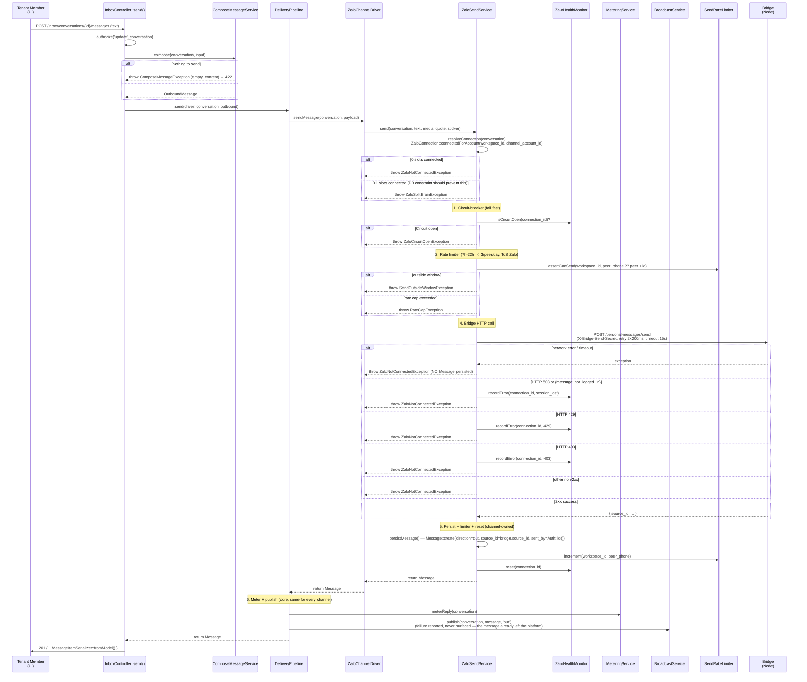

# Outbound Send (Zalo Personal)

Module: `app/Http/Controllers/Chat` + `app/Modules/Chat/Delivery` + `app/Modules/Chat/Adapter/ZaloPersonal` (plain Laravel — no `modules/` directory since the 2026-06-28 refactor) · Status: live (GĐ1) · Updated: 2026-07-26

## Purpose

Reply to inbound Zalo conversations via `ZaloSendService::send()`: resolve the account's live connection → circuit-breaker → rate limiter → bridge HTTP call → message persist → meter reply. All sends are allowed; metering purely tracks usage for analytics.

**Value:** Ensures outbound compliance (rate limits, metering for billing data) without blocking sends. No quota gate enforced.

## Actors & permissions

- **Workspace member** with `update` permission on the conversation (`ConversationPolicy::update()`, team-based visibility) → can send replies.
- **System** (`InboxController::send()`) → acts on behalf of the authenticated member; composes the outbound message via `ComposeMessageService`, then hands it to `DeliveryPipeline`.

Link: [crm-authorization-model.md](../crm-authorization-model.md) § Inbox scope.

## Trigger / entry points

**Route** `POST /inbox/conversations/{conversation}/messages` (name `inbox.send`, `routes/web_api.php`):
- Request body (`SendMessageRequest`): `text`, `attachment_id`, `reply_to_message_id`, `sticker` — at least one of them must produce content.
- Controller: `app/Http/Controllers/Chat/InboxController.php::send()`.
- Compose: `ComposeMessageService::compose()` turns the request into an `OutboundMessage` (no transport).
- Driver dispatch: `DeliveryPipeline::send(ChannelRegistry::driver($conversation->channel), …)` → `ZaloChannelDriver::sendMessage()` → `ZaloSendService::send()`.

## Operational flow (step-by-step)

**Any exception from any step** propagates up through `ZaloChannelDriver::sendMessage()`, which wraps each into a channel-agnostic `App\Contracts\SendException` with an `error_code` (`circuit_open`, `outside_window`, `rate_cap`, `not_connected`, `split_brain`), and `InboxController::send()` catches it uniformly — **every failure returns HTTP `422`**, distinguished only by the JSON body's `error_code` (FE picks the toast message from this code, not from the HTTP status).

**Steps:**
1. Member submits the reply from the composer — text, a previously uploaded attachment, a sticker, or a quoted reply.
2. Controller authorizes via `ConversationPolicy::update()`, then calls `ComposeMessageService::compose()`; nothing to send → `ComposeMessageException` → `422 { error_code: empty_content }` before any driver call.
3. `DeliveryPipeline::send()` receives the driver resolved from `ChannelRegistry`; `ZaloChannelDriver::sendMessage()` delegates to `ZaloSendService::send()`.
4. Service resolves the conversation's live connection via `channel_account_id` (`ZaloConnection::connectedForAccount()` — exactly one connected slot expected; the DB partial-unique index makes 0 or 1 the only reachable outcomes via the app, `>1` is a defense-in-depth branch).
5. Circuit-breaker check (`ZaloHealthMonitor::isCircuitOpen()`) — open → fail fast, no bridge call.
6. Rate limiter check (`SendRateLimiter::assertCanSend()`) — 7h–22h window + max 3 messages per peer phone/day (Zalo ToS).
7. HTTP POST to bridge `/personal-messages/send` (15s timeout, 2×200ms retry). Non-2xx / timeout → `ZaloNotConnectedException`, **no Message row created**.
8. On bridge success the channel service persists `Message` (`direction=out`, `source_id` = bridge's `source_id` field, `sent_by = Auth::id()`), increments the rate limiter, and resets the circuit breaker.
9. Back in `DeliveryPipeline`: meter the reply (race-safe compare-set) and publish to the conversation stream. Metering and broadcast live here, not in the channel service, so every channel and every send origin is counted the same way.
10. Controller returns `201` with the message serialized as a stream item (`MessageItemSerializer::fromModel()`) on success, or `422` with an `error_code` on any failure.

## Data touched

**Models:**
- `Conversation`
  - Reads: `id`, `channel_account_id`, `peer_phone`, `peer_uid`, `workspace_id`, `thread_type`, `last_metered_period`
  - Writes: `last_metered_period` (via `MeteringService::meterReply()`), `last_message_at`, `last_message_preview`, `stream_version`
  - RLS: enforced on all writes

- `Message`
  - Writes: `direction='out'`, `type`, `body`, `media_url`, `media_meta`, `source_id` (from the bridge response's `source_id` field — not a remapped `message_id`), `platform_sent_at`, `sent_by`
  - RLS: inherited via conversation FK

- `ZaloConnection`
  - Reads (via `connectedForAccount()`): `workspace_id`, `channel_account_id`, `state = 'connected'`, `deleted_at IS NULL` — no other fields (no `account_status`/`account_health` columns are read here; circuit-breaker state lives in cache, not this table)
  - No writes in the send flow itself

- `ChannelUsage`
  - Writes: `answered_count` increment via compare-set + upsert (F1 atomicity)
  - Columns: `workspace_id`, `channel`, `period`, `answered_count`, `updated_at`

**RLS scoping:**
- All model writes respect the `workspace_id` global scope (bound at the tenant middleware layer before this controller runs).

## State transitions

Conversation state: no change (conversation remains open after reply); lead/pipeline status is managed separately.

`Message.direction`: new row created with `'out'` on successful send.

## Business rules applied

- **F1 (Race-safe metering):** `MeteringService::meterReply()` uses a compare-set atomic update + upsert in a single transaction. Idempotent: same conversation, same period → counted once only (see `tests/Feature/Billing/MeteringRaceTest.php`). No quota gate applied; pure usage tracking.
- **F3 (Circuit-breaker):** `ZaloHealthMonitor` tracks bridge failures per connection in cache (not a DB column). After enough errors → circuit opens, sends fail fast without calling the bridge. Reset on successful send.
- **F4 (Bridge fail-fast timeout):** HTTP timeout 15s, retry 2×200ms on network failure. Timeout/network error → throw, no Message persisted (the bridge, not this service, owns retry from its side via the outbox).
- **F8 (Rate limit + window):** `SendRateLimiter` enforces 7h–22h (Asia/Ho_Chi_Minh) + max 3 messages per phone number per day (Zalo ToS, not quota-related).

Link: [crm-business-rules.md](../crm-business-rules.md) § F1, F3, F4, F8.

## Edge cases & error handling

| Scenario | Behavior |
|---|---|
| **Nothing to send** | `422 { error_code: empty_content, message: "Nội dung không được để trống." }` — raised by `ComposeMessageService`, before any driver call. |
| **Quoted reply with no text / with an attachment** | `422 { error_code: quote_requires_text }` / `422 { error_code: quote_with_attachment_unsupported }` — also before any driver call. |
| **Conversation's channel has no registered driver** | `422 { error_code: channel_unavailable }`. |
| **0 connected slots for the account** | `ZaloNotConnectedException` → wrapped `SendException(not_connected)` → `422`. |
| **>1 connected slots for the account** (should be DB-impossible via the app) | `ZaloSplitBrainException` → `SendException(split_brain)` → `422`. |
| **Circuit breaker open** | `SendException(circuit_open)` → `422`. |
| **Outside 7h–22h window** | `SendException(outside_window)` → `422`. |
| **Rate cap (3 msg/phone/day)** | `SendException(rate_cap)` → `422`. |
| **Bridge session lost (503 / not_logged_in)** | `SendException(not_connected)` → `422`; health monitor records the error. |
| **Bridge rate-limited (429) / forbidden (403)** | Same as above — `422`, health monitor records. |
| **Bridge timeout / network error** | `422`; **no Message persisted**; member can retry. |
| **Every error above is distinguished only by `error_code` in the JSON body — the HTTP status is uniformly 422, never 402/409/429/503.** | |

## Related

- [zalo-personal-inbox.md](./zalo-personal-inbox.md) — inbound message ingestion.
- [conversation-metering.md](./conversation-metering.md) — metering gate contract + implementation.
- [channel-account-architecture.md](./channel-account-architecture.md) — account-keyed connection resolution this flow relies on.
- [system-architecture.md](../system-architecture.md) § Billing + Metering.
- [crm-business-rules.md](../crm-business-rules.md) § F1, F3, F4, F5, F8, F13, F20.
