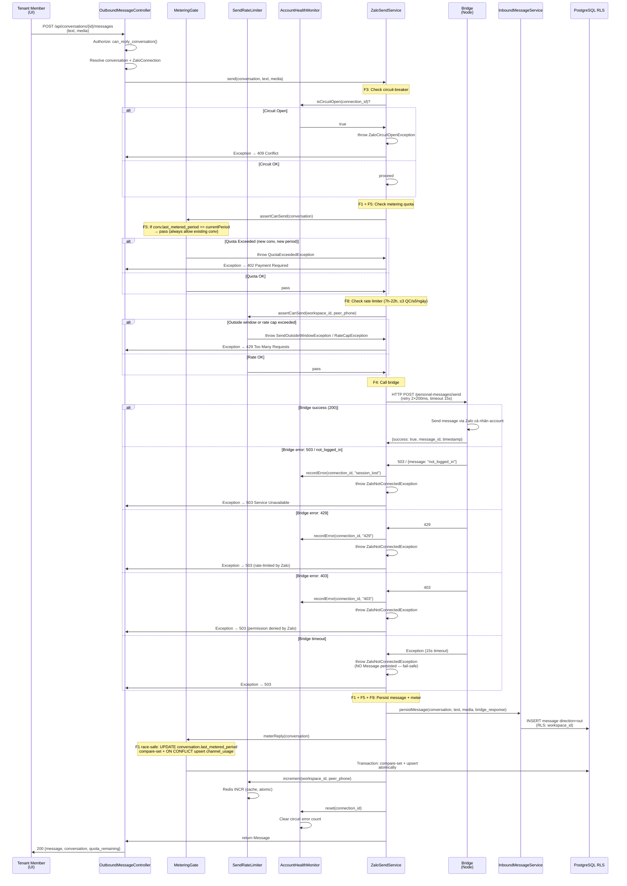

# Outbound Send (Zalo Personal)

Module: `channel-zalo` · Status: live (GĐ1) · Updated: 2026-06-28

## Purpose

Reply to inbound Zalo conversations via `ZaloSendService` chain: circuit-breaker → metering quota → rate limiter → bridge HTTP call → message persist → meter reply. Implements fail-safe metering (quota gate never blocks outbound; only blocks new conversations when over quota per F5/F13).

**Value:** Ensures outbound compliance (rate limits, metering for billing) while maintaining optimistic UX (never fail mid-conversation).

## Actors & permissions

- **Workspace member** (`lead.manage` / `conversation.reply`) → can send replies on conversations in their visibility scope (team-based).
- **System** (OutboundMessageController) → acts on behalf of authenticated member, validates quota + rate limits before bridge call.

Link: [crm-authorization-model.md](../crm-authorization-model.md) § Inbox scope.

## Trigger / entry points

**API endpoint** `POST /api/conversations/{id}/messages`:
- Frontend form: text + optional media (file_url, media_kind).
- Controller: `modules/inbox/src/Http/Controllers/OutboundMessageController.php::store()`.
- Service: `ZaloSendService::send()` (modules/channel-zalo).
- Route: `modules/inbox/routes/web.php`.

## Operational flow (step-by-step)

**Steps:**
1. Member submits reply text + optional media via UI form.
2. Controller authorizes: member can reply (policy: `ConversationPolicy::update()`).
3. Controller resolves conversation + ZaloConnection from conversation.zalo_connection_id.
4. Service checks circuit-breaker (F3): if open → 409 Conflict (connection unhealthy).
5. Service checks metering quota via `assertCanSend()` (F1/F5):
   - If conversation already metered this period → pass (allow existing conversation).
   - If new conversation + period over quota → throw QuotaExceededException → 402.
6. Service checks rate limiter (F8): 7h–22h window + max 3 messages per peer phone per day.
   - Outside window or rate-capped → throw SendOutsideWindowException / RateCapException → 429.
7. Service calls bridge HTTP POST `/personal-messages/send` with retry (2×200ms, 15s timeout).
   - Bridge error (503, 429, 403) → record health monitor error → throw ZaloNotConnectedException → 503.
   - Bridge timeout → throw ZaloNotConnectedException; **NO Message persisted** (fail-safe).
   - Bridge success → return bridge response (message_id, timestamp).
8. Service persists Message with direction='out' (idempotent on conversation_id + source_id from bridge).
9. Service meters reply atomically (F1 race-safe compare-set + upsert channel_usage in transaction).
10. Service increments rate limiter counter (Redis atomic INCR if enabled, else in-memory).
11. Service resets circuit-breaker error count on success.
12. Controller returns 200 with updated Message + Conversation cache + quota_remaining for FE re-render.

## Data touched

**Models:**
- `Conversation` (modules/inbox)
  - Reads: id, zalo_connection_id, peer_phone, peer_uid, workspace_id, last_metered_period
  - Writes: last_metered_period (via ConversationMeter.meterReply), last_message_at, last_message_preview
  - RLS: enforced on all writes

- `Message` (modules/inbox)
  - Writes: direction='out', type, body, media_url, media_meta, source_id (from bridge message_id), platform_sent_at
  - RLS: inherited via conversation FK

- `ZaloConnection` (modules/channel-zalo)
  - Reads: connection_id, account_status, account_health
  - No writes in send flow

- `ChannelUsage` (modules/billing)
  - Writes: answered_count increment via ON CONFLICT upsert (F1 atomicity)
  - Columns: workspace_id, channel, period, answered_count, updated_at

**RLS scoping:**
- All model writes respect workspace_id global scope (binded at controller entry).
- ChannelUsage write bypasses RLS (internal billing table, no per-workspace scoping needed).

## State transitions

Conversation state: "open" → no change (conversation remains open after reply). Status managed separately by tenant (e.g., "leads.lead_status").

Message.direction: new → 'out' on successful send.

## Business rules applied

- **F1 (Race-safe metering):** `ConversationMeter::meterReply()` uses compare-set atomic UPDATE + ON CONFLICT upsert in single transaction (PostgreSQL 15+). Idempotent: same conversation, same period → counted once only.

- **F3 (Circuit-breaker):** `AccountHealthMonitor` tracks bridge failures per connection. After N errors → circuit open, all sends fail fast without calling bridge. Reset on successful send.

- **F4 (Bridge fail-fast timeout):** HTTP timeout 15 seconds; retry 2×200ms on network failure. If timeout → throw, no message persisted (fail-safe: bridge responsible for retry from their side).

- **F5 (Existing conversation always allowed):** Conversation already metered in current period (`last_metered_period == currentPeriod`) → `assertCanSend()` passes even if quota remaining = 0. Only blocks NEW conversations when over quota.

- **F8 (Rate limit + window):** SendRateLimiter enforces 7h–22h (Ho Chi Minh time) + max 3 QC (quick call?) per phone number per day. Persisted in Redis if enabled, else in-memory cache.

- **F9 (Metering atomicity):** Compare-set + upsert wrapped in `DB::transaction()`. If upsert fails after compare-set → entire transaction rolls back, conversation.last_metered_period reverted (no under-counting).

- **F13/F20 (Inbound never blocked):** Inbound acceptance NEVER gated by quota (only outbound gated via F5). See [zalo-personal-inbox.md](./zalo-personal-inbox.md).

Link: [crm-business-rules.md](../crm-business-rules.md) § F1, F3, F4, F5, F8, F9, F13, F20.

## Edge cases & error handling

| Scenario | Behavior |
|---|---|
| **Quota exceeded (new conversation, period over)** | throw QuotaExceededException → 402 Payment Required; member sees "quota exceeded" message in UI. |
| **Circuit breaker open** | throw ZaloCircuitOpenException → 409 Conflict; member sees "connection unhealthy, try again later". |
| **Outside 7h–22h window** | throw SendOutsideWindowException → 429; member sees "can only send during 7h–22h". |
| **Rate cap (3 msg/phone/day)** | throw RateCapException → 429; member sees "too many messages to this phone today". |
| **Bridge session lost (503, not_logged_in)** | ZaloNotConnectedException → 503; health monitor records error; member sees "session expired, admin needs to re-login". |
| **Bridge rate-limited (429)** | ZaloNotConnectedException → 503; health monitor records; circuit-breaker increments error counter. |
| **Bridge timeout (15s)** | ZaloNotConnectedException → 503; NO Message persisted; member can retry. |
| **Metering transaction rollback** | Rare; if upsert fails after compare-set → entire transaction rolls back. Conversation.last_metered_period NOT updated → retry meterReply later idempotent. |
| **Media URL invalid** | Message persists with media_meta as-is; FE handles 404 / rendering error gracefully. |
| **Member loses permission mid-request** | Authorization policy re-checked at controller; unlikely race but returns 403 if membership changed. |
| **Conversation deleted by tenant** | FK constraint violation (if conversation hard-deleted); returns 404. Soft-delete recommended to preserve audit. |

## Related

- [zalo-personal-inbox.md](./zalo-personal-inbox.md) — inbound message ingestion.
- [conversation-metering.md](./conversation-metering.md) — metering gate contract + implementation.
- [system-architecture.md](../system-architecture.md) § Billing + Metering.
- [crm-business-rules.md](../crm-business-rules.md) § F1, F3, F4, F5, F8, F9, F13, F20.
