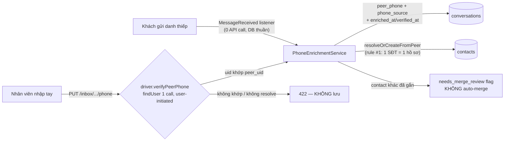

# Phone Enrichment — SĐT khách cho quy tắc #1 CDP

Module: messaging · Status: **LIVE (P01c+P05 — inbox-full-messaging-framework)** · Updated: 2026-07-04

## Purpose
Mở khóa quy tắc #1 CDP (chống trùng theo SĐT — trước đây peer_phone luôn NULL). **A1 founder: consent-by-conduct** — danh thiếp khách CHỦ ĐỘNG gửi = đồng ý ngầm → lift + dedup; KHÔNG cột consent; SĐT **KHÔNG** auto-enroll vào tệp gửi chủ động/QC (backlog opt-in riêng).

## 2 nguồn CHO PHÉP (BLK-5: CẤM harvest — rủi ro khóa acc Zalo duy nhất)

CẮT HẲN: getUserInfo/getAllFriends/getMultiUsersByPhones backfill, command enrich hàng loạt.

## Thứ tự nguồn mạnh (KHÔNG ghi đè mạnh bằng yếu; cùng hạng = take-latest)
`manual_verified (3) > business_card (2) > friend_profile (1, chưa dùng) > unverified (0)`

## Điểm kiến trúc
- Hook qua **listener `LiftPhoneFromBusinessCard` trên MessageReceived** — KHÔNG sửa InboundMessageService (file ownership H2). Chạy inline trong ingest (TenantScope đã bind bởi webhook — không cần queue+RLS binding riêng). Fail-safe: lỗi enrich không chặn ingest.
- Chỉ lift 1-1 + direction='in' (mình gửi danh thiếp/nhóm → không phải consent của peer).
- Verify nhập tay: Zalo-specific `ZaloChannelDriver::verifyPeerPhone` (qua dispatcher `/zca/findUser`, workspace_token B1, rate-limit bridge) — controller check `method_exists` (kênh không hỗ trợ → 422, không lưu SĐT chưa xác minh). Reject CẢ 2 nhánh: findUser không resolve LẪN uid≠peer_uid (LOW-2).
- **Lưu ý vận hành:** verify cần slot đã re-promote QR (binding workspace) — slot pre-adapter trả `workspace_binding_missing` 403.

## Goal #2 metric
Đích = **100% của TẬP có business_card/manual-verified** có peer_phone (không phải % tổng hội thoại); nghiệm thu data thật 7 ngày (P12).

## Files
- `app/Services/Inbox/PhoneEnrichmentService.php` · `app/Listeners/LiftPhoneFromBusinessCard.php` · `app/Http/Controllers/Inbox/ConversationPhoneController.php` · `ZaloChannelDriver::verifyPeerPhone` · migration `500005_add_phone_source_to_conversations`
- Tests: `tests/Feature/Inbox/PhoneEnrichmentTest.php` (9 — gồm e2e "2 nguồn cùng SĐT → 1 hồ sơ")

## Spike 5a (info-only, KHÔNG chặn build — đã de-gate)
Câu hỏi còn mở cho tương lai: friend-profile (`getUserInfo`/`getAllFriends`) có trả phone không khi ĐÃ kết bạn — chạy LAB cùng đợt runtime evidence P12. Kết quả KHÔNG đổi scope phase này (harvest vẫn cấm).
