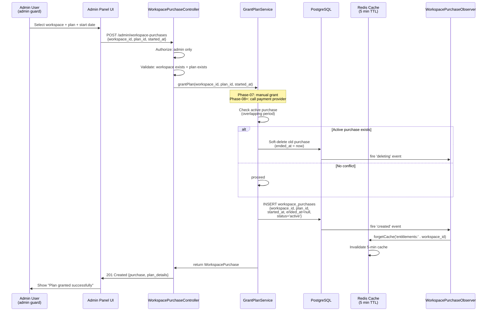
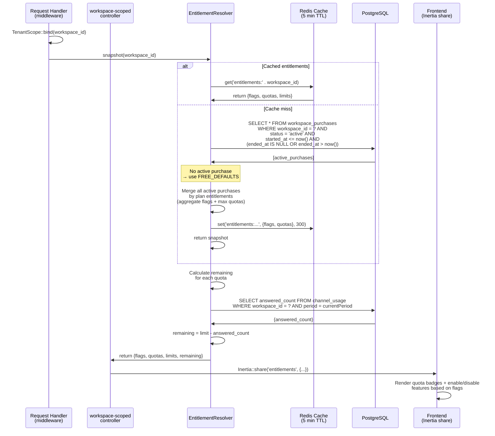

# Plan Entitlements & Admin Grant

Module: `billing` · Status: live (GĐ1) · Updated: 2026-06-28

## Purpose

Manage workspace entitlements (features + quotas) via marketplace_items (global plans) + workspace_purchases (tenant subscription). Admin grants plans manually (Phase-07: no payment integration). EntitlementResolver resolves active entitlements + quota remaining per workspace.

**Value:** Foundation for monetization (Phase-07 manual grant; Phase-08+ payment provider drivers like VNPay/MoMo). Decouples billing from features via contract pattern.

## Actors & permissions

- **Platform admin** (`admin` guard) → view workspace purchases, grant/revoke plans via admin panel.
- **EntitlementResolver service** → resolve workspace quota (cache-able) + remaining (query ChannelUsage, not cache-able).
- **GrantPlanService** → apply plan to workspace (no-op on code level; admin action in DB).
- **PaymentProvider contract** → abstract payment processing (Phase-08: implement VNPay/MoMo drivers).

Link: [admin/admin-auth.md](../admin/admin-auth.md) (admin guard scope).

## Trigger / entry points

**Admin panel** `POST /admin/workspace-purchases`:
- Admin selects workspace + plan, grants manually (payment-manual driver).
- Controller: `Admin\WorkspacePurchaseController::store()` (future).
- Service: `GrantPlanService::grantPlan()` (modules/billing).

**Frontend entitlements** (Inertia share):
- Controller uses `EntitlementResolver::snapshot()` to send entitlements + remaining to FE.
- EntitlementResolver calls at request entry; shared with all requests (global).

## Operational flow (step-by-step)

### Admin Grant Flow



### Resolve Entitlements Flow



**Steps (Admin Grant):**
1. Admin opens admin panel, selects workspace + plan (Free/Team/Business).
2. Admin submits form: workspace_id, plan_id, started_at (default: today).
3. Controller validates: workspace exists, plan exists, admin authorized.
4. GrantPlanService checks for overlapping active purchase:
   - If found → soft-delete old purchase, set ended_at = now (audit trail).
5. GrantPlanService inserts new WorkspacePurchase (status='active').
6. WorkspacePurchaseObserver (boot listener) fires 'created' event → calls forgetCache() → invalidates Redis cache for entitlements.
7. Controller returns 201 with new purchase details.

**Steps (Resolve Entitlements):**
1. Request handler calls TenantScope::bind(workspace_id) at request entry.
2. Controller (or middleware) calls EntitlementResolver::snapshot(workspace_id).
3. EntitlementResolver checks Redis cache (key: `entitlements:{workspace_id}`, TTL: 5 min):
   - If hit → return cached {flags, quotas}.
   - If miss → query active WorkspacePurchases.
4. Query returns all purchases WHERE status='active' AND started_at <= now() AND (ended_at IS NULL OR ended_at > now()).
5. If no active purchase → use FREE_DEFAULTS (limits: 50 conv/month, 3 seats).
6. EntitlementResolver merges all active purchase entitlements (aggregate flags + max quotas).
7. Caches result for 5 minutes.
8. For each quota (e.g., 'quota.conversations.zalo_personal'):
   - Query ChannelUsage for current period → get answered_count.
   - Calculate remaining = limit - answered_count.
9. Returns snapshot to controller.
10. Controller shares entitlements with Inertia FE (global state).

## Data touched

**Models:**
- `MarketplaceItem` (marketplace_items table, global)
  - Reads: plan_id, code (e.g., 'plan.free'), entitlements (JSONB: {flags, quotas})
  - Example: {flags: ['module.inbox'], quotas: {'quota.conversations.zalo_personal': 50}}
  - No RLS (global catalog)
  - Seeded in PlanSeeder (Phase-07 manual)

- `WorkspacePurchase` (workspace_purchases table)
  - Reads: workspace_id, plan_id, started_at, ended_at, status
  - Writes: INSERT new purchase, UPDATE ended_at (soft-delete)
  - RLS: none (admin-only access via middleware)
  - Unique constraint: only 1 active purchase per workspace at any time

- `ChannelUsage` (channel_usage table, internal)
  - Reads: workspace_id, channel, period, answered_count
  - Used by remaining() to calculate quota consumption
  - No writes in entitlement resolution

**RLS scoping:**
- EntitlementResolver scoped to currentWorkspace() (bound at request entry).
- ChannelUsage query bypasses RLS but filters by workspace_id manually.
- WorkspacePurchase query (admin side) bypasses RLS (admin-only access).

## State transitions

- **WorkspacePurchase.status:** 'active' → 'inactive' (soft-delete via ended_at) or null (not shown).
- **Workspace entitlements:** changes when purchase granted → cache invalidated → next request fetches new entitlements.

## Business rules applied

- **F10 (No-op default binding):** If billing module disabled → EntitlementResolver binding (BillingServiceProvider) never runs. FE gets no entitlements (no feature gates). All features available.

- **F21 (Free defaults):** Workspace without active purchase → FREE_DEFAULTS: {flags: ['module.inbox'], quotas: {conversations.zalo_personal: 50}}.

- **F11 (Workspace isolation):** EntitlementResolver + GrantPlanService scoped to workspace_id. No cross-tenant entitlement leakage.

- **F24 (Plan soft-delete):** When new plan granted, old plan ended_at = now (audit trail, not hard-deleted). Enables historical analysis (which plan was active when).

- **F25 (Aggregate plan entitlements):** Multiple active purchases (e.g., free + addon) merge entitlements: flags union, quotas max per key.

Link: [crm-business-rules.md](../crm-business-rules.md) § F10, F21, F24, F25.

## Edge cases & error handling

| Scenario | Behavior |
|---|---|
| **Admin grants plan to nonexistent workspace** | Controller validates; returns 422 "workspace not found". |
| **Plan not found** | Controller validates; returns 422 "plan not found". |
| **Overlapping active purchase exists** | GrantPlanService soft-deletes old purchase (ended_at = now); new purchase starts. Audit shows history. |
| **Cache miss on entitlements** | Query DB (slower); cache miss after grant (observer invalidates). Next request hits cache. |
| **Workspace has no active purchase** | EntitlementResolver returns FREE_DEFAULTS (50 conv/month, 3 seats). |
| **Quota limit = null (unlimited)** | remaining() returns PHP_INT_MAX (no blocking). |
| **ChannelUsage period straddles month boundary** | now('Asia/Ho_Chi_Minh')->format('Y-m') atomic once per day. New period → new ChannelUsage record. |
| **Admin revokes plan mid-month** | GrantPlanService sets ended_at = now; next request → EntitlementResolver cache misses → new query shows no active purchase → FREE_DEFAULTS applied. |
| **Multiple admin grant requests (race)** | DB unique constraint prevents 2 active purchases same period; second request fails; admin sees "purchase already exists". |
| **Concurrent metering + entitlement change** | meterReply() uses snapshot of current limit (from cache at that moment); remaining() calculated after. Possible: quota appears available, but metered after limit revoked. Acceptable (edge case). |

## Related

- [conversation-metering.md](./conversation-metering.md) — uses EntitlementResolver to check quota.
- [../system-architecture.md](../system-architecture.md) § Billing + Entitlements.
- [crm-business-rules.md](../crm-business-rules.md) § F10, F21, F24, F25.

**Data Models (Phase-07):**
```php
// MarketplaceItem (global catalog, PlanSeeder)
Schema::create('marketplace_items', fn (Blueprint $table) => {
    $table->uuid('id')->primary();
    $table->enum('type', ['plan']); // 'plan' for payment
    $table->string('code')->unique(); // 'plan.free', 'plan.team', 'plan.business'
    $table->string('name'); // 'Free', 'Team $99/mo', etc
    $table->jsonb('entitlements'); // {flags: [...], quotas: {...}}
    $table->timestamps();
});

// WorkspacePurchase (tenant subscriptions)
Schema::create('workspace_purchases', fn (Blueprint $table) => {
    $table->uuid('id')->primary();
    $table->uuid('workspace_id');
    $table->uuid('plan_id'); // FK marketplace_items.id
    $table->timestamp('started_at');
    $table->timestamp('ended_at')->nullable(); // soft-delete via ended_at
    $table->enum('status', ['active', 'inactive'])->default('active');
    $table->timestamps();
    $table->unique(['workspace_id', 'id']); // 1 active per workspace
    $table->foreign('workspace_id')->references('id')->on('workspaces');
    $table->foreign('plan_id')->references('id')->on('marketplace_items');
});
```

**PaymentProvider Contract (Phase-08+):**
```php
interface PaymentProvider {
    public function charge(WorkspacePurchase $purchase): PaymentResult;
    public function verify(PaymentResult $result): bool;
    public function cancel(WorkspacePurchase $purchase): void;
}

// Drivers: PaymentManualDriver (Phase-07), VNPayDriver (Phase-08), MoMoDriver (Phase-08)
```
