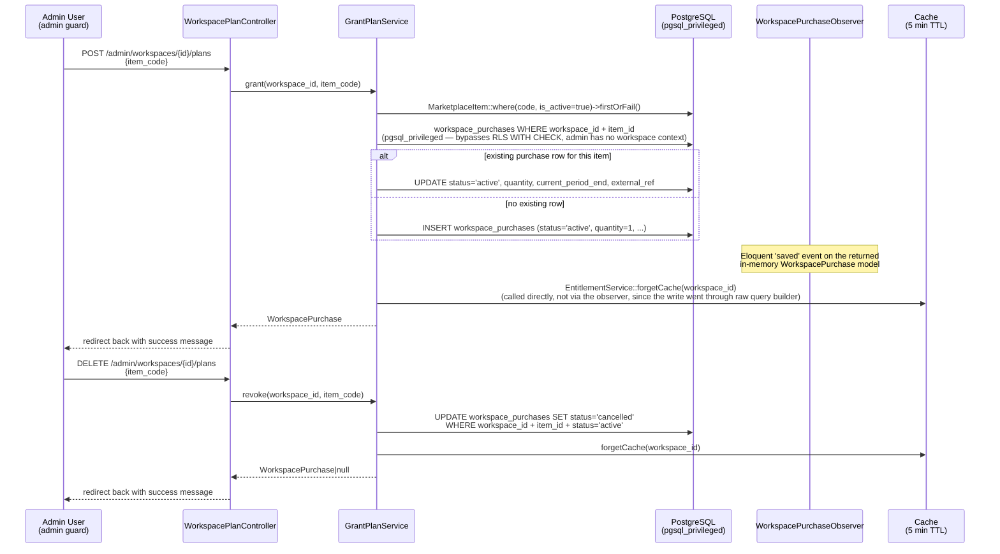
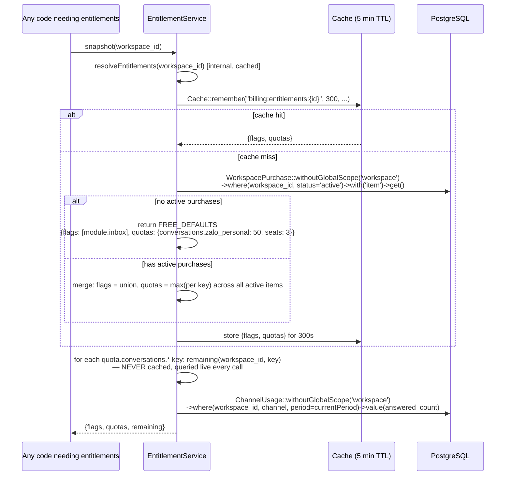

# Plan Entitlements & Admin Grant

Module: `app/Services` + `app/Http/Controllers/Billing/Admin` (plain Laravel — no `modules/` directory, no `PaymentProvider` contract/driver layer) · Status: live (GĐ1, manual grant only — no payment provider integration) · Updated: 2026-07-04

## Purpose

Manage workspace entitlements (feature flags + quotas) via `marketplace_items` (global plan/addon catalog) + `workspace_purchases` (tenant's active purchases). Platform admin grants/revokes plans manually through an admin panel (no payment flow yet — VNPay/MoMo are a documented future roadmap item, not implemented). `EntitlementService` resolves a workspace's aggregate entitlements + quota remaining.

**Value:** Foundation for monetization — quota gating works today via manual grants; a payment provider can be added later purely as a new way to call `GrantPlanService::grant()`, without touching the entitlement-resolution side.

## Actors & permissions

- **Platform admin** (`admin` guard, permission `platform.billing.manage`) → view a workspace's available plans/addons + current usage, grant or revoke an item via the admin panel.
- **`EntitlementService`** → resolves a workspace's aggregate entitlements (cached 5 min) and remaining quota (never cached — computed live from `channel_usage`).
- **`GrantPlanService`** → single source of truth for grant/revoke; called by the admin controller today, callable from a future payment webhook the same way.

Link: [admin/admin-auth.md](../admin/admin-auth.md) (admin guard scope).

## Trigger / entry points

**Admin panel**, all under `admin.can:platform.billing.manage` middleware (`routes/web.php:439-443`):
- `GET /admin/workspaces/{workspace}/plans` (`admin.workspaces.plans.index`) — list catalog items + this workspace's active items + current-period usage.
- `POST /admin/workspaces/{workspace}/plans` (`admin.workspaces.plans.store`) — grant an item by `item_code`.
- `DELETE /admin/workspaces/{workspace}/plans` (`admin.workspaces.plans.destroy`) — revoke an item by `item_code`.
- Controller: `app/Http/Controllers/Billing/Admin/WorkspacePlanController.php`.
- Service: `App\Services\GrantPlanService::grant()` / `::revoke()`.

**Frontend entitlements** (Inertia share):
- `EntitlementService::snapshot($workspaceId)` — called wherever the app needs to share `{flags, quotas, remaining}` with the FE (quota badges, feature gates).

## Operational flow (step-by-step)

### Admin Grant/Revoke Flow

### Resolve Entitlements Flow

**Steps (Admin Grant):**
1. Admin opens `/admin/workspaces/{workspace}/plans`, sees the catalog (`marketplace_items` where `is_active=true`) with which items are already active for this workspace and current-month `channel_usage`.
2. Admin submits `POST .../plans` with `item_code` (validated against `marketplace_items.code`).
3. `GrantPlanService::grant()` looks up the active `MarketplaceItem`, then checks for an existing `workspace_purchases` row for `(workspace_id, item_id)` via `pgsql_privileged` (bypasses RLS — the admin request has no workspace RLS context bound).
4. If a row exists → `UPDATE` it back to `status='active'` (idempotent re-grant, refreshes `quantity`/`current_period_end`/`external_ref`). If not → `INSERT` a new row.
5. `EntitlementService::forgetCache($workspaceId)` is called directly inside `GrantPlanService` (the write goes through the raw query builder on `pgsql_privileged`, not through Eloquent, so `WorkspacePurchaseObserver`'s `saved`/`deleted` hooks don't fire for this path — the service invalidates the cache itself).
6. Controller redirects back with a flash success message (not a JSON/201 response — this is a classic Inertia form-then-redirect flow).

**Steps (Admin Revoke):**
1. Admin submits `DELETE .../plans` with `item_code`.
2. `GrantPlanService::revoke()` finds the active purchase row for `(workspace_id, item_id)` and sets `status='cancelled'` — no row is deleted, no `ended_at` column exists to stamp.
3. Cache invalidated the same way as grant.

**Steps (Resolve Entitlements):**
1. Caller invokes `EntitlementService::snapshot($workspaceId)`.
2. Internally resolves `{flags, quotas}` via `Cache::remember("billing:entitlements:{$workspaceId}", 300, ...)`.
3. Cache miss → queries all `status='active'` `WorkspacePurchase` rows for the workspace, eager-loads each `item`; if none → returns the hardcoded `FREE_DEFAULTS` constant (not a DB-seeded row) without any query beyond the purchases check.
4. If purchases exist → merges: `flags` is a union across all active items' `getFlags()`; each quota key takes the `max()` across all active items' `getQuotas()` (multiple active purchases only ever raise a limit, never lower it).
5. `remaining()` is computed **live on every call**, deliberately never cached (it changes on every `meterReply()`) — queries `channel_usage.answered_count` for the current period and subtracts from the (cached) limit.
6. `snapshot()` returns `{flags, quotas, remaining}` for the FE to render quota badges / feature gates.

## Data touched

**Models:**
- `MarketplaceItem` (`marketplace_items` table, global — no `workspace_id`, no RLS)
  - Reads: `id`, `code`, `name`, `type` (`plan`|`addon`), `billing_type` (`one_off`|`recurring`), `price_cents`, `currency`, `entitlements` (jsonb `{flags: [...], quotas: {...}}`), `is_active`
  - GRANT SELECT only to the app role — INSERT/UPDATE/DELETE reserved for superuser/seeder, no admin UI writes this table

- `WorkspacePurchase` (`workspace_purchases` table, RLS-scoped)
  - Reads/writes: `workspace_id`, `item_id` (FK → `marketplace_items.id`, `ON DELETE RESTRICT`), `status` (`active`|`cancelled`|`expired`), `quantity`, `external_ref`, `current_period_start`, `current_period_end`, `lock_version`
  - No `plan_id`, no `started_at`/`ended_at` columns exist
  - RLS: `ENABLE + FORCE`, policy scoped to `workspace_id`; `GrantPlanService` deliberately bypasses it via `pgsql_privileged` since admin requests have no workspace context bound

- `ChannelUsage` (`channel_usage` table, internal, no RLS)
  - Reads: `workspace_id`, `channel`, `period`, `answered_count` — used by `remaining()`
  - No writes in entitlement resolution (writes happen in `MeteringService::meterReply()`)

**RLS scoping:**
- `EntitlementService` queries `WorkspacePurchase`/`ChannelUsage` with `withoutGlobalScope('workspace')`, filtering by `workspace_id` manually (it runs both from tenant request context and from admin context, where no RLS scope is bound).
- `GrantPlanService` writes via `pgsql_privileged` specifically because admin requests never bind a workspace RLS context.

## State transitions

- **`WorkspacePurchase.status`:** `active` ↔ `cancelled` (revoke), or `expired` (a third value the schema supports but no code path currently sets — not exercised by `GrantPlanService`). No soft-delete; the row persists with its status changed.
- **Workspace entitlements:** change the instant a purchase is granted/revoked (cache invalidated synchronously in the same request) — the next `snapshot()` call anywhere sees the new state within the same 5-minute cache window it just cleared.

## Business rules applied

- **F21 (Free defaults):** A workspace with zero active purchases gets `FREE_DEFAULTS` — `{flags: ['module.inbox'], quotas: {'quota.conversations.zalo_personal': 50, 'quota.seats': 3}}` — hardcoded in `EntitlementService`, explicitly commented as a **placeholder pending founder sign-off before launch**, not queried from a seeded "free plan" row.
- **F11 (Workspace isolation):** Every entitlement/usage query filters explicitly by `workspace_id` (RLS is bypassed by design here, so this manual filter is the actual isolation boundary for this service).
- **Aggregate entitlements:** Multiple simultaneously-active purchases (e.g. a base plan + an addon) merge: flags union, quotas take the max per key — never additive, never a min.
- **Idempotent grant:** Re-granting an item the workspace already has updates the existing row in place rather than creating a duplicate (`(workspace_id, item_id)` is the effective business key `GrantPlanService` looks up by, though it isn't a DB-level unique constraint).

Link: [crm-business-rules.md](../crm-business-rules.md) § F11, F21.

## Edge cases & error handling

| Scenario | Behavior |
|---|---|
| **`item_code` doesn't match an active `marketplace_items` row** | `grant()` calls `firstOrFail()` → `ModelNotFoundException` (404), surfaced as a standard Laravel error page/response, not a custom JSON error. |
| **Re-granting an item the workspace already has** | Idempotent — updates the existing row's `status`/`quantity`/`current_period_end`/`external_ref` rather than erroring or duplicating. |
| **Revoking an item with no active purchase row** | `revoke()` returns `null` silently — no error, no-op. |
| **Cache miss right after a grant/revoke** | Expected and immediate — `forgetCache()` runs synchronously as part of the same request that mutated the purchase. |
| **Workspace has no active purchase** | `EntitlementService` returns `FREE_DEFAULTS` (50 conversations/month, 3 seats) — values explicitly marked as a pre-launch placeholder in code. |
| **Quota limit is `null` for a key** | `remaining()` returns `PHP_INT_MAX` (unlimited, no blocking). |
| **Multiple active purchases for the same workspace** | Flags union, quotas take the max per key across all of them — no conflict resolution needed since it's a pure aggregate, not a priority ordering. |
| **Payment provider integration (VNPay/MoMo)** | Not implemented. Documented as a future roadmap item (project `CLAUDE.md`) — when built, it would call the same `GrantPlanService::grant()` this admin flow already uses, not a separate code path. |

## Related

- [conversation-metering.md](./conversation-metering.md) — uses `EntitlementService::remaining()` to check quota.
- [../system-architecture.md](../system-architecture.md) § Billing + Entitlements.
- [crm-business-rules.md](../crm-business-rules.md) § F11, F21.
