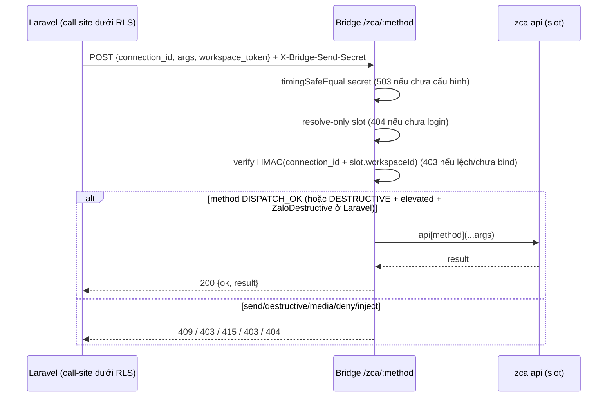
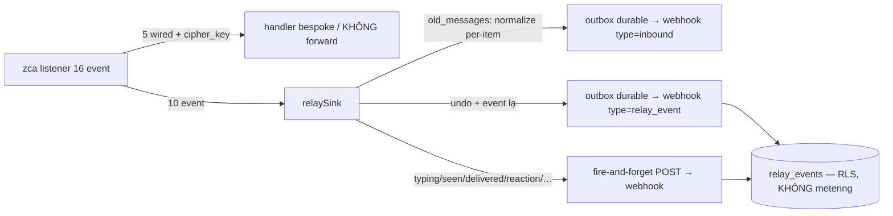

# Zalo Generic Dispatcher + Relay Forwarder (adapter L1)

Module: messaging · Status: live · Updated: 2026-07-04

## Purpose

Sở hữu 100% bề mặt zca-js (146 REST method / 16 listener event) bằng cơ chế **generic** thay vì hand-wire từng API: (1) **dispatcher** `POST /zca/:method` trên bridge — allowlist reflection + gate tier; (2) **relay forwarder** — subscribe 10 event chưa có handler bespoke, forward về Laravel lưu `relay_events` (không vứt event nào — H1). Nâng zca-js → method/event mới **tự lộ**, method chưa phân tier bị test snapshot chặn build (M1). Nguồn tier: [zca-capability-map](./zca-capability-map.md).

## Actors & permissions

| Actor | Quyền | Phạm vi |
|---|---|---|
| Laravel call-site (tương lai: controller expose READ/action) | resolve `ZaloConnection` **dưới tenant RLS** (CẤM `pgsql_privileged` đường dispatcher — audit B1) | mọi method DISPATCH_OK |
| Laravel call-site destructive | `TenantPermission::ZaloDestructive` (`tenant.zalo.destructive`) — gate TRƯỚC khi gọi bridge, tách khỏi `ZaloManage` (H4/A-V3) | 39 method DESTRUCTIVE, kèm header `X-Bridge-Elevated-Secret` |
| Bridge (defense-in-depth) | `X-Bridge-Send-Secret` (timing-safe) + token workspace B1 + elevated secret riêng | không thay quyền Laravel |

## Trigger / entry points

- **Dispatcher**: `POST {bridge}/zca/:method` body `{connection_id, args: [...], workspace_token}` — `services/zalo-bridge/src/routes/zca-dispatch.mjs:registerZcaDispatchRoutes`.
- **Forwarder**: tự attach khi listener start (`src/index.mjs:startListenerForSlot` → `src/relay-forwarder.mjs:attachRelayForwarder`), đúng 1 lần/api instance (`slot.forwarderAttached`).
- **Webhook nhận relay**: `POST /api/integrations/zalo-personal/webhook` type `relay_event` (hoặc type lạ) → `ZaloPersonalWebhookController::handleRelayEvent`.
- **Bind workspace**: `ZaloConnectionController::promote` gửi `workspace_id` (từ session) → bridge lưu `slot.workspaceId` + meta file (khôi phục qua `tryLoginWithSavedSession`).

## Operational flow

### Dispatcher `POST /zca/:method`

1. Auth `X-Bridge-Send-Secret` — `timingSafeEqual`, secret rỗng → 503 fail-closed (M3).
2. Resolve slot **resolve-only** — chưa login → 404, KHÔNG get-or-create (M2).
3. **B1 token-từ-session**: verify `workspace_token == HMAC_SHA256("{connection_id}:{slot.workspaceId}", BRIDGE_SEND_SECRET)`. Slot chưa bind workspace → 403 `workspace_binding_missing`; token lệch → 403 `workspace_token_mismatch`. Control CHÍNH vẫn là RLS `zalo_connections` phía Laravel (call-site sai workspace không SELECT nổi connection); token chỉ là defense-in-depth, derive từ **session**, KHÔNG từ connection row.
4. Rate-limit per-connection (120 req/60s) → 429.
5. Elevated = header `X-Bridge-Elevated-Secret` khớp `BRIDGE_ELEVATED_SECRET` (rỗng = không bao giờ elevated).
6. `invokeMethod(api, allowlist, method, args, {elevated})` — allowlist reflect own-property (146), cache trên slot:
   - ngoài allowlist / injection (`__proto__`, `constructor`…) → **404** `METHOD_NOT_ALLOWED`
   - DENY (`custom`, `getCookie`, `getContext`) → **403** `METHOD_DENIED`
   - 6 OUTBOUND send (`sendMessage`…) → **409** `OUTBOUND_USE_SEND_ENDPOINT` (send giữ `/personal-messages/send` — outbox + echo dedup + metering F14)
   - 39 DESTRUCTIVE không elevated → **403** `DESTRUCTIVE_DENIED`
   - 6 MEDIA + `getFullAvatar` → **415** `MEDIA_SPECIAL_ONLY` (KHÔNG có route `/zca-media` generic — MED-1; media send dùng `/send/attachment` sẵn có)
   - args không phải array → **400**; mang field file (`path`/`attachments`…) → **400** `FILE_REF_FORBIDDEN`; > 64KB → **413**
7. OK → `{ok: true, result}`.

### Relay forwarder (16 − 5 wired − cipher_key = 10 event)

1. Login/promote → `startListenerForSlot` attach 5 handler bespoke (giữ nguyên) rồi `attachRelayForwarder` (guard `slot.forwarderAttached`).
2. Event đến → `relaySink` phân lane:
   - `old_messages` (B5): array N tin → per-item normalize qua `buildGroupBackfillPayload` (group `thread_type=1`, 1-1 `thread_type=0`), `source_id = msgId` thật (`deriveInboundSourceId`) → **outbox durable**, đi đường inbound thường → dedup chung live (MED-3).
   - `undo`: envelope `relay_event` + `source_id` → **outbox durable** (đổi DB — ẩn tin ma).
   - chatty (`typing`, `seen_messages`, `delivered_messages`, `reaction`, `old_reactions`, `upload_attachment`, `connected`, `disconnected`): **fire-and-forget** POST thẳng (ký secret), lỗi bỏ qua — KHÔNG outbox (H3 chống nghẽn FIFO).
   - event lạ (zca version mới): durable (H1).
3. Laravel webhook: `relay_event`/type lạ → `insertOrIgnore` vào `relay_events` (idempotent theo `source_id`), **KHÔNG metering**.

## Data touched

- **`relay_events`** (INSERT, idempotent): `workspace_id` (RLS ENABLE+FORCE `ws_isolation`), `channel_account_id`/`connection_id` (resolve privileged tối thiểu như P04), `event_type`, `personal_uid`, `source_id`, `payload` jsonb (KHÔNG bao giờ chứa `cipher_key` — B6 chặn từ bridge), `received_at`. Unique partial `(workspace_id, event_type, source_id) WHERE source_id IS NOT NULL`.
- **`messages`/`conversations`** (qua đường inbound thường): chỉ từ `old_messages` normalize — dedup `source_id`.
- **`channel_usage` (metering): KHÔNG đụng** — test enforce.
- Bridge slot meta file: `workspace_id` bind lúc promote (persist qua restart).

## State transitions

Không đổi state machine nào. `relay_events` là append-only (chưa có consumer product — undo/seen xử lý sâu hơn là phase sau).

## Business rules applied

- **B1** cross-tenant: RLS `zalo_connections` control chính + audit call-site (report `audit-callsite-b1-2026-07-04.md`) + token-từ-session (LAB 2-slot: token W1 trên slot W2 → 403).
- **B2/H4**: 39 DESTRUCTIVE gate `ZaloDestructive` ở Laravel + elevated secret ở bridge.
- **B3**: né 5 event wired → không double-ingest (test no-double `message`).
- **B4**: 6 OUTBOUND → 409, send giữ đường riêng (metering F14 nguyên vẹn).
- **B5**: old_messages per-item + `source_id=msgId` → dedup chung live.
- **B6**: `cipher_key` không bao giờ rời bridge.
- **H1**: không drop im lặng — mọi event lạ vào `relay_events`.
- **H2**: envelope luôn đủ `connection_id` (chống 400 dead-letter poison).
- **H3**: chatty không đi outbox durable.
- **F1/F14**: `relay_events` KHÔNG tính metering.
- **M1**: snapshot 146 method — method mới chưa phân tier → test fail build.

## Edge cases & error handling

- Slot chưa re-promote sau khi nâng cấp (thiếu `workspace_id` meta) → dispatcher 403 fail-closed cho tới khi quét QR promote lại; 4 route cũ + send KHÔNG ảnh hưởng.
- Bridge restart → `tryLoginWithSavedSession` khôi phục `slot.workspaceId` từ meta; allowlist cache build lại lazy ở request đầu.
- Webhook down khi event chatty → mất (chấp nhận — trạng thái, không phải dữ liệu); undo/old_messages giữ trong outbox retry.
- `relay_events` phình (chatty rate cao) → spike đo rate (P09 pending) trước khi bật consumer; TTL/prune là việc sau.
- Payload không JSON-serializable (cyclic) → `payload=null`, sink không bao giờ ném ngược vào emitter.
- Relogin tái dùng listener → guard `forwarderAttached` chống attach lần 2 (MED-2).

## Related

- [zca-capability-map](./zca-capability-map.md) — tier 146 method / 16 event (nguồn sự thật).
- [zalo-personal-inbox](./zalo-personal-inbox.md) — đường inbound thường; [outbound-send](./outbound-send.md) — đường send riêng.
- Plan + evidence: `plans/260704-inbox-multichannel-relayer/` (phase-10/11/12, reports `lab-*`, `redteam-*`, `audit-callsite-b1-*`, `lab-2slot-b1-evidence-*`).
