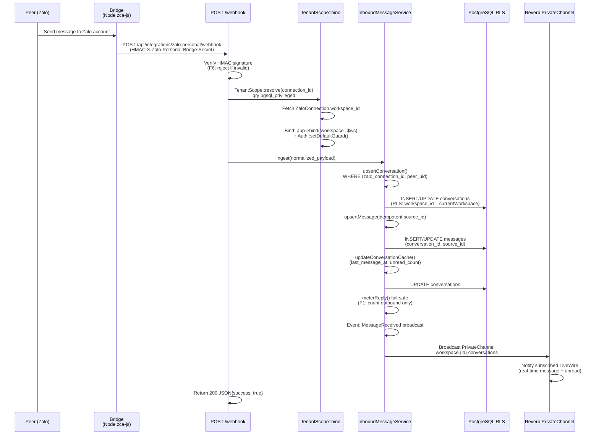

# Zalo Personal Inbox

Module: `inbox` + `channel-zalo` · Status: live (GĐ1) · Updated: 2026-06-28

## Purpose

Accept inbound personal Zalo messages via webhook, create Conversation + Message records in real-time, bind workspace scope safely from connection ID, broadcast to LiveWire realtime subscribers for instant UI update, and queue inbound for CDP dedup (Phase-08).

**Value:** Tenants capture leads from Zalo personal conversations in a unified inbox without needing separate Zalo OA setup (phase 1 positioning).

## Actors & permissions

- **Tenant admin** (workspace owner) — configure Zalo personal connection via QR login, view unified inbox, read conversation threads.
- **Workspace member** with `lead.view` / `lead.manage` → can read/reply in conversations matching team visibility.
- **Bridge service** (Node.js zca-js client) — acts as system actor, sends webhook POST when peer messages arrive.

Link: [crm-authorization-model.md](../crm-authorization-model.md) § Inbox scope.

## Trigger / entry points

**Inbound webhook** `POST /api/integrations/zalo-personal/webhook`:
- Bridge sends HMAC-signed payload when peer messages arrive.
- Code: `app/Http/Controllers/Integration/ZaloPersonalWebhookController.php::handle()`.
- Route: `routes/api.php`.

**Entrypoint in bridge:**
- Bridge (Node zca-js) receives message event from Zalo client → normalizes → POST to webhook with `X-Zalo-Personal-Bridge-Secret` header.

## Operational flow (step-by-step)

**Steps:**
1. Bridge calls webhook with normalized payload + HMAC header.
2. Webhook verifies HMAC (F6 security).
3. Webhook resolves workspace from `connection_id` via privileged query to `zalo_connections`.
4. Webhook **binds workspace scope** (`TenantScope::bind()`) to app container before processing (critical: chokes RLS leak F11).
5. Webhook calls `InboundMessageService::ingest()` with normalized peer/message data.
6. Service upserts Conversation idempotent on `(zalo_connection_id, peer_uid)` (F2).
7. Service upserts Message idempotent on `(conversation_id, source_id)` (F14: fail-safe direction='in' default).
8. Service updates Conversation cache (last_message_at, unread_count atomic increment F16).
9. Service calls `meterReply()` fail-safe (F1: only count outbound, inbound always accepted per F13/F20).
10. Event broadcasts via Reverb PrivateChannel `workspace.{id}.conversations` for real-time UI (F22).
11. Webhook returns HTTP 200 to bridge (ACK to prevent bridge retry).

## Data touched

**Models:**
- `Conversation` (app/Models)
  - Reads: zalo_connection_id, peer_uid (composite lookup)
  - Writes: channel, peer_uid, peer_name, peer_avatar_url, peer_phone, conversation_number, last_message_at, last_message_preview, unread_count, contact_id (null for draft)
  - RLS: `workspace_id` global scope enforced
  - Sequence: `WorkspaceSequence::next('conversation')` for conversation_number

- `Message` (app/Models)
  - Reads: conversation_id, source_id (idempotency key)
  - Writes: direction ('in'/'out'/'echo'), type, body, media_url, media_meta, platform_sent_at, sender_uid, sender_name, sent_by
  - RLS: inherited via conversation FK

- `ZaloConnection` (app/Models)
  - Reads: connection_id → workspace_id (privileged query, bypasses RLS)
  - No writes in inbound

**RLS scoping:**
- Webhook query `ZaloConnection` WITHOUT RLS (uses pgsql_privileged role) to resolve workspace from connection_id.
- After TenantScope bind, all Conversation/Message writes enforce workspace RLS at DB level.
- If connection lookup fails → 403 Unauthorized (no workspace found).

## State transitions

None — inbound conversations start in "open" state. Conversation.contact_id = null until CDP dedup (Phase-08) or tenant links to contact.

## Business rules applied

- **F2 (Dedup inbound per peer):** Conversation unique per (zalo_connection_id, peer_uid) per workspace. Same peer → same conversation thread.
- **F13/F20 (Always accept inbound):** Inbound messages NEVER blocked by quota, regardless of billing plan. Preserves lead capture.
- **F14 (Fail-safe direction):** If webhook payload missing `direction` field → default to `in` (not `out`); prevents accidental outbound counting.
- **F6 (Webhook auth):** HMAC signature required; reject unsigned payloads (prevents spoofing).
- **F11 (RLS scope-binding):** Webhook binds workspace BEFORE touching conversation data; unscoped query to ZaloConnection via privileged role (no RLS leak).

Link: [crm-business-rules.md](../crm-business-rules.md) § Inbox.

## Edge cases & error handling

| Scenario | Behavior |
|---|---|
| **HMAC signature invalid** | Return 403 Unauthorized, log rejection. |
| **connection_id not found** | Return 403 Unauthorized, log missing connection. |
| **Duplicate source_id** (retry from bridge) | Message::updateOrCreate() idempotent → no-op, return existing message. |
| **Peer phone null** | Conversation records peer_phone = null; CD dedup later fails gracefully (requires phone to resolve contact). |
| **Peer avatar too large** | No processing on FE; avatar_url stored as-is (FE lazy-loads, handles image errors). |
| **Bridge timeout (15s)** | Webhook returns 504 to bridge, bridge retries; no Message created (fail-safe F13). |
| **RLS violation during write** | PostgreSQL returns permission error; webhook catches, returns 500 to bridge; message lost (acceptable per F13 "always retry inbound"). |
| **Metering gate error** | Fail-safe: lỗi gate KHÔNG chặn inbound (line 65 `try/catch` in InboundMessageService). |

## Related

- [conversation-to-lead.md](./conversation-to-lead.md) — convert inbound conversation to Lead with CDP dedup.
- [outbound-send.md](./outbound-send.md) — reply to conversation via ZaloSendService (outbound metering).
- [system-architecture.md](../system-architecture.md) § Inbox + Zalo Channel + Integration Driver Pattern.
- [crm-business-rules.md](../crm-business-rules.md) § F2, F6, F11, F13, F14, F20.
