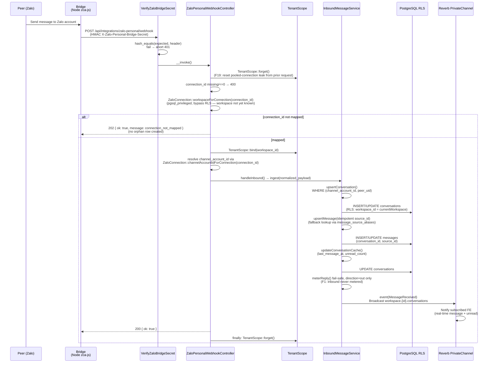

# Zalo Personal Inbox

Module: `app/Modules/Integration/Chat/ZaloPersonal` + `app/Services` (plain Laravel — no `modules/` directory since the 2026-06-28 refactor) · Status: live (GĐ1) · Updated: 2026-07-04

> **04/07 — Inbox full messaging framework (P01a→P12):** inbox nâng từ text-only lên module nhắn tin đầy đủ — media composer, quote/reaction/sticker, message-state (recalled/receipts/reactions/typing), phone enrichment, CRM layer, seen-sync (OFF), khung omnichannel ĐÓNG BĂNG qua `OutboundSendPipeline` + `ChannelCapabilities`. Chi tiết: [README index](./README.md) + `channel-framework-contract.md`.

## Purpose

Accept inbound personal Zalo messages via webhook, create Conversation + Message records in real-time, bind workspace scope safely from the connection, broadcast to Reverb realtime subscribers for instant UI update, and hand off to CDP dedup on demand ([conversation-to-lead.md](./conversation-to-lead.md)).

**Value:** Tenants capture leads from Zalo personal conversations in a unified inbox without needing separate Zalo OA setup (phase 1 positioning).

## Actors & permissions

- **Tenant admin** (workspace owner) — configure Zalo personal connection via QR login, view unified inbox, read conversation threads.
- **Workspace member** with `lead.view` / `lead.manage` → can read/reply in conversations matching team visibility.
- **Bridge service** (Node.js zca-js client) — acts as system actor, sends webhook POST when peer messages arrive.

Link: [crm-authorization-model.md](../crm-authorization-model.md) § Inbox scope.

## Trigger / entry points

**Inbound webhook** `POST /api/integrations/zalo-personal/webhook`:
- Bridge sends HMAC-signed payload when peer messages arrive.
- Code: `app/Http/Controllers/Integration/ZaloPersonalWebhookController.php::__invoke()`.
- Route: `routes/api.php`. Middleware: `VerifyZaloBridgeSecret` (alias `zalo.bridge.secret`).

**Entrypoint in bridge:**
- Bridge (Node zca-js) receives message event from Zalo client → normalizes → POST to webhook with `X-Zalo-Personal-Bridge-Secret` header.

## Operational flow (step-by-step)

**Steps:**
1. Bridge calls webhook with the raw bridge payload + HMAC header + `connection_id`.
2. `VerifyZaloBridgeSecret` middleware verifies HMAC via `hash_equals` — invalid/missing header or unconfigured secret → `abort(401)` before the controller runs.
3. Controller resets any leaked RLS scope (`TenantScope::forget()`, F19), then resolves workspace from `connection_id` via `ZaloConnection::workspaceForConnection()` (queries `pgsql_privileged`, bypassing RLS since the workspace isn't known yet).
4. Unmapped `connection_id` → `202 { message: connection_not_mapped }` — no conversation/message created, no error surfaced to bridge (avoids orphan rows and unnecessary bridge retries).
5. Mapped → `TenantScope::bind($workspaceId)`, then `channel_account_id` is resolved separately (`ZaloConnection::channelAccountIdForConnection($connectionId)`) purely to key the conversation upsert — it plays no role in workspace resolution.
6. `InboundMessageService::ingest()` upserts Conversation idempotent on `(channel_account_id, peer_uid)` (F2) — stable key across reconnects.
7. Service upserts Message idempotent on `(conversation_id, source_id)`, falling back to `message_source_aliases` lookup for pre-rekey source_id formats (F14: fail-safe direction='in' default).
8. Service updates Conversation cache (last_message_at, unread_count atomic increment F16).
9. Service calls `meterReply()` in a try/catch, only for `direction='out'` (F1: inbound is never metered — see [conversation-metering.md](./conversation-metering.md)).
10. Event broadcasts via Reverb PrivateChannel `workspace.{id}.conversations` for real-time UI.
11. Webhook returns HTTP 200 to bridge (ACK — removes the message from the bridge's outbox).

## Data touched

**Models:**
- `Conversation` (app/Models)
  - Reads: `channel_account_id`, `peer_uid` (composite lookup, stable across reconnects)
  - Writes: channel, peer_uid, peer_name, peer_avatar_url, peer_phone, conversation_number, last_message_at, last_message_preview, unread_count, contact_id (null for draft), stream_version
  - RLS: `workspace_id` global scope enforced
  - Sequence: `WorkspaceSequence::next('conversation')` for conversation_number

- `Message` (app/Models)
  - Reads: conversation_id, source_id (idempotency key; falls back to `message_source_aliases` for pre-rekey formats)
  - Writes: direction ('in'/'out'/'echo'), type, body, media_url, media_meta, platform_sent_at, sender_uid, sender_name, sent_by
  - RLS: inherited via conversation FK

- `ZaloConnection` (app/Models)
  - Reads: `connection_id` → `workspace_id` (`workspaceForConnection()`, via `pgsql_privileged`); `connection_id` → `channel_account_id` (`channelAccountIdForConnection()`, same connection)
  - No writes in the `inbound` event path (writes happen in `bridge_session` — see `handleBridgeSession()`)

- `ChannelAccount` (app/Models) — new in this rekey
  - Not read/written directly by the inbound path; `channel_account_id` is looked up through `ZaloConnection`, not `ChannelAccount` itself.

**RLS scoping:**
- Webhook resolves workspace via `ZaloConnection` on the `pgsql_privileged` connection (bypasses RLS — no workspace context exists yet).
- After `TenantScope::bind()`, all Conversation/Message writes enforce workspace RLS at DB level.
- `TenantScope::forget()` runs both defensively at request start (F19: guard against a leaked scope from a prior request on a pooled connection) and in a `finally` block at request end.

## State transitions

None — inbound conversations start in "open" state. `Conversation.contact_id` stays null until a tenant converts it to a Lead ([conversation-to-lead.md](./conversation-to-lead.md)).

## Business rules applied

- **F2 (Dedup inbound per peer):** Conversation unique per `(channel_account_id, peer_uid)` — stable across reconnects (partial unique index, `deleted_at IS NULL`). Same peer → same conversation thread.
- **F13/F20 (Always accept inbound):** Inbound messages are never routed through any metering gate at all (not merely "fail-safe" — `direction='in'` skips `meterReply()` entirely). Preserves lead capture unconditionally (quota enforcement removed as of 2026-07-25).
- **F14 (Fail-safe direction):** If webhook payload is missing `direction` → defaults to `in`; prevents accidental outbound counting.
- **F6 (Webhook auth):** HMAC signature required at the middleware layer; unsigned/invalid payloads never reach the controller.
- **F11/F19 (RLS scope-binding):** Workspace resolved and bound BEFORE touching conversation data; scope explicitly reset both before and after the request to prevent leaking across pooled connections.

Link: [crm-business-rules.md](../crm-business-rules.md) § Inbox.

## Edge cases & error handling

| Scenario | Behavior |
|---|---|
| **HMAC signature invalid/missing/unconfigured** | Middleware aborts `401` before the controller runs. |
| **`connection_id` missing or `<= 0`** | `400 { message: missing connection_id }`. |
| **`connection_id` not mapped to a workspace** | `202 { message: connection_not_mapped }` — no orphan conversation/message, bridge does not retry (F13 always-accept still holds — the message is dropped only because there is no tenant to attribute it to). |
| **Duplicate `source_id`** (bridge retry) | `InboundMessageService` idempotent upsert on `(conversation_id, source_id)`, with `message_source_aliases` fallback for pre-rekey formats → no-op, returns existing message, still `200`. |
| **Transient DB error** (`QueryException`/`PDOException`, e.g. deadlock, connection down) | `503 { message: transient_db_error }` → bridge outbox retries with backoff. |
| **Malformed/permanently-invalid payload** (`InvalidArgumentException`, e.g. driver can't parse) | `422 { message: permanent_bad_payload }` → bridge dead-letters, does not retry forever. |
| **Any other unhandled exception** | `503 { message: unexpected_error }` → treated as retry-safe rather than silently dropping the message. |
| **Metering error during `direction='out'`** | Fail-safe: caught in `InboundMessageService::ingest()` — message still persisted and broadcast regardless (F13/F20). No quota gate to block on. |

## Related

- [conversation-to-lead.md](./conversation-to-lead.md) — convert inbound conversation to Lead via `ConversationLeadController`.
- [outbound-send.md](./outbound-send.md) — reply to conversation via `ZaloSendService` (outbound metering).
- [channel-account-architecture.md](./channel-account-architecture.md) — account-keyed identity model this flow relies on.
- [system-architecture.md](../system-architecture.md) § Inbound Message (Webhook).
- [crm-business-rules.md](../crm-business-rules.md) § F2, F6, F11, F13, F14, F19, F20.
