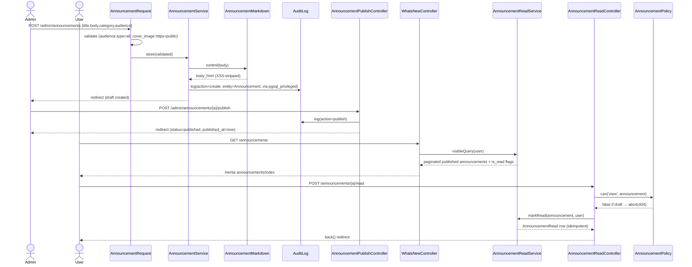

# Product Announcements / What's New

Module: Platform (Cross-Cutting) · Status: live · Updated: 2026-06-15

## Purpose

Platform staff publish global product announcements (new features, improvements, fixes, maintenance notices). Tenant users see an in-app feed ("What's New") with an unread-badge counter. Read state is per-user and global — once read in any workspace context the badge clears everywhere. This satisfies the customer-facing changelog requirement without coupling the system to workspace-scoped data access.

Related actor story: [crm-actors-and-use-cases.md](../../crm-actors-and-use-cases.md) — Platform staff / "Announce product updates".

## Actors & permissions

| Actor | Action | Guard | Permission |
|---|---|---|---|
| Super-admin (or future `product` role) | Full CRUD + publish/unpublish | `admin` | `platform.announcements.manage` |
| Tenant user (any workspace) | Read feed, mark as read | `web` | Authenticated + published announcement |
| Guest / unauthenticated | — | — | Redirected to login |

Permission assignment: `super_admin` role (admin guard) → `platform.announcements.manage`. Seeded via migration `2026_06_14_120003_seed_announcement_permission.php`.

Authorization model: [crm-authorization-model.md](../../crm-authorization-model.md).

## Trigger / entry points

**Admin plane (CRUD)**

| Action | Route | Controller |
|---|---|---|
| List | `GET /admin/announcements` | `Admin\AnnouncementController@index` |
| Create form | `GET /admin/announcements/create` | `Admin\AnnouncementController@create` |
| Store | `POST /admin/announcements` | `Admin\AnnouncementController@store` |
| Edit form | `GET /admin/announcements/{a}/edit` | `Admin\AnnouncementController@edit` |
| Update | `PATCH /admin/announcements/{a}` | `Admin\AnnouncementController@update` |
| Delete | `DELETE /admin/announcements/{a}` | `Admin\AnnouncementController@destroy` |
| Publish | `POST /admin/announcements/{a}/publish` | `Admin\AnnouncementPublishController@publish` |
| Unpublish | `DELETE /admin/announcements/{a}/unpublish` | `Admin\AnnouncementPublishController@unpublish` |

All admin routes are gated by `admin.can:platform.announcements.manage` middleware + `AnnouncementRequest::authorize()` re-checking on the admin guard.

**Tenant plane (read)**

| Action | Route | Controller |
|---|---|---|
| Feed (What's New page) | `GET /announcements` | `WhatsNewController` |
| Mark as read | `POST /announcements/{announcement}/read` | `AnnouncementReadController` |

## Operational flow (step-by-step)

### Admin: Create & Publish

1. Super-admin submits form → `AnnouncementRequest` validates (title, body, category, audience `type=all` v1 lock, optional `cover_image` must be https + public IP).
2. `AnnouncementController::store()` calls `AnnouncementService::store()`:
   - Sets `created_by = auth('admin')->id()` (server-controlled).
   - Generates `slug` from title (unique, suffix on collision).
   - Calls `AnnouncementMarkdown::toHtml($body)` → CommonMark + HTML purifier (XSS strip). Writes `body_html`.
   - Status defaults to `draft`.
3. Audit entry written via `Auditable` trait on the model → `Audit::log()` → `AuditLog::on('pgsql_privileged')::forceCreate()` (admin-plane writes bypass RLS).
4. Admin publishes via separate action → `AnnouncementPublishController::publish()`:
   - Wraps in DB transaction.
   - Sets `status = published`, `published_at = now()`.
   - Writes another audit entry (action `publish`).

### Tenant: Read feed

1. Tenant user GETs `/announcements` → `WhatsNewController`.
2. Controller calls `AnnouncementReadService::visibleQuery($user)`:
   - `status = published AND published_at <= now() AND audience->>'type' = 'all'`.
3. Paginates 15 per page. Collects page IDs → single query for user's read rows (`AnnouncementRead WHERE user_id = ? AND announcement_id IN (...)`).
4. Maps each announcement to shape including `is_read` flag (O(1) from flipped collection). Returns Inertia page `announcements/index`.

### Tenant: Mark as read

1. Tenant user POSTs `/announcements/{announcement}/read`.
2. `AnnouncementReadController`:
   - `abort_unless($user->can('view', $announcement), 404)` → `AnnouncementPolicy::view()` returns false for drafts → **404 not 403** (BR-X15 non-enumeration).
   - Calls `AnnouncementReadService::markRead($announcement, $user)`.
3. `markRead`: checks existing row first (idempotent), then `AnnouncementRead::forceCreate([announcement_id, user_id, read_at])`. `user_id` is always `auth()->id()` — never from request body (BR-X12 IDOR guard).
4. Returns `back()` redirect.

### Unread badge (shared props)

`HandleInertiaRequests::share()` calls `AnnouncementReadService::getUnreadCount($user)` → same `unreadQuery()` SSOT → injected into every Inertia response as `unreadAnnouncementCount`.



## Data touched

| Table | Operation | Notes |
|---|---|---|
| `announcements` | R/W | Global — no `workspace_id`. `slug` unique. `body_html` server-computed. `status/published_at/created_by/updated_by` server-controlled (outside `$fillable`). |
| `announcement_reads` | R/W | Global — no `workspace_id`. `user_id` always from `auth()->id()`. `$guarded = ['*']`; `forceCreate` via `AnnouncementReadService` only. |
| `audit_logs` | W | Admin-plane entries via `pgsql_privileged` (bypasses RLS). `entity_type = App\Models\Announcement`. |

## State transitions

```
draft ──publish──► published
published ──unpublish──► draft
```

Guards:
- Only a `platform.announcements.manage` admin can publish/unpublish.
- `published_at` set to `now()` on publish; cleared to `null` on unpublish.
- Both transitions are atomic (wrapped in DB transaction).

## Business rules applied

- **BR-X12** — `user_id` in `announcement_reads` always from `auth()->id()`, never request body. `AnnouncementReadService::markRead()` is the only write path; `AnnouncementRead` model has `$guarded = ['*']`.
- **BR-X15** — Draft non-enumeration: `AnnouncementPolicy::view()` returns `false` for drafts; controllers call `abort_unless(..., 404)` not `403`. Tenant cannot distinguish "does not exist" from "is a draft".
- **v1 audience lock** — `audience.type` must be `all`. `by_plan`, `by_entitlement`, `workspace_filter` rejected by `AnnouncementRequest` validation (future extension point, no DB changes needed).
- **SSRF guard** — `cover_image` must be `https` and resolve to a public IP (private ranges 10.x, 172.16-31.x, 192.168.x blocked at validation).
- **XSS guard** — `body_html` is always the output of `AnnouncementMarkdown::toHtml()` which runs CommonMark + HTML purifier. `<script>` tags and event-handler attributes (`onerror`, `onclick`, etc.) are stripped.
- **Idempotent reads** — `markRead` checks for existing row before `forceCreate`. Two consecutive POST requests produce exactly one `announcement_reads` row.

## Edge cases & error handling

| Scenario | Behavior |
|---|---|
| Mark-read on draft | `AnnouncementPolicy::view()` → false → `abort(404)` — non-enumeration |
| Mark-read twice | `markRead` returns existing row; no duplicate insert |
| Future `published_at` | Excluded by `scopePublished` (`published_at <= now()`); not visible in feed or badge count |
| `cover_image` with private IP | `AnnouncementRequest` validation rejects with `cover_image` error |
| Slug collision | `AnnouncementService` appends `-2`, `-3`, etc. until unique |
| Admin writes in test | `Audit::log()` via `pgsql_privileged` — outside `DatabaseTransactions` wrapper; persists after test rollback; query with `DB::table('audit_logs')` using `entity_type = App\Models\Announcement` |
| Cross-workspace read | Read state is global; marking read in workspace A removes badge in workspace B (no `workspace_id` on `announcement_reads`) |

## Related

- [crm-authorization-model.md](../../crm-authorization-model.md) — Two-plane auth, admin guard, `platform.announcements.manage`
- [crm-business-rules.md](../../crm-business-rules.md) — BR-X12 (IDOR), BR-X15 (non-enumeration)
- [system-architecture.md](../../system-architecture.md) — §3.7 global tables, §9c cross-cutting foundations
- [features/README.md](../README.md) — Module 3 index
- `app/Models/Announcement.php` — Global model (HasFactory, Auditable, HasUuids, SoftDeletes)
- `app/Models/AnnouncementRead.php` — Global model ($guarded = ['*'])
- `app/Services/AnnouncementReadService.php` — SSOT for all unread queries
- `app/Support/Markdown/AnnouncementMarkdown.php` — XSS-safe markdown pipeline
- `database/migrations/2026_06_14_120003_seed_announcement_permission.php` — Permission seeding (migration, not seeder, for test DB)
