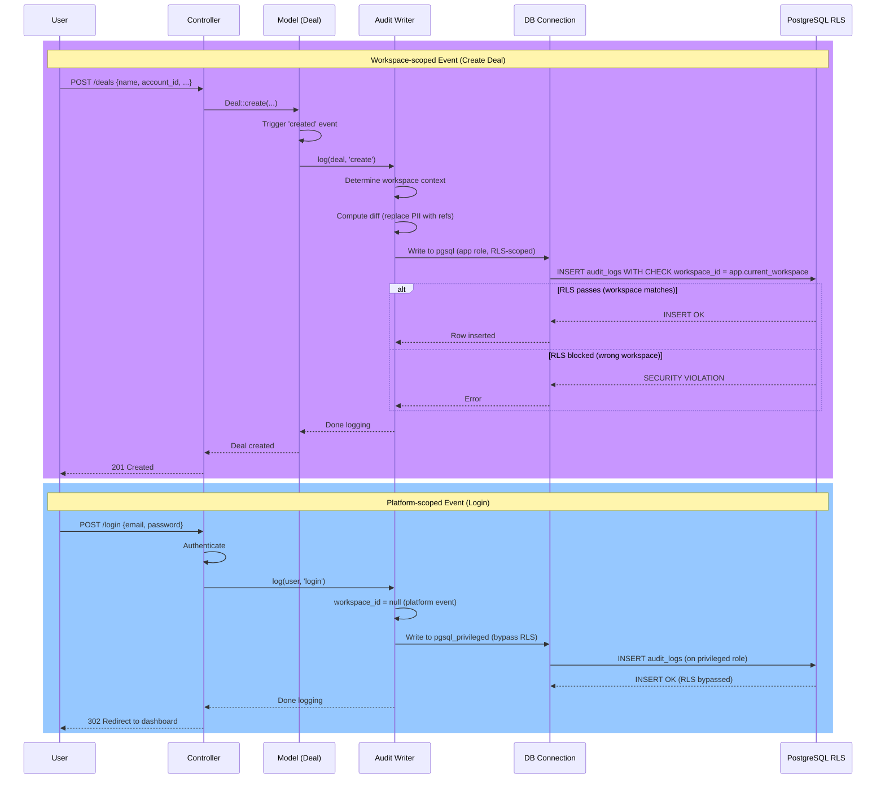

# Audit Log (Append-Only History)

Module: Platform · Status: live · Updated: 2026-06-15

## Purpose

Records an immutable history of all changes to core entities: create, update, delete, owner/role changes, and security events (login, impersonation, export, GDPR erasure). Audit entries are **append-only** and **PII-minimized**: sensitive fields (name, email, phone) are referenced by ID rather than copied verbatim, so PII can be erased at source without rewriting history. Implements BR-X05 (audit log), BR-X07 (PII handling), and audit §7 in architecture.

## Actors & permissions

- **System** (app) — writes audit entries when models change or security events occur.
- **Audit writers** — use a privileged DB connection (`pgsql_privileged`) for Platform plane events (login, impersonation, audit events with no workspace).
- **Audit readers** — workspace admins can query audit logs for their workspace (read-only).

See [crm-authorization-model.md](../../crm-authorization-model.md) and [crm-business-rules.md](../../crm-business-rules.md) BR-X05, X07.

## Trigger / entry points

**Automatic triggers:**
- Model created → `Audit::log($model, 'create')` called (framework integration, deferred to feature implementations).
- Model updated → `Audit::log($model, 'update')` called (framework integration, deferred).
- Model deleted (soft) → `Audit::log($model, 'delete')` called.
- Owner reassigned → `Audit::log($model, 'ownership_changed')` called (BR-X03).
- Role/permission changes → spatie observer (deferred) → `Audit::log()`.
- Login attempt → auth listener → `Audit::log()`.
- Impersonation (platform staff) → `Audit::log()` (deferred to authorization module).
- Data export → export controller → `Audit::log()`.
- GDPR erasure → service → `Audit::log()`.

**Code references:**
- `app/Support/Audit/Audit.php:log()` — main writer.
- `app/Models/AuditLog.php` — immutable model (no update/delete).
- `database/migrations/*/100010_create_audit_logs_table.php` — schema.
- `database/sql/setup-roles.sql` — privilege grants (app role: INSERT only on audit_logs).

## Operational flow (step-by-step)

### Workspace-scoped Event (e.g., Deal Created)

1. **Controller action creates a Deal** (future Sales module):
   - `$deal = Deal::create(['name' => '...', ...])`.
   - Model `created` hook fires → `Audit::log($deal, 'create')`.

2. **Audit::log() called**:
   - Determines workspace context: `workspaceId = $model->workspace_id` or `currentWorkspace()->id`.
   - **If workspace-scoped** (`workspace_id !== null`):
     - Writes on the default connection (`pgsql`), which is RLS-scoped and app-owned.
     - Constructs audit entry:
       ```php
       [
           'workspace_id' => $workspaceId,
           'entity_type' => 'deal' (morph class),
           'entity_id' => $deal->id,
           'action' => 'create',
           'actor_id' => auth()->id(),
           'actor_type' => 'user',
           'changes' => $this->diff($model, 'create'),
           'context' => ['ip' => ..., 'user_agent' => ...],
           'occurred_at' => now(),
       ]
       ```
     - Inserts into `audit_logs` via `forceCreate()` (bypass fillable guards).
     - **RLS policy ensures** `workspace_id = current_setting('app.current_workspace')` is satisfied (matches the active workspace).

3. **PII handling**:
   - Model declares PII attributes: `auditPiiAttributes() → ['name', 'email', 'phone']`.
   - `Audit::diff()` replaces those field values with a reference:
     ```php
     // Before PII minimization:
     'changes' => ['email' => ['old' => 'john@old.com', 'new' => 'john@new.com']]
     
     // After PII minimization:
     'changes' => ['email' => ['ref' => $model->id]]
     // Actual email is on the Contact model, erasable separately
     ```
   - **Effect**: audit trail doesn't store PII verbatim; if PII is erased at source, history remains but references a tombstoned value.

### Platform-scoped Event (e.g., User Login)

1. **Auth listener fires on successful login**:
   - `Audit::log($user, 'login')`.

2. **Audit::log() called**:
   - Determines workspace context: `workspaceId = null` (user login is not workspace-scoped).
   - **If not workspace-scoped** (`workspace_id === null`):
     - Writes on the privileged connection (`pgsql_privileged`), which bypasses RLS.
     - Inserts the same entry structure (but no `workspace_id` field).
     - **Rationale**: Platform-plane events (login, impersonation, …) don't have a workspace context. The privileged connection is needed to write them (RLS would block them on the app connection).

### Query Audit Log

1. **Workspace admin requests audit log** (future module):
   - Controller: `AuditLog::where('workspace_id', currentWorkspace()->id)->orderBy('occurred_at', 'desc')->get()`.
   - Global scope on `AuditLog` automatically filters by workspace (inherited from `BelongsToWorkspace` trait — deferred).
   - RLS policy ensures only the active workspace's logs are visible.

2. **Frontend displays**:
   - Entity type, action, timestamp, actor, changes.
   - PII fields shown as "***" or "Redacted" (UI responsibility).



## Data touched

**Tables involved:**
- `audit_logs` — append-only history.

**Fields of `audit_logs` table:**
- `id` (UUID) — primary key.
- `workspace_id` (UUID, nullable) — scoped to workspace; null for Platform-plane events.
- `entity_type` (string) — morph class (e.g., 'deal', 'contact', 'user').
- `entity_id` (UUID/int) — primary key of the changed entity.
- `action` (enum: create, update, delete, ownership_changed, role_changed, login, export, erasure) — what happened.
- `actor_id` (int, nullable) — user who triggered the change; null for system/admin events.
- `actor_type` (enum: user, system, admin) — who acted.
- `actor_admin_id` (int, nullable) — set when an Admin performed the action (`actor_type = 'admin'`); see [admin plane](../admin/README.md).
- `impersonated_by_admin_id` (int, nullable) — set when an Admin made the change while impersonating a user (BR-X05); see [impersonation](../admin/impersonation.md).
- `changes` (JSONB) — diff: `{field: {old: ..., new: ...}}` or `{field: {ref: entity_id}}` for PII.
- `context` (JSONB, nullable) — request context: IP, user agent.
- `occurred_at` (timestamp) — when the change happened (not `created_at`; precise timing).

**Indexes:**
- `audit_logs(workspace_id, entity_type, entity_id, occurred_at desc)` — for "what happened to this record" queries.
- `audit_logs(workspace_id, actor_id, occurred_at desc)` — for "what did this user do" queries.

**Retention:**
- Per workspace: `workspaces.audit_retention` (e.g., 90 days, 7 years). Admin-driven purge job deletes older logs.

## State transitions

Audit is **append-only** — no updates, no deletes in normal operation.

| Phase | Event | Audit entry | PII handling |
|---|---|---|---|
| Record created | Model create | Entry logged; full data captured except PII (stored as refs) | PII on source record |
| Record updated | Model update | Entry logged; changed fields only | PII replaced by ref to entity_id |
| Record deleted | Soft delete | Entry logged (entity still visible if deactivated) | Reference only |
| PII erased (GDPR) | Erasure request | Erasure action logged; PII source value tombstoned | Source record's PII set to null; audit refs unchanged |

## Business rules applied

- **BR-X05**: Audit log — all CRUD + security events logged, append-only, immutability enforced at DB level.
- **BR-X07**: PII handling — sensitive fields referenced (not copied); source value erasure does not require audit rewrite.
- **BR-X01**: Tenant isolation — audit_logs table is workspace-scoped; RLS policy enforces isolation.

## Edge cases & error handling

| Scenario | Behavior |
|---|---|
| Audit write fails (DB error) | Exception propagates; the triggering action (e.g., model save) fails. **Rationale**: audit integrity is critical; fail-safe is better than silent loss. |
| Stale RLS context at audit time | RLS blocks the INSERT; auditing fails; action fails. (Mitigation: `ResetTenantContext` + `IdentifyWorkspace` ensure context is fresh.) |
| PII field declared but no `auditPiiAttributes()` method | No PII minimization applied; field stored verbatim in audit (suboptimal but safe). |
| Actor is null (system action) | `actor_id = null, actor_type = 'system'`. Searchable and filterable. |
| Workspace_id is null (Platform event) | Entry written on privileged connection; no RLS enforcement. Readable only by Platform staff. |
| Audit log retention expires | Scheduled job purges old entries. Permanent deletion; no recovery. |
| Admin queries audit log mid-request | Sees entries up to the DB snapshot; uncommitted changes from current request not yet visible (standard TX isolation). |

## Related

- [tenant-isolation.md](./tenant-isolation.md) — workspace scoping + RLS for audit isolation.
- [rbac-visibility.md](./rbac-visibility.md) — audit log read access (future module). |
- [crm-authorization-model.md](../../crm-authorization-model.md) — Platform plane (privileged connection, impersonation logging).
- [crm-business-rules.md](../../crm-business-rules.md) — BR-X05, X07 (PII handling).
- [system-architecture.md](../../system-architecture.md) — §7 (audit, soft-delete, concurrency), §9 (async jobs + audit).
- [`Audit` class](../../../app/Support/Audit/Audit.php)
- [`AuditLog` model](../../../app/Models/AuditLog.php)
- [`setup-roles.sql`](../../../database/sql/setup-roles.sql) — privilege grants.
