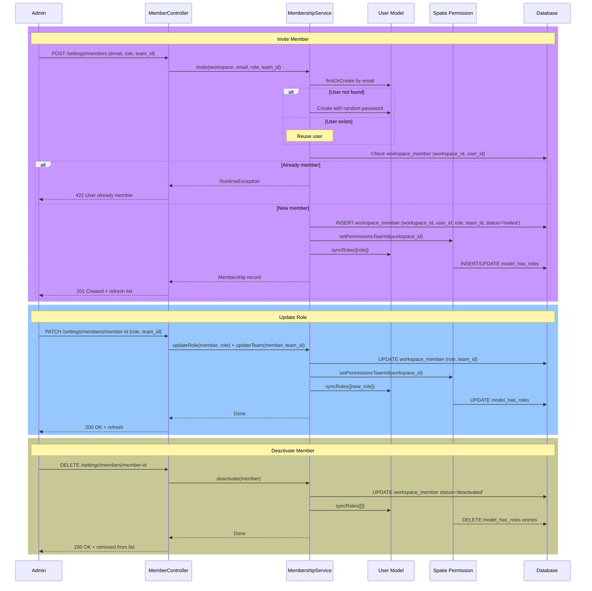

# Members (Workspace Membership)

Module: Platform · Status: live · Updated: 2026-06-13

## Purpose

Manages workspace members: inviting users, assigning roles and teams, deactivating members, and syncing roles with spatie permissions. A member is the **bridge between a global user and a workspace**, establishing identity, RBAC scope, and team assignment. Implements BR-X03 (reassignment), BR-X12 (role server-control), and integrates with spatie `laravel-permission` for role checks.

## Actors & permissions

- **Workspace admin** can invite, update roles/teams, and deactivate members.
- **Members** are invited by email; non-existent users are created automatically (status = `invited`; they must set a password on first login).
- **Deactivated members** lose access immediately and require active membership reassignment of their records.

See [crm-authorization-model.md](../../crm-authorization-model.md) BR-X03 and [crm-business-rules.md](../../crm-business-rules.md) for role definitions.

## Trigger / entry points

**UI entry point:**
- Settings → Members: `GET /settings/members` → `resources/js/pages/settings/members.tsx`

**API entry points:**
- `GET /settings/members` — list members in the workspace.
- `POST /settings/members` — invite a new member.
- `PATCH /settings/members/{member}` — update role or team.
- `DELETE /settings/members/{member}` — deactivate a member.

**Code references:**
- `app/Http/Controllers/Settings/MemberController.php` — CRUD handlers.
- `app/Services/MembershipService.php` — business logic for invite, role updates, deactivation.
- `app/Models/WorkspaceMember.php` — membership model.
- `app/Http/Requests/Settings/MemberInviteRequest.php` — validation for invite.
- `app/Http/Requests/Settings/MemberUpdateRequest.php` — validation for role/team updates.
- `resources/js/pages/settings/members.tsx` — React member list and form.

## Operational flow (step-by-step)

### Invite Member

1. **Admin navigates to Members** → sees list of existing members and an "Invite Member" button.

2. **Admin clicks "Invite"** → form appears with email, role dropdown, and optional team field.

3. **Admin enters email, selects role (e.g., "sales_rep"), optionally team** → submits form.

4. **POST /settings/members** with `{ email, role, team_id? }`:

5. **MemberController::store()**:
   - Validates via `MemberInviteRequest` (email required + valid format; role enum check; team_id optional + exists in workspace).
   - Calls `MembershipService::invite($workspace, $email, $role, $teamId)`.

6. **MembershipService::invite()** (transactional):
   - **Find or create global user**:
     - Looks up `users` table by email.
     - If not found, creates a new user with name derived from email (before @) and random password (status = `invited`, awaiting password reset).
     - If found, reuses the user.
   - **Check idempotency**: queries `workspace_member` for `(workspace_id, user_id)` pair.
     - If found, throws error: "User already a member of this workspace" (prevents duplicate).
   - **Create membership**:
     - Inserts `workspace_member` row: `(workspace_id, user_id, role, team_id, status = 'invited', invited_at)`.
     - Workspace_id auto-stamped by trait.
   - **Sync role with spatie**:
     - Calls `$user->syncRoles([$role])` within the workspace's team scope (via `PermissionRegistrar::setPermissionsTeamId($workspace_id)`).
     - spatie creates/updates `model_has_roles` entry for the user under the workspace team.
   - Returns the membership record.

7. **Frontend updates**: new member appears in the list with status "invited"; send email (deferred, not shown here).

### Update Member Role or Team

1. **Admin clicks edit icon on a member row** → form appears with role and team dropdowns.

2. **Admin changes role (e.g., "sales_rep" → "sales_manager")** and/or team, then submits.

3. **PATCH /settings/members/{member}** with `{ role, team_id? }`:

4. **MemberController::update()**:
   - Validates via `MemberUpdateRequest`.
   - Calls `MembershipService::updateRole($member, $role)` and/or `updateTeam($member, $teamId)`.

5. **MembershipService::updateRole()**:
   - Updates `workspace_member.role`.
   - Re-syncs spatie role: `$user->syncRoles([$role])` in the workspace scope.
   - **Result**: user's permissions are updated immediately (spatie checks use the new role).

6. **MembershipService::updateTeam()**:
   - Updates `workspace_member.team_id`.
   - **Result**: user's visibility scope is recomputed on next request (manager sees new subtree).

7. **Frontend updates**: row reflects new role and team.

### Deactivate Member

1. **Admin clicks "Deactivate" on a member** → confirmation dialog.

2. **Admin confirms** → `DELETE /settings/members/{member}`.

3. **MemberController::destroy()**:
   - Calls `MembershipService::deactivate($member)`.

4. **MembershipService::deactivate()**:
   - Sets `workspace_member.status = 'deactivated'`.
   - Removes all roles: `$member->user->syncRoles([])`.
   - **Deferred (Module 2+)**: open record reassignment (e.g., "move all your deals to Jane") is enforced by Sales/Support modules.
   - **Effect**: user can no longer log in to the workspace; next login attempt fails 403 (IdentifyWorkspace finds no active membership).

5. **Frontend updates**: member row marked as deactivated or removed from list.

## Data touched

**Tables involved:**
- `users` — global user identity (created on invite if new).
- `workspace_member` — membership records (workspace-scoped).
- `model_has_roles` (spatie) — role assignments, scoped per workspace.
- `role_has_permissions` (spatie) — role → permission mappings (global; seeded in `PlatformPermissionSeeder`).
- `audit_logs` — membership/role changes (audited by subsequent modules if needed).

**Fields of `workspace_member` table:**
- `id` (UUID) — primary key.
- `workspace_id` (UUID) — scoped to workspace.
- `user_id` (int) — global user.
- `role` (enum: admin, sales_manager, sales_rep, support_manager, support_agent, marketer, viewer) — workspace-scoped role.
- `team_id` (UUID, nullable) — team within the workspace.
- `status` (enum: invited, active, deactivated) — membership status.
- `invited_at` (timestamp, nullable) — when invited.
- `created_at`, `updated_at` — timestamps.
- **Constraint**: `unique(workspace_id, user_id)` — one membership per user per workspace.

**Fields of `users` table:**
- `id` (int) — primary key.
- `email` (string) — **global unique** (user identity across all workspaces).
- `name` (string) — display name.
- `password` (string hashed) — password.
- `status` (enum: active, invited, suspended) — user status (global).
- `locale`, `timezone` — user preferences.
- `created_at`, `updated_at` — timestamps.

> Platform staff are **not** `users`: they live in the separate `admins` table (`admin` guard). See [crm-authorization-model.md](../../crm-authorization-model.md).

## State transitions

| Component | Before | After | Trigger |
|---|---|---|---|
| Member status | Null (non-existent) | `invited` | Invite member |
| Member status | `invited` | `active` | User sets password on first login (auto-transitioned by auth) |
| Member role | `sales_rep` | `sales_manager` | Admin updates role |
| Member team_id | Team A | Team B | Admin reassigns to different team |
| Member status | `active` | `deactivated` | Admin deactivates |
| User status | `active` | (unchanged) | Member deactivation (member status ≠ user status) |

## Business rules applied

- **BR-X03**: Reassignment — member deactivation is gated on reassigning open records (enforced by Sales/Support modules when they exist); this module only prevents further access.
- **BR-X12**: No privilege escalation — role, team_id, status are server-controlled; never bound from request (FormRequest guards).
- **BR-X01**: Tenant isolation — membership is workspace-scoped; `workspace_member` table has RLS and global scope.
- **BR-X02**: Visibility — team assignment determines visibility scope (manager sees subtree via closure table).

## Edge cases & error handling

| Scenario | Behavior |
|---|---|
| Invite user already in workspace | 422: "User already a member." |
| Invite with role that doesn't exist | 422: FormRequest validation rejects invalid enum. |
| Update member to a team not in the workspace | 422: FormRequest validates team_id exists in workspace. |
| Deactivate the only admin in the workspace | Allowed (no guard; workspace becomes read-only until re-activated). |
| Deactivate self (my own membership) | Allowed; user loses access on next request (session validation fails). |
| User already has an active membership, deactivate, then re-invite | Creates a new membership record (old one is deactivated; no automatic reactivation). |
| Workspace deleted | Cascade deletes all memberships. |

## Related

- [tenant-isolation.md](./tenant-isolation.md) — membership lookup in `IdentifyWorkspace`.
- [teams.md](./teams.md) — team hierarchy for manager visibility.
- [workspace-settings.md](./workspace-settings.md) — admin interface.
- [crm-authorization-model.md](../../crm-authorization-model.md) — Platform vs. Workspace planes, roles.
- [crm-business-rules.md](../../crm-business-rules.md) — BR-X03, X12.
- [system-architecture.md](../../system-architecture.md) — §3.1 (workspace_member table), §5 (RBAC).
- [`MembershipService`](../../../app/Services/MembershipService.php)
- [`MemberController`](../../../app/Http/Controllers/Settings/MemberController.php)
- [`WorkspaceMember` model](../../../app/Models/WorkspaceMember.php)
- [`PlatformPermissionSeeder`](../../../database/seeders/PlatformPermissionSeeder.php)
- [`members.tsx`](../../../resources/js/pages/settings/members.tsx)
