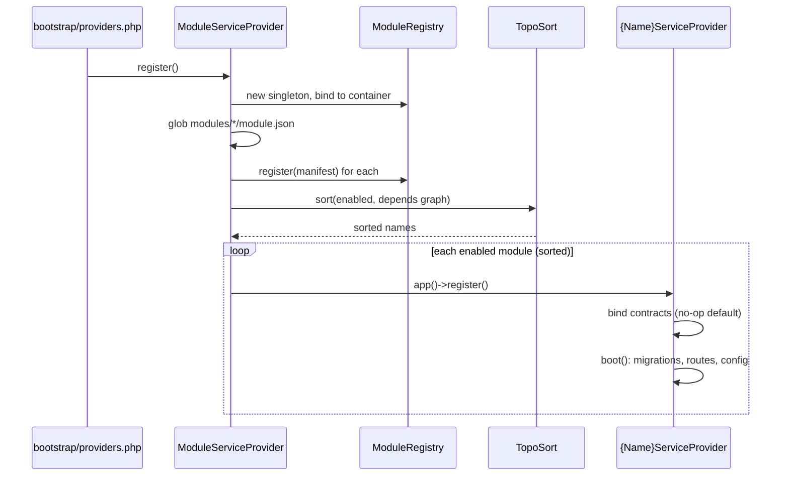

# Module Framework (Loader & Registry)

Module: platform · Status: live · Updated: 2026-06-27

## Purpose

Dựng bộ khung nạp/cô lập module cho modular monolith. Loader quét `modules/*/module.json`, sort theo `depends`, boot `{Name}ServiceProvider` khi `enabled=true`. Cho phép disable 1 module mà không vỡ app, và tích hợp kênh/cổng thanh toán mới mà không sửa lõi.

## Actors & permissions

- **System boot** (không actor người dùng) — chạy tự động khi Laravel khởi động qua `bootstrap/providers.php`.
- Người thêm module mới: dev tạo `modules/{name}/module.json` + `{Name}ServiceProvider`.

## Trigger / entry points

| Trigger | Code path |
|---|---|
| App boot | `bootstrap/providers.php` → `ModuleServiceProvider::register()` |
| Query registry | `app(ModuleRegistry::class)->isEnabled($name)` |
| Vite build (FE) | `resources/js/app.tsx::resolvePage()` + glob `modules/*/resources/js/pages/**/*.tsx` |

## Operational flow (step-by-step)

1. **Laravel bootstrap** nạp `bootstrap/providers.php` → `ModuleServiceProvider` được đăng ký.
2. `ModuleServiceProvider::register()` tạo `ModuleRegistry` singleton, bind vào container.
3. Glob `modules/*/module.json` → parse mỗi file qua `ModuleManifest::fromFile()` (validate required fields + type).
4. Register ALL manifests vào `ModuleRegistry` (kể cả `enabled=false` — registry phản ánh toàn trạng thái).
5. Filter `enabled=true` → topo-sort theo `depends` (Kahn's algorithm). Vòng lặp → throw `RuntimeException` rõ tên module.
6. Với mỗi module enabled (đúng thứ tự): gọi `app()->register("Modules\\{StudlyName}\\Providers\\{StudlyName}ServiceProvider")`. Guard `class_exists`.
7. Mỗi `{Name}ServiceProvider::boot()` tự nạp: migration (`loadMigrationsFrom`), config (`mergeConfigFrom`), routes web/api/channels (guard `file_exists`).
8. **Route api per-module:** nạp trong group `api` middleware (không session, không `ResetTenantContext`) — webhook-safe.
9. **FE (build-time):** Vite glob `modules/*/resources/js/pages/**/*.tsx` → bundle. `resolvePage()` in `app.tsx` check prefix `Modules.{Module}.{Page}` → resolve đúng file module.

## Data touched

| Data | Đọc/Ghi |
|---|---|
| `modules/*/module.json` | Đọc tại boot |
| Container bindings | Ghi (singleton `ModuleRegistry`, module contracts) |
| Route collection | Ghi (per-module routes appended) |
| Migration paths | Ghi (registered, chạy khi `artisan migrate`) |

Không đụng DB tại boot — chỉ register paths + bindings.

## State transitions

| Trạng thái | Hành động | Kết quả |
|---|---|---|
| `enabled: true` | Boot | Provider registered, routes/migrations active |
| `enabled: false` | Boot | Provider skipped, routes 404, bindings absent |
| `enabled: false` + no-op bound by consumer | Boot | Consumer's no-op binding survives, no exception |
| Cyclic dependency | Boot | `RuntimeException` thrown, app doesn't start |

## Business rules applied

- **Convention-only class loading:** loader chỉ register `Modules\{Studly}\Providers\{Studly}ServiceProvider` — không eval, không include path tùy ý từ manifest. Chặn injection qua manifest.
- **F10 no-op pattern:** consumer module bind no-op mặc định cho contract của nó; provider (khai `depends:[consumer]`) override sau topo-sort. Invariant: provider PHẢI khai `depends` đúng để override đúng thứ tự.
- **Disable-safe:** tắt module → 0 route/migration/binding của nó. Consumer xử lý không-có-driver: `Manager::hasAny()`.
- **`isEntitled()` stub:** luôn trả `true` cho enabled module. Chưa là gate bảo mật — TODO phase-07 nối Entitlements per-workspace.

## Edge cases & error handling

| Case | Behavior |
|---|---|
| Module thiếu `routes/api.php` | `file_exists` guard → skip, không lỗi (N4) |
| `module.json` thiếu required field | `InvalidArgumentException` với tên file + field |
| `type` không hợp lệ | `InvalidArgumentException` liệt kê allowed types |
| Class `{Name}ServiceProvider` không tồn tại | `class_exists` guard → skip, log warning |
| Cyclic `depends` | `RuntimeException` với tên module trong vòng |
| Vite glob module tắt | Build vẫn bundle file — route 404 chặn trước render, không vỡ build |

## Related

- ADR: `docs/decisions/2026-06-27-modular-monolith.md`
- Spec: `docs/modular-architecture.md` §3 (structure), §4 (contracts), §6 (S0)
- Phase: `plans/260627-modular-standardization/phase-01-module-framework.md`
- Sample module proof: `modules/sample/`
