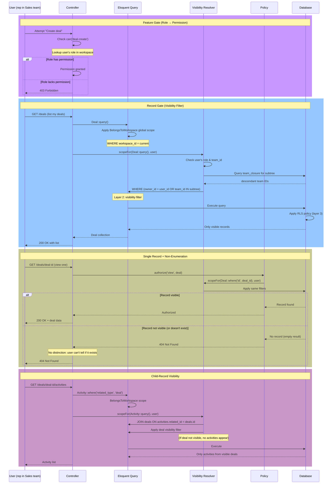

# RBAC + Visibility Scoping

Module: Platform · Status: live · Updated: 2026-06-13

## Purpose

Enforces two layers of access control:
1. **Feature gate** (role-based permissions): does the user have permission to perform an action (e.g., `deal.create`)?
2. **Record gate** (visibility resolver): can the user see this specific record based on ownership and team hierarchy?

Implements BR-X02 (ownership + team visibility), BR-X09 (child-record visibility), BR-X15 (non-enumeration), and BR-X16 (scoped search). The visibility resolver is the single chokepoint for all data queries.

## Actors & permissions

**Roles** (per workspace):
- `admin` — see all records, manage structure.
- `sales_manager` — see own records + team subtree records.
- `sales_rep` — see only own records.
- `support_manager`, `support_agent`, `marketer`, `viewer` — similar hierarchy.

See [crm-authorization-model.md](../../crm-authorization-model.md) for role definitions and workspace RBAC spec.

## Trigger / entry points

**Infrastructure code** (runs on every data-access query):
- `app/Support/Visibility.php` — main visibility resolver.
- Eloquent Policies: `app/Policies/*` (deferred to Sales/Support modules; template exists).
- spatie `laravel-permission`: role/permission checks (`$user->can('permission')`).

**Code references:**
- `app/Support/Visibility.php:scopeFor($query, $user)` — applies visibility filters to a query builder.
- `config/permission.php` — spatie config (teams enabled, team_foreign_key = workspace_id).
- `database/seeders/PlatformPermissionSeeder.php` — platform roles and permissions seeded.

## Operational flow (step-by-step)

### Feature Gate (Role → Permission)

1. **User attempts action** (e.g., "Create deal"):
   - Controller checks: `if (!auth()->user()->can('deal.create'))`.
   - spatie evaluates: does the user have the `deal.create` permission?
   - Lookup: user has role `sales_rep` in workspace → does `sales_rep` have `deal.create` permission?
   - Result: permission granted or denied (403).
   - **Scope**: workspace-specific (via `PermissionRegistrar::setPermissionsTeamId($workspace_id)`).

### Record Gate (Visibility Filter)

1. **User lists deals** (e.g., "My pipeline"):
   - Controller calls: `Deal::query()->get()` (or similar query).
   - Before execution, **must apply visibility scope**: `Visibility::scopeFor($query, $user)`.
   - Visibility resolver examines:
     - User's role: `admin`, `sales_manager`, `sales_rep`, etc.
     - User's team subtree (via closure table): `team_closure` for descendants.
     - Record's owner and team.
   - **Filter applied**:
     - Admin: `where 1 = 1` (no filter; sees all records).
     - Manager: `where owner_id = user_id OR team_id IN (select descendant from closure)` (own + subtree).
     - Rep: `where owner_id = user_id` (own only).
   - Result: query builder is scoped; only visible records are returned.

2. **User fetches single deal** (e.g., "View deal #123"):
   - Controller calls: `Deal::findOrFail($id)`.
   - Policy check (Laravel's `authorize()`) runs:
     - `view` policy method checks: can this user see this record?
     - Calls `Visibility::scopeFor(Deal::where('id', $id), $user)->exists()`.
     - If visibility scope blocks the record → query returns empty → `findOrFail()` throws 404 (not 403).
   - **Non-enumeration** (BR-X15): 404 for both "record doesn't exist" and "you can't see it" (prevents user enumeration).

### Child-Record Visibility (Polymorphic)

1. **User views activities on a Deal**:
   - Activities inherit their parent Deal's visibility.
   - Data layer query: `Activity::where('related_type', 'deal')->where('related_id', $deal_id)`.
   - Visibility scope joins to the Deal and applies visibility: `join deals on activities.related_id = deals.id where (deal visibility filter)`.
   - **Effect**: if the user can't see the Deal, they can't see its Activities.

### Global Scope Integration

1. **Every model using `BelongsToWorkspace` trait** automatically applies the workspace global scope.
2. **Visibility scope is applied on top**:
   - Example: `Deal::query()` auto-filters by workspace (layer 1).
   - Then: `Visibility::scopeFor()` applies the ownership/team filter (layer 2).
   - Then: PostgreSQL RLS applies (layer 3).
   - **Result**: triple-layer filtering ensures no data leaks.

## Data touched

**Tables involved:**
- `workspace_member` — user's role and team in the workspace.
- `team_closure` — closure table for fast visibility computation.
- `roles`, `permissions`, `model_has_roles`, `role_has_permissions` (spatie).
- All workspace-scoped tables (deals, contacts, activities, etc.) filtered by visibility.

**Visibility context:**
- User's role (from `workspace_member.role`).
- User's team_id (from `workspace_member.team_id`).
- Descendant team IDs (from `team_closure where ancestor_id IN user's team` → subtree).
- Record's owner_id and team_id (from the record itself).

**Permissions seeded**:
- Global permissions: role-based (permissions are global; spatie manages team-scoped assignment via `PlatformPermissionSeeder`).

## State transitions

Visibility is **query-time computed** — no persistent state.

| User attribute | Impact on visibility | When evaluated |
|---|---|---|
| Role changes | Permissions change immediately | Next request (spatie checks) |
| Team assignment changes | Visibility scope changes (subtree recomputed) | Next request (closure table query) |
| Team hierarchy reparents | Manager's subtree changes | Next request (closure table updated) |
| Record's owner changes | Visibility changes (BR-X03 reassignment) | Immediately in same TX (audit + visibility recomputed) |

## Business rules applied

- **BR-X02**: Ownership + team hierarchy — visibility computed per role (own, team subtree, all).
- **BR-X09**: Child-record visibility — Activities/Tasks inherit parent visibility (data layer joins).
- **BR-X15**: Non-enumeration — 404 for both missing and unauthorized records.
- **BR-X16**: Scoped search — every list query must apply visibility; no unscoped path.

## Edge cases & error handling

| Scenario | Behavior |
|---|---|
| Admin requests a record from another workspace | 404 (workspace scope filter hides it, visibility doesn't run). |
| Manager of Team A requests record owned by Team B | 404 (visibility filter excludes it; no cross-team visibility). |
| User's role changes mid-request | Visibility for that request uses the OLD role (role change is in the DB, but middleware ran at request start). **Next request** sees the new role. |
| Team is moved/reparented, affecting manager's subtree | Closure table is updated immediately; **next query** sees the new subtree. Current request (if mid-flight) uses the old tree. |
| Policy check is bypassed (developer error) | Still protected by RLS (layer 3) — record may not be visible to the database role. |
| Visibility scope accidentally omitted on a query | No records returned if visibility should filter (query runs on the workspace scope, but ownership filter is missing — could return wrong data). **Mitigation**: code review + tests that verify visibility filtering. |

## Related

- [tenant-isolation.md](./tenant-isolation.md) — workspace scope (layer 1).
- [teams.md](./teams.md) — team hierarchy + closure table.
- [members.md](./members.md) — role and team assignment.
- [crm-authorization-model.md](../../crm-authorization-model.md) — Platform vs. Workspace RBAC planes.
- [crm-business-rules.md](../../crm-business-rules.md) — BR-X02, X09, X15, X16.
- [system-architecture.md](../../system-architecture.md) — §5 (RBAC detail), §4 (RLS, layer 3).
- [`Visibility` resolver](../../../app/Support/Visibility.php)
- [`PlatformPermissionSeeder`](../../../database/seeders/PlatformPermissionSeeder.php)
- spatie [laravel-permission](https://spatie.be/docs/laravel-permission) docs
