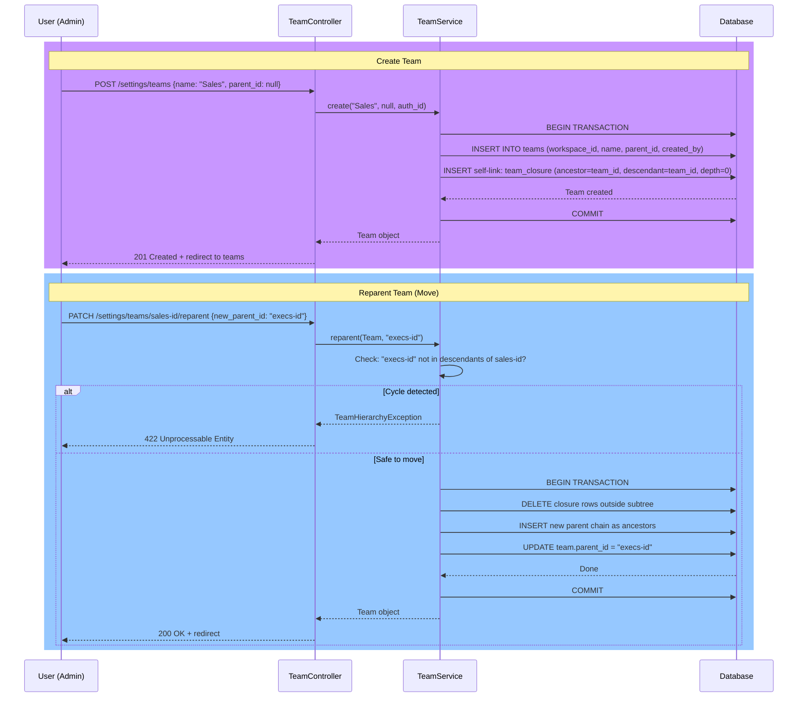

# Teams (Hierarchical Organization)

Module: Platform · Status: live · Updated: 2026-06-13

## Purpose

Organizes workspace members into a hierarchical tree structure (teams with parent-child relationships). Managers see all records owned by themselves and anyone in their descendant teams — this is the **manager rollup visibility rule** (BR-X02). Implemented via a **closure table** (`team_closure`) for O(1) subtree visibility queries. Prevents cycles in the hierarchy (BR-X13).

## Actors & permissions

- **Workspace admin** can create, rename, reparent, and delete teams.
- **Managers** can see their team subtree; **admins** see all (visibility enforced separately in data layer).
- **Sales reps / support agents** are assigned to a team but cannot modify team structure.

See [crm-authorization-model.md](../../crm-authorization-model.md) and [crm-business-rules.md](../../crm-business-rules.md) BR-X02 (visibility), BR-X13 (cycle guard).

## Trigger / entry points

**UI entry point:**
- Settings → Teams: `GET /settings/teams` → `resources/js/pages/settings/teams.tsx`

**API entry points:**
- `GET /settings/teams` — list teams for the workspace.
- `POST /settings/teams` — create a team.
- `PATCH /settings/teams/{team}` — rename a team.
- `PATCH /settings/teams/{team}/reparent` — move a team under a new parent.
- `DELETE /settings/teams/{team}` — delete a leaf team.

**Code references:**
- `app/Http/Controllers/Settings/TeamController.php` — handlers for CRUD.
- `app/Services/TeamService.php` — team mutations (closure table maintenance).
- `app/Models/Team.php` — model.
- `app/Models/TeamClosure.php` — closure table model.
- `resources/js/pages/settings/teams.tsx` — React tree view component.

## Operational flow (step-by-step)

### Create Team

1. **User (admin) navigates to Settings → Teams** → sees list of teams and "Create Team" button.

2. **User clicks "New Team"** → form appears with name and optional parent field.

3. **User submits form** → `POST /settings/teams` with `{ name, parent_id? }`.

4. **TeamController::store()**:
   - Validates request via `TeamStoreRequest` (name required, parent_id optional + exists check).
   - Calls `TeamService::create($name, $parentId, $createdBy)`.

5. **TeamService::create()** (transactional):
   - Inserts a new team row: `INSERT INTO teams (workspace_id, name, parent_id, created_by) VALUES (...)`.
   - Workspace_id is auto-stamped by the `BelongsToWorkspace` trait.
   - Inserts self-link into closure table: `INSERT INTO team_closure (ancestor_id, descendant_id, depth) VALUES (:id, :id, 0)`.
   - If `parent_id` is provided: inserts parent's ancestor chain as ancestors of this new team:
     ```sql
     INSERT INTO team_closure (..., ancestor_id, descendant_id, depth)
     SELECT ancestor_id, :new_team_id, depth + 1
     FROM team_closure WHERE descendant_id = :parent_id
     ```
   - Returns the team object.

6. **Frontend updates**: React re-fetches the team list and re-renders the tree.

### Reparent Team (Move Subtree)

1. **User (admin) clicks "Move Team"** → selects a new parent (or "Root" for no parent).

2. **User submits** → `PATCH /settings/teams/{team}/reparent` with `{ new_parent_id? }`.

3. **TeamController::reparent()**:
   - Validates `new_parent_id` exists (or is null) via `TeamReparentRequest`.
   - Calls `TeamService::reparent($team, $newParentId)`.

4. **TeamService::reparent()** (transactional, with cycle detection):
   - **Cycle check** (BR-X13): if `new_parent_id === team.id` OR `new_parent_id` is a descendant of `team`, throws `TeamHierarchyException` (cannot move a team under itself or a descendant).
   - **Detach from old ancestors**: deletes all closure rows where `descendant_id ∈ {team subtree}` and `ancestor_id ∉ {team subtree}` (removes edges outside the subtree).
   - **Reattach under new parent**: if `new_parent_id` is not null, inserts new closure rows via a cross-join:
     ```sql
     INSERT INTO team_closure (ancestor_id, descendant_id, depth)
     SELECT super.ancestor_id, sub.descendant_id, super.depth + sub.depth + 1
     FROM team_closure super
     CROSS JOIN team_closure sub
     WHERE super.descendant_id = :new_parent_id
       AND sub.ancestor_id = :team_id
     ```
   - Updates `team.parent_id`.
   - Returns the team.

5. **Frontend updates**: tree re-renders with new hierarchy.

### Delete Team

1. **User (admin) clicks "Delete Team"** → only allowed if the team has no children.

2. **User confirms** → `DELETE /settings/teams/{team}`.

3. **TeamController::destroy()**:
   - Validates the team has no children via `TeamService`.
   - Calls `TeamService::delete($team)`.

4. **TeamService::delete()** (transactional):
   - Detaches all members from the team: `UPDATE workspace_member SET team_id = NULL WHERE team_id = :team_id`.
   - Deletes all closure rows referencing the team:
     ```sql
     DELETE FROM team_closure
     WHERE ancestor_id = :team_id OR descendant_id = :team_id
     ```
   - Soft-deletes the team: `UPDATE teams SET deleted_at = NOW()`.

5. **Frontend updates**: team disappears from the list.



## Data touched

**Tables involved:**
- `teams` — team records (workspace-scoped).
- `team_closure` — closure table for O(1) subtree queries (workspace-scoped).
- `workspace_member` — members of the team (updated on team deletion).
- `audit_logs` — team changes (audited by subsequent modules if needed).

**Fields of `teams` table:**
- `id` (UUID) — primary key.
- `workspace_id` (UUID) — scoped to workspace.
- `name` (string) — team display name.
- `parent_id` (UUID, nullable) — parent team; null = root-level team.
- `created_by` (int) — user who created the team.
- `created_at`, `updated_at` — timestamps.
- `deleted_at` — soft delete marker.

**Fields of `team_closure` table:**
- `id` (bigint) — primary key.
- `workspace_id` (UUID) — scoped to workspace.
- `ancestor_id` (UUID) — ancestor in the hierarchy (includes self for depth 0).
- `descendant_id` (UUID) — descendant in the hierarchy (includes self for depth 0).
- `depth` (int) — distance in tree (0 = self-link; 1 = direct parent/child; N = Nth ancestor/descendant).

**Closure table invariants:**
- For each team T, there is a row `(T, T, 0)` (self-link).
- For each parent P and child C, there is a row `(P, C, 1)` (direct parent-child).
- For each ancestor A and descendant D at depth N, there is a row `(A, D, N)` (transitive closure).
- **No cycles**: no row `(T, T, depth > 0)` can ever exist.

## State transitions

| Component | Before | After | Trigger |
|---|---|---|---|
| Team parent | Null or parent A | Parent B | Reparent operation |
| Team deleted_at | Null | Timestamp | Delete operation (soft delete) |
| Member team_id | Team A | Null | Delete Team A |

## Business rules applied

- **BR-X02**: Visibility via team hierarchy — manager sees subtree; closure table enables O(1) visibility query in data layer.
- **BR-X13**: Team hierarchy integrity — cycle guard rejects self-referential and circular reparents.
- **BR-X01**: Tenant isolation — teams are workspace-scoped; closure table includes `workspace_id` and RLS policy.

## Edge cases & error handling

| Scenario | Behavior |
|---|---|
| Admin tries to delete team with children | 422 Unprocessable Entity: "Move or delete child teams first." |
| Admin tries to move team under itself | 422: "A team cannot be moved under itself or one of its descendants." |
| Admin tries to move team under a descendant | 422: cycle guard rejects. |
| Member deactivated mid-reparent | Team structure unaffected; member's visibility recalculated on next request. |
| Concurrent creates of same-name team under same parent | Allowed (no unique constraint on name per parent; team names are UI-friendly, not unique identifiers). |
| Delete Team A that has members | Members' `team_id` set to NULL; they remain in the workspace (BR-X03 — reassignment is per-record, not team-wide). |
| Workspace deleted | All teams and closure rows cleaned up by workspace cascade (soft delete). |

## Related

- [members.md](./members.md) — assigning members to teams.
- [tenant-isolation.md](./tenant-isolation.md) — workspace scoping.
- [crm-authorization-model.md](../../crm-authorization-model.md) — RBAC and workspace plane.
- [crm-business-rules.md](../../crm-business-rules.md) — BR-X02 (visibility), BR-X13 (cycle guard).
- [system-architecture.md](../../system-architecture.md) — §3.1 (teams/closure tables), §5 (RBAC).
- [`TeamService`](../../../app/Services/TeamService.php)
- [`TeamController`](../../../app/Http/Controllers/Settings/TeamController.php)
- [`Team` model](../../../app/Models/Team.php)
- [`TeamClosure` model](../../../app/Models/TeamClosure.php)
- [`teams.tsx`](../../../resources/js/pages/settings/teams.tsx)
