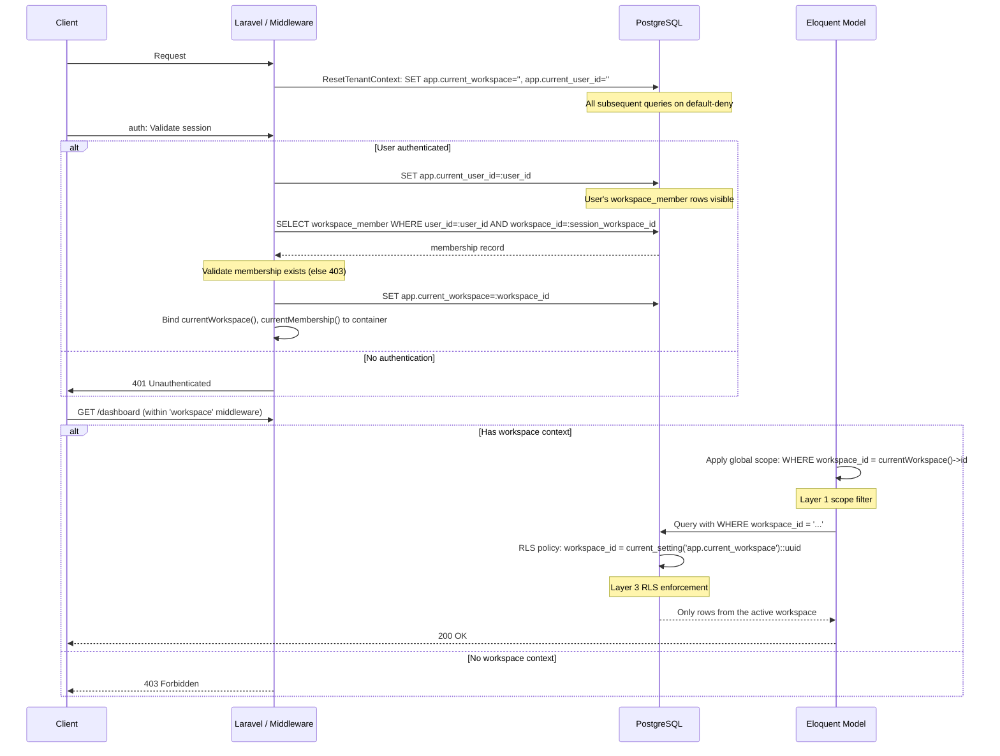

# Tenant Isolation (3-Layer)

Module: Platform · Status: live · Updated: 2026-06-13

## Purpose

Enforces workspace isolation across all data access — no request can read or write data from another workspace. This is the foundational security boundary for the multi-tenant SaaS model; every feature depends on it. Implements BR-X01, X11, X14, X18 and architecture §4.

## Actors & permissions

- **Admin**: can manage workspace settings and audit tenant isolation.
- **Any workspace member**: implicitly protected — their queries are automatically filtered by workspace.
- **Unauthenticated**: requests are rejected before middleware runs.

See [crm-authorization-model.md](../../crm-authorization-model.md) for role definitions.

## Trigger / entry points

**Request flow:**
1. `ResetTenantContext` middleware (runs **first** on every request): `app/Http/Middleware/ResetTenantContext.php`
2. `auth` middleware (Laravel): validates the session.
3. `IdentifyWorkspace` middleware: resolves active workspace and establishes RLS context.
4. Any route within `middleware('workspace')` group (defined in `routes/web.php`, `routes/settings.php`).

**Key code:**
- `app/Http/Middleware/ResetTenantContext.php:handle()` — clears stale RLS context.
- `app/Http/Middleware/IdentifyWorkspace.php:handle()` — binds active workspace and RLS.
- `app/Models/Concerns/BelongsToWorkspace.php` — layer 1 global scope and write-time stamping.
- `app/helpers.php:currentWorkspace()` — retrieves the active workspace.
- `database/sql/setup-roles.sql` — grants RLS privileges and audits INSERT-only access.

## Operational flow (step-by-step)

1. **Request arrives** → `ResetTenantContext` middleware executes **before any app code** (middleware priority in `app/Http/Kernel.php`).
   - Clears `app.current_workspace` and `app.current_user_id` PostgreSQL session variables.
   - **Rationale**: persistent DB connections (Octane, PgBouncer) could leak stale context from a prior request; explicit reset is defense-in-depth.

2. **User authenticated** → `auth` middleware validates session/token.

3. **`IdentifyWorkspace` middleware** (only on routes with `'workspace'` middleware guard):
   - Retrieves the authenticated user.
   - Sets `app.current_user_id` session variable in PostgreSQL (exposes user's own `workspace_member` rows to RLS for the lookup).
   - **Resolves active membership**: queries `workspace_member` with `user_id` and the session's `current_workspace_id` (if set); falls back to the user's oldest active membership.
   - **Validates membership**: if no active membership found, aborts with 403 (no workspace access).
   - Sets `app.current_workspace` PostgreSQL session variable to the membership's `workspace_id`.
   - Scopes spatie role checks to the workspace via `PermissionRegistrar::setPermissionsTeamId()`.
   - Binds `currentWorkspace()` and `currentMembership()` to the container for app use.
   - Stores the workspace ID in the session (`current_workspace_id`).

4. **Model queries** (Layer 1):
   - Every model using the `BelongsToWorkspace` trait automatically applies a global scope: `where workspace_id = app('currentWorkspace')->id`.
   - On model creation, the `workspace_id` attribute is auto-stamped from `currentWorkspace()`.
   - **Result**: all queries on workspace-scoped tables are implicitly filtered.

5. **Database-level enforcement** (Layer 3):
   - PostgreSQL RLS policies run **after** the app scope filter (defense-in-depth).
   - Every workspace-scoped table has `ENABLE ROW LEVEL SECURITY` and a policy: `workspace_id = current_setting('app.current_workspace')::uuid`.
   - The app's database role `crm_app` has **no owner privileges** and is bound by RLS: even if the app scope filter is bypassed, a query cannot read/write rows from other workspaces.
   - The privileged role (`crm_owner`) used for audit writes bypasses RLS.

## Data touched

**Tables involved:**
- `workspaces` — root isolation boundary (read via `IdentifyWorkspace`).
- `workspace_member` — membership records; RLS policy enforces user can only see their own rows.
- All workspace-scoped tables (prefixed by the global scope + RLS policies).

**Fields:**
- `workspace_id` — stamped on every workspace-scoped record at creation.
- `app.current_workspace` — PostgreSQL session variable, set by `IdentifyWorkspace`.
- `app.current_user_id` — PostgreSQL session variable, set during membership lookup.
- `current_workspace_id` — session key, holds user's preferred active workspace.

**Audit entries:**
- Created when a user logs in, switches workspaces, or role/membership changes (handled by subsequent modules).

## State transitions

Isolation context is **per-request** and **per-connection**:
- Request arrives → context cleared.
- User authenticated & workspace resolved → context bound.
- Request completes or errors → context discarded.

No persistent state (isolation is ephemeral per-request).

## Business rules applied

- **BR-X01**: Tenant isolation — every query confined to the active workspace.
- **BR-X11**: Same-tenant references — cross-workspace FKs are rejected (enforced by model validators).
- **BR-X14**: Server-derived tenant context — workspace never from client input; resolved from session + user's memberships.
- **BR-X18**: RLS policies on every workspace table (verified by CI tests).

## Edge cases & error handling

| Scenario | Behavior |
|---|---|
| User has no active memberships | 403 Forbidden. Add them via Members page. |
| Session `current_workspace_id` is invalid/deleted | Falls back to oldest active membership. |
| User is deactivated mid-request | Subsequent request aborts 403 (no active membership). |
| Persistent connection (Octane) carries stale context | `ResetTenantContext` clears it at request start; no leak. |
| RLS policy accidentally disabled on a table | CI test fails (verified in seeder). |
| App bypasses `BelongsToWorkspace` scope (raw query) | RLS policy still blocks cross-workspace reads/writes. |
| Privileged connection (audit) used for normal queries | No — audit is explicit via `Audit::log()`, separate code path. |

## Related

- [crm-authorization-model.md](../../crm-authorization-model.md) — Platform vs. Workspace planes, membership, impersonation.
- [crm-business-rules.md](../../crm-business-rules.md) — BR-X01, X11, X14, X18 definitions.
- [system-architecture.md](../../system-architecture.md) — §4 (multi-tenant enforcement), §9 (async jobs re-binding context).
- [`IdentifyWorkspace` middleware](../../../app/Http/Middleware/IdentifyWorkspace.php)
- [`ResetTenantContext` middleware](../../../app/Http/Middleware/ResetTenantContext.php)
- [`BelongsToWorkspace` trait](../../../app/Models/Concerns/BelongsToWorkspace.php)
- [`setup-roles.sql`](../../../database/sql/setup-roles.sql) — RLS policy definitions.
