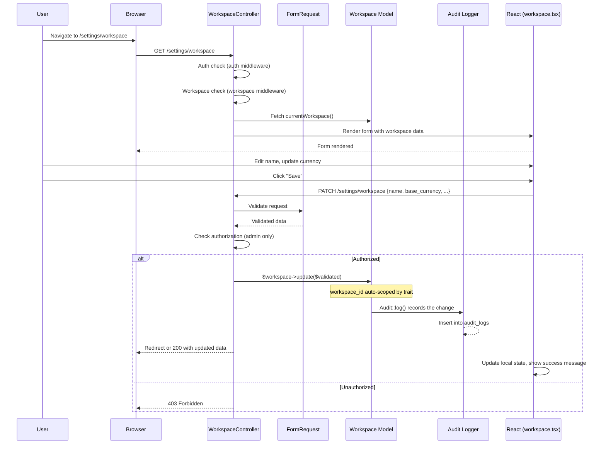

# Workspace Settings

Module: Platform · Status: live · Updated: 2026-06-13

## Purpose

Allows workspace admins to view and update workspace-level configuration: name, base currency, and other foundational settings. The workspace is the root isolation boundary and the customer's operational domain.

## Actors & permissions

- **Workspace admin** (role = `admin`) can view and update workspace settings.
- **Non-admin members** can view settings but cannot update (UI hidden).

See [crm-authorization-model.md](../../crm-authorization-model.md) for role definitions and [crm-business-rules.md](../../crm-business-rules.md) BR-X02 (visibility + role).

## Trigger / entry points

**UI entry point:**
- Settings menu → "Workspace": `GET /settings/workspace` → `resources/js/pages/settings/workspace.tsx`

**API entry points:**
- `GET /settings/workspace` — view settings page (render form).
- `PATCH /settings/workspace` — update workspace (form submission).

**Code references:**
- `app/Http/Controllers/Settings/WorkspaceController.php` — `edit()` and `update()` handlers.
- `app/Http/Requests/Settings/WorkspaceUpdateRequest.php` — validation.
- `resources/js/pages/settings/workspace.tsx` — React form component.
- `app/Models/Workspace.php` — data model.

## Operational flow (step-by-step)

1. **User navigates to Settings → Workspace** → browser requests `GET /settings/workspace`.

2. **WorkspaceController::edit()**:
   - Validates user is authenticated and has an active workspace context (inherited via `auth` and `workspace` middleware).
   - Fetches the current workspace: `currentWorkspace()`.
   - Checks authorization: admin role required (enforced by policy or checked in blade).
   - Returns Inertia view with workspace data: `Inertia::render('settings/workspace', ['workspace' => ...])`.

3. **React renders the form**:
   - Displays workspace name, base_currency, and other editable fields.
   - Edit button/form only visible if user is admin.
   - Submit button triggers `PATCH /settings/workspace`.

4. **User submits form** → `PATCH /settings/workspace` request with updated fields.

5. **WorkspaceController::update()**:
   - Validates request via `WorkspaceUpdateRequest` (validates field types, length, required rules).
   - Checks authorization: admin role.
   - Updates the workspace model: `currentWorkspace()->update($validated)`.
   - Audits the change via `Audit::log()` (recorded in `audit_logs` on the privileged connection).
   - Returns success response: redirect or JSON with updated workspace.

6. **Frontend updates**:
   - Inertia re-renders with fresh workspace data.
   - Sidebar/header reflect new name if applicable.

## Data touched

**Tables involved:**
- `workspaces` — the root boundary record (NOT workspace-scoped itself; all workspaces are visible via roles check).
- `audit_logs` — records of who changed what field to what value (BR-X05).

**Fields of `workspaces` table:**
- `id` (UUID) — primary key.
- `name` — workspace display name (editable).
- `base_currency` — three-letter code (VND in Phase 1; editable, affects all deal values).
- `default_pipeline_id` — (editable; future — MVP may not expose).
- `audit_retention` — (read-only in UI; set at workspace creation or by platform staff).
- `status` — (read-only in UI; set by platform staff).
- `created_at`, `updated_at` — timestamps.

**Audit entry:**
- Action: `update`.
- Changed fields and values recorded (non-PII).
- Actor (the admin who changed it) and timestamp recorded.

**Session/Inertia props:**
- `currentWorkspace` — passed to all pages; reflects updates on next render.

## State transitions

| Field | Before | After | Trigger |
|---|---|---|---|
| `name` | "Old Inc" | "New Inc" | Admin updates + saves |
| `base_currency` | "VND" | "USD" | Admin updates + saves (rare; affects deal rollups) |

No status transitions in this flow (status changes are platform-only, handled separately).

## Business rules applied

- **BR-X01**: Workspace isolation — update is confined to `currentWorkspace()` via the trait global scope.
- **BR-X02**: Role-based access — admin-only gate (enforced by policy or authorization check).
- **BR-X05**: Audit immutability — changes logged in append-only audit_logs.
- **BR-D05**: Base currency — currency field affects deal forecast calculations (set once; future changes are rare and cascading).

## Edge cases & error handling

| Scenario | Behavior |
|---|---|
| Non-admin tries to update settings | 403 Forbidden (policy check). UI doesn't show form. |
| Invalid currency code (e.g., "ABC") | FormRequest validation rejects; error message displayed. |
| Workspace deleted mid-request | 404 (currentWorkspace() returns null). |
| Name too long (>255 chars) | FormRequest validation rejects. |
| Concurrent updates from two admins | Last-write-wins (no locking on workspace; edit conflicts are rare). |

## Related

- [crm-authorization-model.md](../../crm-authorization-model.md) — admin role definition.
- [crm-business-rules.md](../../crm-business-rules.md) — BR-X01, X02, X05.
- [members.md](./members.md) — managing members and their roles.
- [system-architecture.md](../../system-architecture.md) — §3.1 workspace table schema.
- [`WorkspaceController`](../../../app/Http/Controllers/Settings/WorkspaceController.php)
- [`WorkspaceUpdateRequest`](../../../app/Http/Requests/Settings/WorkspaceUpdateRequest.php)
- [`workspace.tsx`](../../../resources/js/pages/settings/workspace.tsx)
