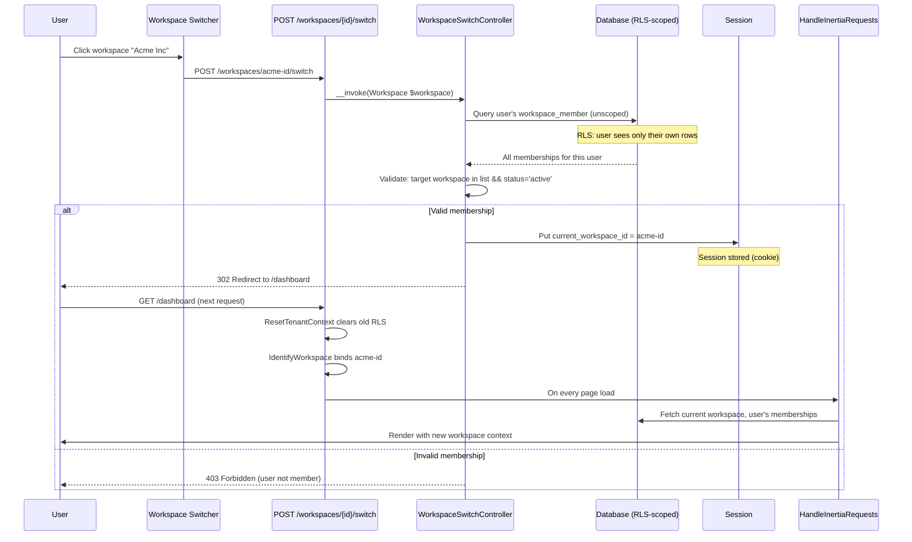

# Workspace Switching

Module: Platform · Status: live · Updated: 2026-06-13

## Purpose

Allows a multi-workspace user to switch their active workspace context. The active workspace determines which data they see and operate on for the rest of the session. Implements tenant navigation for users with multiple workspace memberships.

## Actors & permissions

- **Any workspace member** with 2+ active memberships in different workspaces can switch.
- **Admin users** of a workspace can switch to other workspaces they're members of.

See [crm-authorization-model.md](../../crm-authorization-model.md) for role definitions.

## Trigger / entry points

**UI entry point:**
- Workspace switcher dropdown: `resources/js/components/workspace-switcher.tsx`
- Workspace list in sidebar (Inertia prop `workspaces`).

**API entry point:**
- `POST /workspaces/{workspace}/switch` — `app/Http/Controllers/WorkspaceSwitchController.php:__invoke()`

**Code references:**
- `app/Http/Controllers/WorkspaceSwitchController.php` — handler validates and switches.
- `app/Http/Middleware/HandleInertiaRequests.php` — passes workspace list and current workspace to React.
- `resources/js/components/workspace-switcher.tsx` — UI dropdown for switching.

## Operational flow (step-by-step)

1. **User clicks workspace in dropdown** → triggers `POST /workspaces/{workspace}/switch` with the target workspace ID.

2. **WorkspaceSwitchController validates**:
   - Authenticates the user (inherited via `auth` middleware).
   - Checks the target workspace is resolved (exists).
   - Queries the user's `workspace_member` records (unscoped, via `withoutGlobalScope('workspace')` to cross-check all memberships).
   - **Validates user has an active membership** in the target workspace (status = `active`).
   - If validation fails → aborts 403 (user not a member or deactivated).

3. **Session updated**:
   - Stores `current_workspace_id` in the session: `session()->put('current_workspace_id', $workspace->id)`.

4. **Next request**:
   - `IdentifyWorkspace` middleware reads the session `current_workspace_id`.
   - If present and user has an active membership in it → uses that workspace (no fallback needed).
   - Establishes RLS context for the new workspace.
   - Binds `currentWorkspace()` and `currentMembership()` to the new workspace.

5. **Frontend updates** (via Inertia shared props):
   - `HandleInertiaRequests` computes the current workspace and workspace list on every request.
   - Passed as props to React: `currentWorkspace`, `workspaces`.
   - React re-renders the switcher, workspace-dependent routes, and sidebar.

## Data touched

**Tables involved:**
- `workspace_member` — queried unscoped to find all user memberships and validate status.
- `workspaces` — route model binding resolves the workspace.

**Session:**
- `current_workspace_id` — stores the preferred workspace ID (string/UUID).

**Shared props (Inertia):**
- `auth.user` — authenticated user.
- `currentWorkspace` — active workspace object.
- `workspaces` — list of all workspaces the user is an active member of.
- `currentMembership` — active membership record (role, team_id).

**Audit entries:**
- Workspace switch is not explicitly audited (low security sensitivity); workspace change is surfaced in membership/context logs if needed.

## State transitions

| State | Event | Next state |
|---|---|---|
| Workspace A context | Click "Switch to B" | Workspace B context |
| Workspace B context | Session expires | Re-login or select workspace again |
| Deactivated membership | Try to switch to A | 403 (membership no longer active) |

## Business rules applied

- **BR-X01**: Tenant isolation — switch validates the target workspace and establishes RLS context.
- **BR-X14**: Server-derived tenant context — workspace selection is validated server-side; client cannot spoof a workspace.
- **BR-X03**: Only active members can switch (deactivated memberships are excluded).

## Edge cases & error handling

| Scenario | Behavior |
|---|---|
| User clicks "switch" but has only 1 workspace | UI hides switcher or shows single option (no-op). |
| Target workspace deleted mid-request | 404 (route model binding). |
| User deactivated between dropdown render and switch request | 403 (membership no longer active). |
| Session expires mid-switch | User redirected to login; upon re-auth, oldest membership is used. |
| Multiple browser tabs switching simultaneously | Last switch wins (session is per-browser). |
| User has roles/permissions in workspace A but not B | RBAC is re-evaluated on next request via spatie + RLS. No data leaks across workspaces. |

## Related

- [tenant-isolation.md](./tenant-isolation.md) — context established by `IdentifyWorkspace`.
- [workspace-settings.md](./workspace-settings.md) — workspace admin panels.
- [crm-authorization-model.md](../../crm-authorization-model.md) — membership + roles.
- [`WorkspaceSwitchController`](../../../app/Http/Controllers/WorkspaceSwitchController.php)
- [`HandleInertiaRequests` middleware](../../../app/Http/Middleware/HandleInertiaRequests.php)
- [`workspace-switcher.tsx`](../../../resources/js/components/workspace-switcher.tsx)
