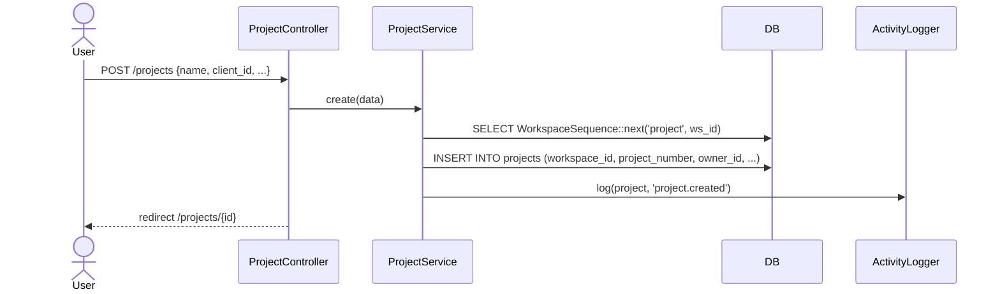
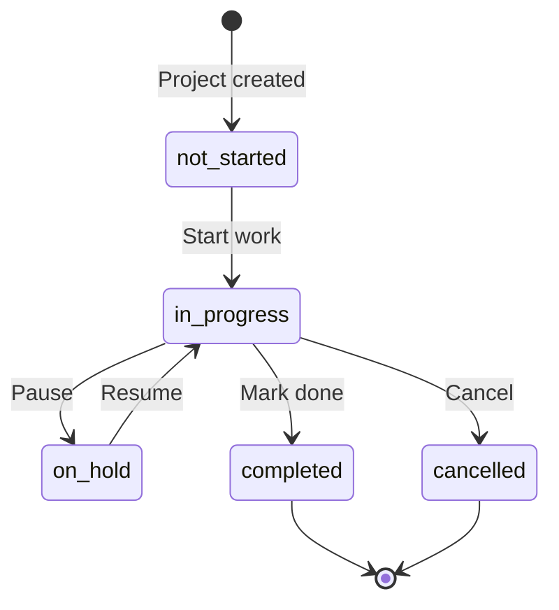

# Projects & Milestones

Module: Projects · Status: live · Updated: 2026-06-25

## Purpose

Quản lý dự án gắn với khách hàng (Client), theo dõi tiến độ qua milestone kanban, chia sẻ file, thảo luận/bình luận, và timeline hoạt động có kiểm soát hiển thị cho khách hàng.

## Actors & permissions

| Actor | Permissions |
|---|---|
| Admin | `tenant.project.view` + create/update/delete + manage members |
| Sales Manager / Project Manager | `tenant.project.view` + update progress/status |
| Sales Rep | `tenant.project.view_own` — chỉ thấy project mình là member/owner |
| Viewer | read-only qua `tenant.project.view` |

Visibility fail → `abort(404)` (BR-X15).
Project members có thể xem/update task gắn với project (intersection authz).

## Trigger / entry points

**UI:**
- `/projects` — list + filter theo status/client
- `/projects/create` — tạo mới
- `/projects/{project}` — chi tiết (tabs: milestones, members, files, discussions, activity)

**API:**
- `GET/POST /projects` → `ProjectController::index/store`
- `GET/PATCH/DELETE /projects/{project}` → show/update/destroy
- `PATCH /projects/{project}/status` → changeStatus
- `PATCH /projects/{project}/progress/recalc` → recalcProgress
- `POST /projects/{project}/members` → `ProjectMemberController::store`
- `DELETE /projects/{project}/members/{userId}` → destroy
- `POST/PATCH/DELETE /projects/{project}/milestones/...` → `ProjectMilestoneController`
- `POST /projects/{project}/milestones/reorder` → bulk reorder
- `POST /projects/{project}/files` → `ProjectFileController::store`
- `POST/DELETE /projects/{project}/discussions/...` → `ProjectDiscussionController`

**Code paths:**
- `app/Http/Controllers/Projects/ProjectController.php`
- `app/Services/ProjectService.php`
- `app/Policies/ProjectPolicy.php`
- `app/Models/Project.php`, `ProjectMilestone.php`, `ProjectDiscussion.php`
- `resources/js/pages/projects/`

## Operational flow (step-by-step)

### Create Project

1. Admin điều hướng `/projects/create`.
2. Điền: name, client (optional), status, start_date, deadline, billing_type, visible_to_customer.
3. Submit `POST /projects` → `ProjectController::store(StoreProjectRequest)`.
4. **ProjectService::create(data)**:
   - `project_number = WorkspaceSequence::next('project', workspaceId)`.
   - `owner_id = auth()->id()`.
   - Insert project row (workspace_id auto-stamp).
   - Log activity `project.created`.
5. Redirect `/projects/{project}`.

### Milestone Kanban

1. Admin mở tab Milestones → kanban board theo milestone status.
2. Tạo milestone: `POST /projects/{project}/milestones` → `ProjectMilestoneController::store`.
3. Drag reorder: `POST /projects/{project}/milestones/reorder` với `{items: [{id, order}]}` → bulk UPDATE trong TX.

### Member Management

- Add member: `POST /projects/{project}/members` — validate user là active `WorkspaceMember` (G12).
- Remove member: `DELETE /projects/{project}/members/{userId}`.
- Role: `manager|member|viewer` (project-level role, độc lập RBAC workspace).

### Progress & Status

- Manual progress: PATCH `progress` field.
- Auto-progress từ tasks: `PATCH /projects/{project}/progress/recalc` → đếm tasks completed / total.
- Status change log activity `project.status.changed`.

## Data touched

| Entity | Read / Write | Notes |
|---|---|---|
| `projects` | write | system columns auto-stamped |
| `project_members` | write | RLS pivot (G4), workspace_id required |
| `project_milestones` | write | ordered by milestone_order |
| `project_discussions` | write | thread + replies (HasComments) |
| `attachments` | write | polymorphic, visible_to_customer aware |
| `activities` | write | append-only, visible_to_customer flag |
| `workspace_sequences` | write | project_number atomic increment |
| `custom_fields` (jsonb) | write | entity_type = 'project' |

## State transitions

Status lưu qua `project_statuses` (workspace-scoped lookup, P01).

## Business rules applied

- **Workspace isolation** (BR-X01): `workspace_id` auto-stamp + RLS.
- **Member validation** (G12): `project_members.user_id` phải là active `WorkspaceMember`.
- **Non-enumeration** (BR-X15): project ngoài workspace → `abort(404)`.
- **Activity visible_to_customer**: activity log có flag — customer portal chỉ thấy `visible_to_customer=true`.
- **progress_from_tasks**: khi bật → recalc từ tasks thay vì manual input.
- Custom fields: `entity_type='project'` phải ∈ `CustomFieldDefinition::ENTITY_TYPES`.
- Morph alias (G3): attachments/notes/activities ghi `'project'` (không FQCN).

## Edge cases & error handling

- Delete project có members → pivot rows cascade hoặc service cleanup.
- Reorder milestones với id không thuộc project → validation reject.
- Add user ngoài workspace làm member → `WorkspaceMember` validation abort 422.
- progress_from_tasks=true + không có task → progress = 0 (không chia zero).

## Related

- [crm-domain-definition.md](../../crm-domain-definition.md)
- [clients-contacts.md](../sales/clients-contacts.md) — Client liên kết project
- [tasks-timers.md](./tasks-timers.md) — Task gắn với Project
- [system-architecture.md](../../system-architecture.md) §3.3
