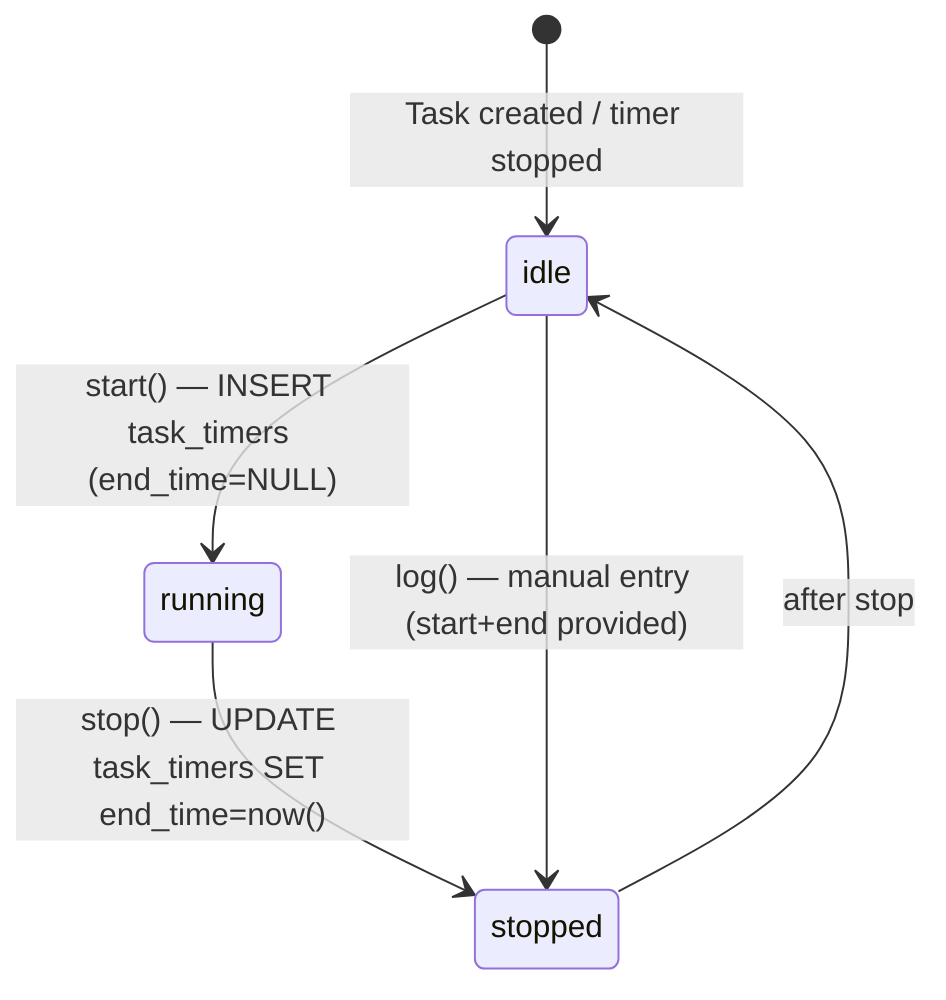
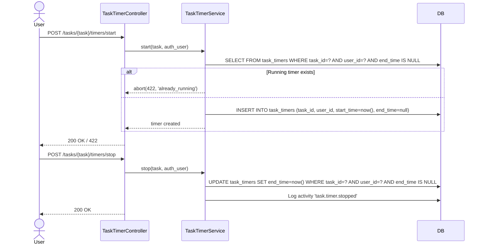

# Tasks & Timers

Module: Projects / Engagement · Status: live · Updated: 2026-06-25

## Purpose

Quản lý công việc (Task) đa hình — gắn với lead/khách hàng/dự án/liên hệ tùy ngữ cảnh. Hỗ trợ nhiều người thực hiện (assignees), người theo dõi (followers), checklist, bình luận, nhắc hẹn, tags, và **bộ đếm giờ/timesheet** (start/stop/manual log) để theo dõi thời gian làm việc.

## Actors & permissions

| Actor | Permissions |
|---|---|
| Admin | `tenant.task.view` + create/update/delete + timer |
| Sales Manager / Project Manager | `tenant.task.view` + assign |
| Sales Rep / Support Agent | `tenant.task.view_own` — own OR assignee OR follower |
| Viewer | read-only (assignee override: assignee thấy/sửa task của mình dù là viewer) |

Assignee override (policy): dù role viewer, nếu là assignee → có thể view + update task đó.
Visibility fail → `abort(404)` (BR-X15).

## Trigger / entry points

**UI:**
- `/tasks` — list với filter status/priority/assignee
- `/tasks/kanban` — kanban theo status
- `/tasks/{task}` — detail (tabs: checklist, assignees, timers, attachments, comments, activity)

**API:**
- `GET/POST /tasks` → `TaskController::index/store`
- `GET/PATCH/DELETE /tasks/{task}` → show/update/destroy
- `PATCH /tasks/{task}/status` → `TaskStatusController::update`
- `PATCH /tasks/{task}/kanban-order` → `TaskKanbanController::reorder`
- `PATCH /tasks/{task}/assignees` → `TaskAssigneeController::update`
- `POST/PATCH/DELETE /tasks/{task}/checklist/...` → `TaskChecklistController`
- `POST /tasks/{task}/timers/start` → `TaskTimerController::start`
- `POST /tasks/{task}/timers/stop` → `TaskTimerController::stop`
- `POST /tasks/{task}/timers/log` → manual log

**Code paths:**
- `app/Http/Controllers/Tasks/TaskController.php`
- `app/Services/TaskService.php`
- `app/Services/TaskTimerService.php`
- `app/Policies/TaskPolicy.php`
- `app/Models/Task.php`, `TaskTimer.php`, `TaskAssignee.php`, `TaskChecklistItem.php`
- `resources/js/pages/tasks/`

## Operational flow (step-by-step)

### Create Task

1. User tạo task tại `/tasks` hoặc từ trang Project/Lead.
2. Điền: name, description, status, priority, start_date, due_date, related_to (polymorphic).
3. `POST /tasks` → `TaskController::store(TaskStoreRequest)`.
4. **TaskService::create(data, relatedType?, relatedId?, assigneeIds?, checklistItems?)**:
   - `task_number = WorkspaceSequence::next('task', workspaceId)`.
   - `owner_id = auth()->id()`, `status = STATUS_NOT_STARTED`.
   - Insert task. Sync assignees (TaskAssignee pivot, RLS). Bulk insert checklist items.
   - Log activity `task.created`.

### Timer Start/Stop

**start()**: `TaskTimerService::start(task, user)` — INSERT `task_timers(task_id, user_id, start_time=now(), end_time=null)`.

**stop()**: `TaskTimerService::stop(task, user)` — UPDATE running timer (end_time IS NULL for this user) SET end_time=now().

**Constraint**: 1 running timer per (task, user) — start khi đã running → abort 422.

### Multi-Assignee

- `PATCH /tasks/{task}/assignees` với `{user_ids: [...]}` → `TaskAssigneeController::update`.
- `TaskService::syncAssignees(task, userIds)` — validate users là active `WorkspaceMember` (G12), sync pivot `task_assignees`.

### Checklist

- Items có order, toggle done, có thể assign user (phải là workspace member).
- Reorder: bulk UPDATE `item_order` trong TX.

## Data touched

| Entity | Read / Write | Notes |
|---|---|---|
| `tasks` | write | system columns auto-stamped |
| `task_timers` | write | running = end_time IS NULL |
| `task_assignees` | write | pivot RLS (G4), workspace_id stamped |
| `task_followers` | write | pivot RLS (G4) |
| `task_checklist_items` | write | ordered, assigned_user phải là member |
| `activities` | write | append-only |
| `comments` | write | commentable morph = 'task' |
| `reminders` | write | remindable morph = 'task' |
| `custom_fields` (jsonb) | write | entity_type = 'task' |
| `workspace_sequences` | write | task_number atomic |

## Business rules applied

- **Workspace isolation** (BR-X01): `workspace_id` auto-stamp + RLS trên mọi bảng task.
- **Assignee validation** (G12): `task_assignees.user_id` + `task_checklist_items.assigned_user_id` phải là active `WorkspaceMember`.
- **Timer constraint**: 1 running timer per (task, user) — không cho start nếu đã có running.
- **Assignee override**: assignee có thể view/update dù role là viewer (PolicyGate override).
- **Non-enumeration** (BR-X15): task ngoài workspace/visibility → `abort(404)`.
- Custom fields: entity_type = `'task'` phải ∈ `CustomFieldDefinition::ENTITY_TYPES`.
- Morph alias (G3): `related_type` lưu `'lead'|'client'|'project'|'contact'` (không FQCN).

## Edge cases & error handling

- Start timer khi đã running → 422 `task.timer.already_running`.
- Stop timer khi không có running → 422 `task.timer.not_running`.
- Assign user ngoài workspace → validation reject 422.
- Delete task có running timer → cascade delete timer rows.
- Task liên kết entity đã bị xóa → related_type/related_id remains (soft-delete safe).

## Related

- [crm-domain-definition.md](../../crm-domain-definition.md)
- [projects-milestones.md](./projects-milestones.md) — Task gắn với milestone_id
- [clients-contacts.md](../sales/clients-contacts.md) — Task liên kết client/contact
- [leads-pipeline-convert.md](../sales/leads-pipeline-convert.md) — Task liên kết lead
- [system-architecture.md](../../system-architecture.md) §3.3
- `tests/Feature/Tasks/TaskTimerTest.php` — timer test coverage
