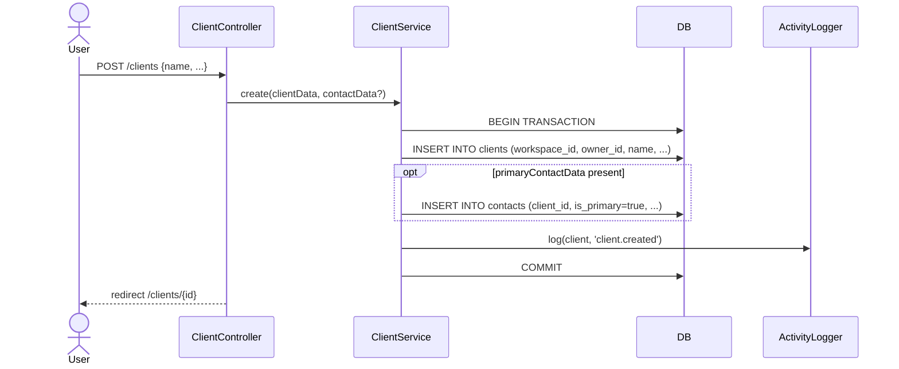

# Clients & Contacts

Module: Sales Core · Status: live · Updated: 2026-06-25

## Purpose

Quản lý hồ sơ công ty (Client) và người liên hệ (Contact) — xương sống CRM. Mỗi Client đại diện một tổ chức/công ty; mỗi Contact là người làm việc trực tiếp thuộc Client đó. Hỗ trợ nhiều Contact/Client, đánh dấu Primary Contact, nhóm client, vault bảo mật, và đầy đủ 5 shared M0 trait (custom fields, tags, attachments, notes, activity).

Tham chiếu user story: [crm-actors-and-use-cases.md](../../crm-actors-and-use-cases.md).

## Actors & permissions

| Actor | Permissions |
|---|---|
| Admin | `tenant.client.view`, `tenant.client.create`, `tenant.client.update`, `tenant.client.delete` — toàn quyền |
| Sales Manager | `tenant.client.view`, `tenant.client.create`, `tenant.client.update` |
| Sales Rep | `tenant.client.view_own` — chỉ thấy client của mình (owner_id = me) |
| Viewer | read-only qua `tenant.client.view` (tùy config workspace) |

Visibility fail → `abort(404)` (non-enumeration, [BR-X15](../../crm-business-rules.md)).
Chi tiết RBAC: [crm-authorization-model.md](../../crm-authorization-model.md).

## Trigger / entry points

**UI:**
- `/clients` — list + search + filter
- `/clients/create` — tạo mới
- `/clients/{client}` — chi tiết (tabs: contacts, notes, attachments, activity, vault)

**API:**
- `GET /clients` → `ClientController::index`
- `POST /clients` → `ClientController::store`
- `GET /clients/{client}` → `ClientController::show`
- `PATCH /clients/{client}` → `ClientController::update`
- `DELETE /clients/{client}` → `ClientController::destroy`
- `POST /clients/{client}/vault` → `ClientVaultEntryController::store`
- `POST /clients/{client}/customer-admins` → `ClientCustomerAdminController::sync`

**Code paths:**
- `app/Http/Controllers/ClientController.php` — thin controller
- `app/Services/ClientService.php` — business logic
- `app/Policies/ClientPolicy.php` — record-level authz
- `app/Models/Client.php`, `app/Models/Contact.php`
- `resources/js/pages/clients/` — React pages

## Operational flow (step-by-step)

### Create Client

1. Sales Rep/Admin điều hướng tới `/clients/create`.
2. Điền form: name (bắt buộc), vat, phone, website, currency, địa chỉ billing/shipping, ngôn ngữ mặc định.
3. Submit → `POST /clients` → `ClientController::store(StoreClientRequest)`.
4. **ClientService::create(clientData, primaryContactData?)** trong `DB::transaction`:
   - Tạo `Client` (workspace_id auto-stamp từ `BelongsToWorkspace`, owner_id = auth user).
   - Nếu có `primaryContactData`: tạo `Contact` với `is_primary=true`, `client_id` link.
   - Log activity `client.created`.
5. Redirect → `/clients/{client}`.

### Contact Management

- Thêm contact: `POST /clients/{client}/contacts` → `ContactController::store`.
- Đặt Primary: `PATCH /clients/{client}/contacts/{contact}/primary` — atomic swap (set cũ = false, set mới = true trong TX).
- Email unique constraint: partial index `unique(workspace_id, email) WHERE email IS NOT NULL AND deleted_at IS NULL` ([G10](../../plans/260625-perfex-mirror-crm-core/reports/red-team.md)).

### Custom Fields / Tags / Attachments / Notes / Activity

- Custom fields: qua `CustomFieldService::apply(client, payload)` — entity_type = `'client'`.
- Tags: `TagService::attach/sync` — dedupe by slug per workspace.
- Attachments: `AttachmentService::store` — file → `attachments/` namespaced per workspace.
- Notes: tạo trực tiếp qua `NoteService`, morph alias `'client'`.
- Activity: `ActivityLogger::log(client, action, payload)` — append-only.

## Data touched

| Entity | Read / Write | Notes |
|---|---|---|
| `clients` | write | system columns auto-stamped |
| `contacts` | write | `is_primary` swap atomic in TX |
| `activities` | write | append-only via `ActivityLogger` |
| `custom_fields` (jsonb col) | write | via `CustomFieldService::apply` |
| `tags` + `taggables` | write | via `TagService`, RLS on pivot |
| `attachments` | write | scoped per workspace, signed URL |
| `notes` | write | morph alias `'client'` |
| `client_vault_entries` | write | encrypted via `Crypt::encrypt` |
| `client_group_client` | write | pivot RLS (G4) |
| `client_user` | write | customer-admin pivot RLS (G4) |

## State transitions

Client không có state machine phức tạp. Trạng thái quan trọng:
- `leadid` (nullable): null → UUID khi được convert từ Lead ([LeadConversionService](../../../app/Services/LeadConversionService.php)).
- `deleted_at`: null → timestamp khi soft-deleted.

## Business rules applied

- **Workspace isolation** (BR-X01/X11): `workspace_id` auto-stamp, RLS default-deny, global scope.
- **Owner visibility** (BR-X02): `view_own` → chỉ thấy record `owner_id = currentUser()`.
- **Non-enumeration** (BR-X15): record ngoài workspace/visibility → `abort(404)`, không 403.
- **Primary contact invariant**: chỉ 1 contact/client có `is_primary=true` — swap atomic.
- **Contact email unique** (G10): partial index cho phép nhiều null, chặn trùng active email.
- **Customer-admin pivot** (G4): `client_user` mang `workspace_id` → RLS policy.
- Custom fields: `entity_type='client'` phải ∈ `CustomFieldDefinition::ENTITY_TYPES`.

## Edge cases & error handling

- Tạo client không có primary contact → ok (contact optional).
- Swap primary khi không còn contact nào → operation được phép (không bắt buộc có primary).
- Attach customer-admin user không thuộc workspace → `WorkspaceMember` validation reject.
- Delete client có nhiều contact → cascade soft-delete contacts hoặc giữ orphan (theo config FK).
- Convert từ Lead: `client.leadid` set → read-only sau convert (không reset được).

## Related

- [crm-domain-definition.md](../../crm-domain-definition.md) — định nghĩa Client, Contact entity.
- [crm-business-rules.md](../../crm-business-rules.md) — BR-X01/X02/X11/X14/X15.
- [leads-pipeline-convert.md](./leads-pipeline-convert.md) — convert Lead → Client flow.
- [crm-authorization-model.md](../../crm-authorization-model.md) — RBAC model.
- [system-architecture.md](../../system-architecture.md) §3.2 — clients/contacts tables.
