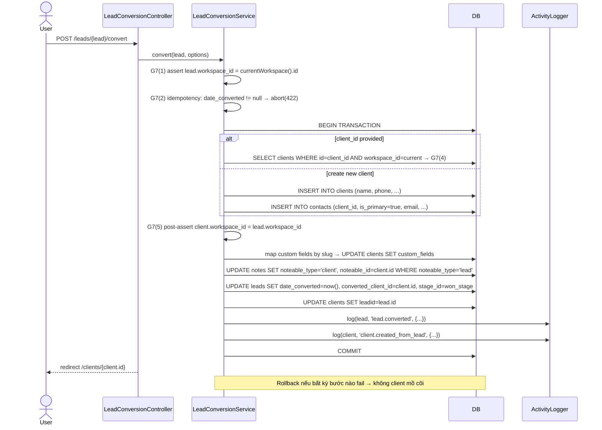
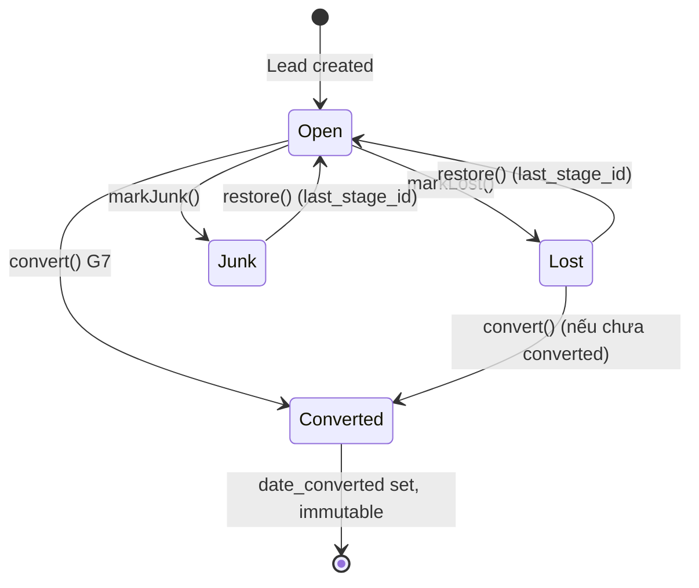

# Leads + Pipeline + Convert

Module: Sales Core · Status: live · Updated: 2026-06-25

## Purpose

Quản lý lead (tiềm năng mua hàng) qua pipeline kanban nhiều giai đoạn (stage). Hỗ trợ: drag-drop đổi stage, assignment với notification email, đánh dấu lost/junk, và **convert Lead → Client + Contact** trong một transaction toàn vẹn.

Tham chiếu: [crm-actors-and-use-cases.md](../../crm-actors-and-use-cases.md), decision locked #2 (Client/Lead thay Account/Deal).

## Actors & permissions

| Actor | Permissions |
|---|---|
| Admin | `tenant.lead.view` + create/update/delete + convert |
| Sales Manager | `tenant.lead.view` (all in workspace) + assign |
| Sales Rep | `tenant.lead.view_own` — assigned OR owner OR created_by OR team OR is_public |
| Viewer | read-only (không tạo/sửa) |

Visibility rule (G12): `is_public=true` → bất kỳ workspace member nào cũng thấy — kể cả rep không phải owner.
Fail visibility → `abort(404)` non-enumeration ([BR-X15](../../crm-business-rules.md)).

## Trigger / entry points

**UI:**
- `/leads` — bảng list + filter
- `/leads-kanban/{pipeline?}` — kanban board
- `/leads/{lead}` — chi tiết (tabs: notes, attachments, activity, reminders)
- `/leads/{lead}/convert` — dialog chuyển đổi

**API routes:**
- `GET /leads` → `LeadController::index`
- `POST /leads` → `LeadController::store`
- `GET /leads/{lead}` → `LeadController::show`
- `PATCH /leads/{lead}` → `LeadController::update`
- `DELETE /leads/{lead}` → `LeadController::destroy`
- `GET /leads-kanban/{pipeline?}` → `LeadController::kanban`
- `PATCH /leads/{lead}/stage` → `LeadStageController::update` (kanban drag)
- `POST /leads/{lead}/assign` → `LeadController::assign`
- `POST /leads/{lead}/convert` → `LeadConversionController::store`
- `POST /leads/{lead}/lost` → `LeadStatusActionController::markLost`
- `POST /leads/{lead}/junk` → `LeadStatusActionController::markJunk`
- `POST /leads/{lead}/restore-status` → `LeadStatusActionController::restore`

**Code paths:**
- `app/Http/Controllers/Leads/LeadController.php`
- `app/Http/Controllers/Leads/LeadConversionController.php`
- `app/Services/LeadService.php`
- `app/Services/LeadConversionService.php`
- `app/Policies/LeadPolicy.php`
- `app/Models/Lead.php` — `scopeVisibleTo()`
- `resources/js/pages/leads/` — React kanban + detail

## Operational flow (step-by-step)

### Kanban Stage Change (drag-drop)

1. User drag card sang stage khác trên `/leads-kanban`.
2. Frontend `PATCH /leads/{lead}/stage` với `{stage_id, lead_order}`.
3. `LeadStageController::update(MoveLeadStageRequest)` — validate `stage_id` thuộc `pipeline_id` (G8).
4. `LeadService::moveStage(lead, stageId, leadOrder)`:
   - Assert stage thuộc pipeline của lead.
   - Cập nhật `lead.stage_id` + `lead.lead_order`.
   - Lưu `last_stage_id` nếu chuyển sang lost/junk.
   - Log activity `lead.stage.changed`.
   - Fire `LeadStageChanged` event.
5. Return `200 OK`.

### Assignment + Notification

1. Manager/Admin `POST /leads/{lead}/assign` với `{assigned_to: userId}`.
2. `LeadService::assign(lead, userId)` — validate user là active `WorkspaceMember`.
3. Log activity `lead.assigned`. Fire `LeadAssigned` event.
4. Listener `SendLeadAssignedNotification` → `TemplatedMailer::send('lead_assigned', assignee, context)`.

### Convert Lead → Client + Contact (G7)

1. Sales Rep mở `/leads/{lead}` → click "Convert" → dialog.
2. Submit form `POST /leads/{lead}/convert` với `{client_name?, client_id?, contact_name?}`.
3. `LeadConversionController::store(ConvertLeadRequest)` → `LeadConversionService::convert(lead, options)`.
4. Service thực hiện trong **1 DB::transaction**:

## Data touched

| Entity | Read / Write | Notes |
|---|---|---|
| `leads` | write | `date_converted`, `converted_client_id`, `stage_id`, `lead_order` |
| `clients` | write | tạo mới hoặc attach existing (G7) |
| `contacts` | write | primary contact cho client mới |
| `notes` | write | re-point morph `noteable_type`/`noteable_id` |
| `activities` | write | `lead.converted` + `client.created_from_lead` |
| `pipeline_stages` | read | resolve won stage |
| `custom_field_definitions` | read | map by slug |

## State transitions

## Business rules applied

- **G8 — Pipeline invariant**: `stage_id` phải thuộc `pipeline_id` của lead — validated trong `MoveLeadStageRequest` + `LeadService`.
- **G7 — Convert safety**:
  1. isolation: `lead.workspace_id === currentWorkspace().id`
  2. idempotency: `date_converted !== null` → abort 422
  3. transaction đảm bảo không client mồ côi
  4. attach-existing: `client.workspace_id` phải match workspace hiện tại
  5. post-assert workspace match
- **G12 — is_public visibility**: `own OR team OR is_public OR tenant.lead.view` — any workspace member thấy public lead.
- **Non-enumeration** (BR-X15): lead ngoài visibility → `abort(404)`.
- **Morph alias** (G3): notes morph alias = `'lead'` (không phải FQCN).

## Edge cases & error handling

- Convert lần 2 (idempotency) → 422 với message `leads.errors.already_converted`.
- Attach client không thuộc workspace → 422 với message `leads.errors.client_not_in_workspace`.
- Stage không thuộc pipeline → validation 422 từ `MoveLeadStageRequest`.
- Rollback nếu contact creation fail → 0 client mồ côi (`assertDatabaseCount` verifiable).
- Cross-workspace convert: lead WS-A + auth WS-B → 404 (route-model-binding scoped + service assert).
- `is_public=false` lead → không hiện trong `Lead::visibleTo()` với rep không phải owner/assignee/team.

## Related

- [clients-contacts.md](./clients-contacts.md) — Client và Contact entities.
- [crm-domain-definition.md](../../crm-domain-definition.md) — Lead, Pipeline, Stage definitions.
- [crm-business-rules.md](../../crm-business-rules.md) — BR-X15, BR-L03.
- [system-architecture.md](../../system-architecture.md) §3.2 — leads/pipeline tables.
- `tests/Feature/Leads/LeadConvertTest.php` — G7 test coverage.
- `tests/Feature/Sales/LeadConversionTest.php` — integration + idempotency + isolation.
