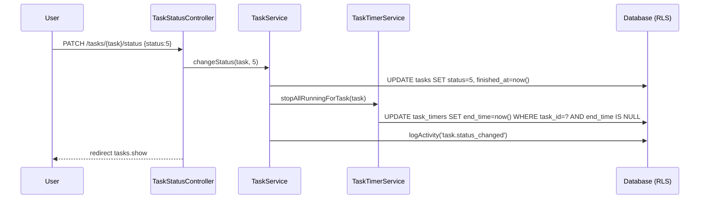

# Tasks + Timers

Module: tasks · Status: live · Updated: 2026-06-25

## Purpose

Task management mirroring Perfex CRM: tasks can be standalone or linked to a lead/client/project/contact via a morph relation. Each task has multi-assignee support, a checklist, a comment/notes thread (inherited traits), and a time-tracking sub-system (start/stop timer + manual log). Tasks are viewable in list and kanban views grouped by status column.

## Actors & permissions

| Actor | Permission | Scope |
|---|---|---|
| Member with `tenant.task.view` | View all workspace tasks | workspace-scoped RLS |
| Member with `tenant.task.view_own` | View only tasks where owner/assignee/follower | owner/assignee/follower filter in Policy |
| Member with `tenant.task.create` | Create tasks | FormRequest authorization |
| Member with `tenant.task.update` | Update any task | Policy; creator+assignee override |
| Member with `tenant.task.delete` | Delete any task | Policy; owner override |
| Task owner or assignee | Update/delete own tasks | Policy creator/assignee override (no extra perm) |
| Member with `tenant.task.update` OR owner/assignee | Log time on task | `logTime` policy |
| Member with `tenant.task.timesheet.update` OR entry owner | Edit/delete own timer entry | `manageTimesheet` policy |

Non-enumeration rule: unauthorized read → `abort(404)` NOT 403 (BR-X15).

## Trigger / entry points

| Trigger | Code path |
|---|---|
| `GET /tasks` (list view) | `Tasks\TaskController@index` |
| `GET /tasks/kanban` | `Tasks\TaskKanbanController@index` |
| `POST /tasks` | `Tasks\TaskController@store` → `TaskService::create()` |
| `PATCH /tasks/{task}` | `Tasks\TaskController@update` → `TaskService::update()` |
| `PATCH /tasks/{task}/status` | `Tasks\TaskStatusController@update` → `TaskService::changeStatus()` |
| `PATCH /tasks/{task}/kanban-order` | `Tasks\TaskKanbanController@reorder` → `TaskService::reorderKanban()` |
| `PUT /tasks/{task}/assignees` | `Tasks\TaskAssigneeController@update` → `TaskService::assign()` |
| `POST /tasks/{task}/checklist` | `Tasks\TaskChecklistController@store` → `TaskService::addChecklistItem()` |
| `PATCH /tasks/{task}/checklist/{item}/toggle` | `Tasks\TaskChecklistController@toggle` → `TaskService::toggleChecklistItem()` |
| `DELETE /tasks/{task}/checklist/{item}` | `Tasks\TaskChecklistController@destroy` → `TaskService::deleteChecklistItem()` |
| `POST /tasks/{task}/timers/start` | `Tasks\TaskTimerController@start` → `TaskTimerService::start()` |
| `PATCH /tasks/{task}/timers/{timer}/stop` | `Tasks\TaskTimerController@stop` → `TaskTimerService::stop()` |
| `POST /tasks/{task}/timers/log` | `Tasks\TaskTimerController@logManual` → `TaskTimerService::logManual()` |
| `DELETE /tasks/{task}/timers/{timer}` | `Tasks\TaskTimerController@destroy` → `TaskTimerService::deleteEntry()` |
| `DELETE /tasks/{task}` | `Tasks\TaskController@destroy` → `TaskService::delete()` |

## Operational flow (step-by-step)

### Task Create

1. User submits `POST /tasks` → `TaskStoreRequest` validates + authorizes `tenant.task.create`
2. `TaskController@store` calls `TaskService::create(data, relatedType, relatedId, assigneeIds, customFields)`
3. Service: guard related_type/related_id both-or-neither (G12), call `WorkspaceSequence::next('task', wsId)` for human-readable `task_number`
4. Set `kanban_order = MAX(kanban_order in status column) + 1` via raw SQL (RLS-scoped)
5. `$task->save()` — `BelongsToWorkspace` stamps `workspace_id`; RLS WITH CHECK enforces
6. Custom fields applied via `CustomFieldService::apply(task, fields)` if present
7. Assignees synced via `$task->assignees()->sync(pivotValues)` — `workspace_id` included in pivot for RLS
8. Activity logged: `task.created`
9. Redirect to `tasks.show`

### Timer Start

1. User clicks "Start Timer" → `POST /tasks/{task}/timers/start`
2. Policy: `logTime` — `tenant.task.update` OR (owner OR assignee)
3. `TaskTimerService::start(task, user)`: guard `task.billed == true` → `RuntimeException`
4. Stop any running timer for this user across all tasks (enforces 1-running-timer constraint at app layer; partial unique index on DB layer)
5. Create `TaskTimer` with `start_time=now()`, `end_time=null`, snapshot `hourly_rate` from task
6. Activity logged on task

### Status Change + Auto-stop

1. `PATCH /tasks/{task}/status` → `TaskStatusUpdateRequest` validates status in `[1,2,3,4,5]`
2. `TaskService::changeStatus(task, status)`:
   - If `status == 5` (COMPLETE): set `finished_at = now()`, call `TaskTimerService::stopAllRunningForTask(task)`
   - If leaving status 5: clear `finished_at`
   - Set `kanban_order = MAX + 1` in new status column
3. Activity logged: `task.status_changed`



## Data touched

| Table | Operation | Scope |
|---|---|---|
| `tasks` | R/W | `workspace_id = current_workspace` (RLS FORCE) |
| `task_assignees` | R/W | `workspace_id = current_workspace` (RLS FORCE); pivot model `TaskAssignee` handles UUID PK |
| `task_followers` | R/W | `workspace_id = current_workspace` (RLS FORCE); pivot model `TaskFollower` |
| `task_checklist_items` | R/W | `workspace_id` stamped by `BelongsToWorkspace` on create |
| `task_timers` | R/W | `workspace_id = current_workspace` (RLS FORCE); NO soft-delete (immutable timesheet) |
| `workspace_sequences` | R/W | `task_number` counter; one row per workspace per entity type |
| `activities` | W | `HasActivities::logActivity()` |

**Audit**: All 3 models (`Task`, `TaskChecklistItem`, `TaskTimer`) have `Auditable` trait → writes to `audit_logs`.

## State transitions

```
NOT_STARTED (1) ←→ IN_PROGRESS (4) ←→ TESTING (3) ←→ AWAITING_FEEDBACK (2) ←→ COMPLETE (5)
```

- Entering status 5 (COMPLETE): sets `finished_at`, stops all running timers
- Leaving status 5: clears `finished_at`
- `kanban_order` reset to end of new column on every status change

## Business rules applied

- **G12**: `related_type` and `related_id` must both be set or both null (atomic)
- **G12**: assignee user_ids and checklist `assigned_user_id` must be active `WorkspaceMember` (not just `exists:users`)
- **G4**: all 5 task tables have Postgres RLS `FORCE` with `workspace_id = current_workspace` predicate; `cho_rach_app` GRANT via migration 700007
- **G6**: `Task::customFieldEntityType()` returns `'task'` — required abstract for `HasCustomFields`
- **G3**: `'task'`, `'task_checklist_item'`, `'task_timer'` registered in `MorphMapServiceProvider`
- **BR-X15**: non-enumeration → `abort(404)` not 403 (in `TaskPolicy::view`)
- **billed=true**: all timer operations (start/stop/log/edit/delete) blocked at service layer (single guard point in `TaskTimerService`)
- **1-running-timer**: partial unique index `WHERE end_time IS NULL` + app guard in `TaskTimerService::start()`
- **Hybrid ID A2**: user FKs (owner_id, created_by, assigned_by, user_id) = bigint; all other FKs = uuid

## Edge cases & error handling

- Billed task: timer ops throw `RuntimeException('Task is billed')` — controller catches → 422 response
- Optimistic lock: `lock_version` on `tasks` (HasOptimisticLock) — TaskUpdateRequest requires `lock_version`
- Milestone reset: updating `related_type` away from `'project'` → `milestone_id` set to null
- Assignee removal: stops running timers for removed assignee
- Task delete: soft-delete; cleans polymorphic children (comments, attachments, tags, reminders, activities) before soft-delete
- `related_id` is stored as uuid string (not resolved via morph map lookup at storage time)

## Related

- [System Architecture](../../system-architecture.md)
- [P09 Phase File](../../../plans/260625-perfex-mirror-crm-core/phase-09-tasks.md)
- [BelongsToWorkspace trait](../../../app/Models/Concerns/BelongsToWorkspace.php)
- [TaskService](../../../app/Services/TaskService.php)
- [TaskTimerService](../../../app/Services/TaskTimerService.php)
- [TaskPolicy](../../../app/Policies/TaskPolicy.php)
