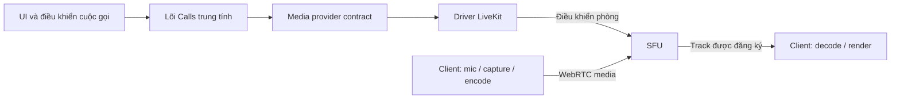

# Tối ưu media từ Discord Web

**Có thể học và tái tạo các nguyên lý giúp Discord gọi nhẹ, nhưng không thể bảo đảm chơi game hoàn toàn không giảm FPS.** Khảo sát này đã đọc bundle Discord Web công khai ngày **22/10/2026**, đối chiếu tài liệu Discord và các chuẩn WebRTC. Kết quả chỉ ra bốn đòn bẩy: xử lý microphone tại thiết bị, chuyển tiếp media bằng SFU, điều chỉnh chất lượng theo nhu cầu xem, và kiểm soát toàn bộ chi phí capture–encode–decode–render. Bản web có giới hạn khác app desktop, nên các tối ưu native không thể mang sang bằng một tùy chọn JavaScript. Với hệ thống tương tự trên Yona, hướng phù hợp là giữ lõi cuộc gọi trung tính, dùng driver media hiện có và thiết lập ngân sách chất lượng theo thiết bị. **Chưa thực hiện cuộc gọi, cấp quyền mic/camera hoặc đo FPS game trong khảo sát này.**

## Bundle hiện hành cho thấy đường WebRTC, chưa chứng minh hiệu năng

Báo cáo phân biệt ba mức bằng chứng: **đọc mã tĩnh hiện hành**, **Discord công bố**, và **thiết kế đề xuất**. Một hàm có mặt trong bundle không chứng minh nhánh đó đang chạy với mọi tài khoản, browser hoặc GPU. Một bài kỹ thuật năm 2024 cũng không tự trở thành cấu hình mặc định năm 2026.

Trong module `113634` (`MediaEngineWebRTC`), đã thấy thu mic qua `getUserMedia`, chia sẻ màn hình qua `getDisplayMedia`, Krisp có fallback, và điều chỉnh `maxBitrate`, `scaleResolutionDownBy`, `maxFramerate`. Screen capture yêu cầu `frameRate:30`; đó là constraint, chưa phải FPS đạt được. Các lựa chọn ưu tiên motion/framerate phụ thuộc experiment. Method `supports` của module này trả false cho `SIMULCAST`; kết luận chỉ áp dụng method đã đọc, không áp dụng mọi engine/phiên bản. Một số method tối ưu native là no-op trên đường browser. Chưa biết codec hoặc hardware encoder thực tế. ([Bundle Discord Web](https://discord.com/assets/web.31d1cd3e6e440749.js))

| Dấu vết để tái kiểm chứng | Giá trị |
|---|---|
| Main bundle | `web.31d1cd3e6e440749.js`, 12.547.650 byte |
| Lấy mẫu | 22/10/2026, 13:45:59 giờ Việt Nam |
| SHA256 | `5e48910d7993de9164fc0be6d4762276d5a195946014a9825546df5b04e91424` |
| Byte offset gốc, bắt đầu từ 0 | Mic: `10991316`; Krisp: `10995624`; encoder parameters: `11048796` |
| Phạm vi | Bốn JavaScript mục tiêu; không phủ toàn bộ graph tải động |

REA gặp giới hạn heap khi phân tích main bundle; không thể gọi graph tổng thể là đầy đủ. Phân tích lại hai module trích nguyên văn, thêm wrapper cú pháp, đã parse thành công nhưng vẫn có quan hệ động chưa xác định. Evidence chính là `ev_d623a0997d1e1f2e50d665ada1bb49f137e52ac74549cdfef65dd5511e84d779` cho khảo sát ban đầu và `ev_b5c81bd2927a1a47cb1c16213c9821d9d5c5f693017cad430f9ddbb7cf4d5c78` cho phạm vi thu hẹp. [Notes và giới hạn](</home/robertnguyen/www/yona/research_notes/Tối ưu media Discord Web/discord_artifact.md>), [provenance](</home/robertnguyen/www/yona/research_notes/Tối ưu media Discord Web/artifacts/focused/provenance.json>) và [Evidence đầy đủ](</home/robertnguyen/www/yona/research_notes/Tối ưu media Discord Web/artifacts/rea-evidence.json>) được lưu để kiểm tra lại.

## SFU giảm upload, còn call và livestream cần hai ngân sách khác nhau

**Discord công bố:** signaling điều khiển trạng thái cuộc gọi; media đi trên đường riêng. Bài kiến trúc 2018 mô tả Gateway, Voice WebSocket và SFU chuyển tiếp audio/video. Chi tiết giao thức trong bài là lịch sử, không nên dùng thuật toán mã hóa cũ để mô tả hiện trạng. Tài liệu voice hiện tại dùng Opus; cấu hình stereo/48 kHz trong tài liệu giao thức không chứng minh mọi mic web đều chạy stereo. ([Kiến trúc WebRTC của Discord](https://discord.com/blog/how-discord-handles-two-and-half-million-concurrent-voice-users-using-webrtc), [Voice Connections](https://github.com/discord/discord-api-docs/blob/main/developers/topics/voice-connections.mdx))

Bài tháng 06/2026 xác nhận **mỗi cuộc gọi được đặt trên một SFU host**. Toàn dịch vụ mở rộng bằng nhiều phòng trên nhiều SFU; không phải một phòng chứa hàng triệu người. Discord chạy phần mềm voice/video của mình trên hạ tầng Cloudflare, không có cơ sở kết luận họ dùng LiveKit hay Cloudflare Realtime SFU. Chất lượng còn phụ thuộc vị trí host và đường đi ISP, vì vậy chọn vùng gần người tạo phòng chưa chắc tối ưu cả nhóm đa vùng. ([How We Moved Discord Voice to the Edge](https://discord.com/blog/how-we-moved-discord-voice-to-the-edge))

Với SFU, một người gửi các phiên bản media cần thiết lên server, rồi server chuyển tới người đăng ký xem. Máy người gửi tránh upload một bản riêng cho từng bạn; người nhận vẫn phải tải, giải mã và hiển thị các luồng đã nhận. **Ẩn 49 ô video bằng CSS không đủ nếu 49 track vẫn tiếp tục được nhận và decode.** Đây là hệ quả thiết kế cần kiểm chứng ở SDK, không phải bằng chứng Discord đã thực hiện mọi tối ưu tương ứng.

Go Live được Discord mô tả năm 2024 là chuỗi capture theo OS, chọn codec theo người phát/người xem và chuyển luồng qua backend tới người đang xem. Các đường hardware encoder, capture native và fallback trong bài không thể gán nguyên sang browser. Hướng dẫn cập nhật tháng 06/2026 còn nêu Discord browser không chỉnh stream quality trong UI; chia sẻ audio phụ thuộc browser, với Chrome được hỗ trợ trong bảng đó. Đây là giới hạn sản phẩm Discord được tài liệu hóa, không phải giới hạn bắt buộc của mọi website. ([How It All Goes Live](https://discord.com/blog/how-it-all-goes-live-an-overview-of-discords-streaming-technology), [Go Live and Screen Share](https://support.discord.com/hc/en-us/articles/360040816151-Go-Live-and-Screen-Share))

**Đề xuất:** call 1–1, nhóm và xem game giữa bạn bè dùng WebRTC/SFU để giữ tương tác tức thời. Phát công khai cho hàng nghìn người xem thụ động nên đánh giá đường sân khấu WebRTC rồi xuất HLS/LL-HLS qua CDN, chấp nhận độ trễ và hệ thống vận hành khác. LiveKit có Egress xuất HLS/RTMP, cần thành phần riêng khi tự host; đây không phải bằng chứng Go Live dùng HLS. ([LiveKit Egress](https://docs.livekit.io/transport/media/ingress-egress/egress/))

E2EE cũng quyết định kiến trúc. Discord công bố từ đầu tháng 03/2026, DM/GDM/voice/Go Live dùng E2EE mặc định, gồm web; Stage là ngoại lệ cho kiến trúc khán giả lớn. DAVE mã hóa frame sau encode và giải mã trước decode, SFU chuyển tiếp nội dung mã hóa. **Suy luận:** server không có khóa không thể khử ồn, mix hay transcode nội dung như plaintext thông thường; xuất chương trình qua CDN cần xác định rõ điểm được phép giải mã và mô hình tin cậy. Không nên tuyên bố E2EE tương đương khi đã thêm một bên xử lý nội dung. ([Hiện trạng E2EE Discord](https://discord.com/blog/every-voice-and-video-call-on-discord-is-now-end-to-end-encrypted), [Đặc tả DAVE](https://github.com/discord/dave-protocol/blob/main/protocol.md))

## Khử ồn tốt cần một pipeline, giữ FPS cần đo cả GPU

**Discord công bố:** Krisp chạy tại thiết bị, hỗ trợ Chrome/Firefox desktop và có thể tự tắt khi CPU cao. Nó lọc đầu phát của người bật, không sửa microphone của người khác. Với môi trường yên tĩnh và mic tốt, bật bộ lọc còn có thể làm giảm chất giọng. System-wide echo cancellation được công bố tháng 09/2026 cho Windows client; chưa đủ cơ sở gán khả năng này cho web. ([Krisp FAQ](https://support.discord.com/hc/en-us/articles/360040843952-Krisp-FAQ), [Discord Update 25/09/2026](https://discord.com/blog/discord-update-september-25-2026))

Bundle chỉ cho thấy cách tích hợp Krisp và fallback; chưa thu được thuật toán nội bộ hoặc trọng số model để tái tạo bộ lọc độc quyền.

Cần phân biệt **noise suppression** giảm quạt/bàn phím, **echo cancellation** giảm âm loa quay lại mic, **AGC** cân mức âm lượng, và **VAD/gate** nhận biết đang nói. Gate không xóa tiếng bàn phím chen lúc người dùng đang nói. WebRTC có các thành phần xử lý này, nhưng browser/thiết bị không bảo đảm cùng cấu hình. Phải kiểm tra capability và setting thực của track. ([WebRTC Audio Processing](https://webrtc.googlesource.com/src/+/refs/heads/main/modules/audio_processing/g3doc/audio_processing_module.md), [Media constraints](https://developer.mozilla.org/en-US/docs/Web/API/MediaTrackConstraints/noiseSuppression))

**Đề xuất:** chế độ tiêu chuẩn dùng xử lý browser; chế độ nâng cao thay bộ NS hiệu lực bằng denoiser đã đo trên AudioWorklet/WASM, có fallback. Tránh mặc định chồng NS browser, AI NS và virtual mic NS: thử A/B để tìm mức méo giọng và tải CPU. RNNoise là một ứng viên có mã nguồn, không phải bằng chứng Discord dùng nó. Worklet/Worker giảm chặn giao diện nhưng không tạo thêm CPU. Game/system audio phải là track riêng, tránh áp bộ lọc giọng nói làm mất nhạc và hiệu ứng. ([AudioWorklet và WASM](https://developer.chrome.com/blog/audio-worklet-design-pattern), [Xiph RNNoise](https://github.com/xiph/rnnoise))

Với giọng nói, có thể thử Opus mono 32–48 kbps, DTX khi được hỗ trợ; chọn FEC/RED theo mạng và SDK. DTX giảm truyền khi im lặng, còn FEC/RED đánh đổi băng thông để chống mất gói. Con số bitrate codec không phải toàn bộ lưu lượng trên dây. Không nên giảm subscription audio xuống vài người nói chỉ để có số bandwidth đẹp: có thể mất đầu câu và hỏng hội thoại. ([Opus RFC 6716](https://www.rfc-editor.org/info/rfc6716/), [LiveKit advanced media](https://docs.livekit.io/transport/media/advanced/))

Discord cũng công bố DAVE web dùng Encoded Transforms, WASM và Worker để tách xử lý mã hóa khỏi main thread. Đây là mẫu phân chia công việc đáng học, không chứng minh WASM luôn nhanh hơn API browser hoặc giảm tổng CPU. ([DAVE trên các nền tảng](https://discord.com/blog/bringing-dave-to-all-discord-platforms))

**Sắc nét phụ thuộc nhiều hơn resolution.** Discord từng sửa lỗi AMD tạo quá nhiều keyframe khi đổi FPS, làm lãng phí bitrate. Với web, chọn codec theo năng lực encode của người phát, decode của người nhận và encoder runtime. H.264 hardware có thể phù hợp máy cũ; VP8 làm fallback; AV1/VP9 chỉ nên ưu tiên sau thử nghiệm. AV1 nén hiệu quả nhưng chi phí encode phụ thuộc phần cứng và implementation. ([Lỗi keyframe AMD](https://discord.com/blog/from-blocky-to-brilliant-improving-video-quality-on-discord-go-live-on-amd-gpus), [WebRTC codecs](https://developer.mozilla.org/en-US/docs/Web/Media/Guides/Formats/WebRTC_codecs), [Codec selection](https://developer.mozilla.org/en-US/docs/Web/API/WebCodecs_API/Codec_selection))

Có GPU hỗ trợ encode chưa chứng minh browser đang dùng hardware encoder. `powerEfficient` là tín hiệu năng lực, không phải bằng chứng tuyệt đối; `prefer-hardware` của WebCodecs cũng không phải công tắc ép hardware cho WebRTC. Không nên thay cả transport chỉ để có hint này. ([Media Capabilities](https://www.w3.org/TR/media-capabilities/), [WebCodecs](https://www.w3.org/TR/webcodecs/))

Để giữ frame pacing, đề xuất tránh xử lý từng frame bằng canvas/JS, blur nền và preview dư thừa; giảm camera đang decode/render khi chơi game. Nghẽn CPU cần giảm chi phí encoder và các layer phụ; nghẽn GPU hoặc capture cần giảm copy frame, decode/render và hiệu ứng; nghẽn mạng cần điều chỉnh bitrate theo chất lượng hình và ngân sách đường truyền. Theo yêu cầu cập nhật, không dùng hạ resolution/fps của screenshare dưới 1080p60 làm phương án tối ưu. **Chỉ giảm bitrate không giải quyết mọi nguyên nhân tụt FPS.** Khi game chiếm sát toàn bộ GPU, có thể thử giới hạn FPS game trong benchmark để đo mức khựng; đây là đánh đổi riêng cần được đánh giá, không phải điều kiện mặc định để gọi stream là nhẹ.

## Phòng 50 người phải giới hạn track nhận và tính egress

**Yêu cầu cập nhật của người dùng: stream chia sẻ màn hình tối thiểu 1920×1080, 60 fps.** Bỏ profile 720p30 và profile văn bản 5–15 fps. Đây là tiêu chí chất lượng cần nghiệm thu ở đầu nhận với nguồn có chuyển động, không chỉ là constraint gửi vào API. Máy phát, nguồn capture, đường mạng hoặc máy xem không đáp ứng thì phải báo rõ không đạt; không âm thầm giảm xuống dưới mức này. Phạm vi cập nhật là screenshare; profile camera bên dưới vẫn là đề xuất riêng.

**Đề xuất cấu hình khởi điểm theo yêu cầu mới, chưa áp dụng và chưa benchmark:**

| Nội dung | Capture/publish để thử | Ưu tiên khi giảm tải |
|---|---|---|
| Voice khi chơi game | Opus mono 32–48 kbps; DTX; NS tiêu chuẩn; AEC khi dùng loa | Giữ giọng liên tục; fallback bộ lọc khi quá tải |
| Camera | 360p hoặc 540p, 24–30 fps, khoảng 0,4–1 Mbps | Gaming mode cho phép tắt camera; layer nhỏ theo ô xem |
| Share game | Tối thiểu 1080p60; thử khoảng 6–10 Mbps, `motion` | Giảm chi phí xử lý và video phụ; giữ mức tối thiểu, báo rõ nếu không đạt |
| Share code/văn bản | Tối thiểu 1080p60, `text/detail`; chọn bitrate sau đo độ rõ chữ | Giữ chữ rõ và mức tối thiểu; không giảm fps để tiết kiệm tải |

Các bitrate trên dành cho **một stream/layer chính**, chưa gồm các lớp simulcast và overhead. Chúng không phải defaults Discord hoặc cam kết chất lượng; khoảng 6–10 Mbps không phải trần cố định, cần điều chỉnh theo codec và nội dung. Game nhiều hạt, chuyển động nhanh và chữ nhỏ có nhu cầu khác nhau. Đủ resolution/fps mà hình nhòe hoặc nhiều khối nén vẫn chưa đạt mục tiêu sắc nét. `contentHint` là tín hiệu ưu tiên nội dung, không bảo đảm browser thực hiện giống nhau; `maxBitrate` là trần payload, không bảo đảm bitrate đạt được. ([Content hints](https://www.w3.org/TR/mst-content-hint/), [WebRTC](https://www.w3.org/TR/webrtc/))

Với LiveKit, adaptive stream chọn layer theo kích thước/visibility, nhưng JS phải gắn track bằng `Track.attach()` đúng cách. Selective subscription giúp chỉ nhận video cần xem. Thiết kế ban đầu nên có một màn chính, vài thumbnail camera và ngừng nhận video ngoài nhu cầu; vẫn giữ audio hội thoại. Theo yêu cầu mới, layer thấp cho thumbnail camera không được tự động áp sang screenshare đang xem: screenshare cần giữ tối thiểu 1080p60. Audio-only là lựa chọn chủ động không xem video, không được tính là đạt chất lượng stream. Simulcast/SVC đều có chi phí encode/upload. Đặc biệt, tài liệu LiveKit hiện tại nói dynacast với VP9/AV1 SVC chỉ dừng **cả stream**, không từng lớp; không nên coi mọi kết hợp codec/layers là tối ưu miễn phí. ([LiveKit subscribing](https://docs.livekit.io/transport/media/subscribe/), [Codecs và dynacast](https://docs.livekit.io/transport/media/advanced/))

Công thức payload egress SFU là `E = Σ(receiver) Σ(publisher khác receiver) bitrate được nhận`. Nếu ai cũng xem mọi người ở bitrate `b`, nó thành `N(N−1)b`. Ví dụ tự tính cho 50 người theo yêu cầu mới: mỗi người nhận bốn camera khác ở 250 kbps; một screenshare 1080p60 giả định 8 Mbps được 49 người xem; bốn mic đang nói liên tục ở 48 kbps, mỗi mic tới 49 người. Mức 8 Mbps là giả định tính tải, chưa chứng minh đủ chất lượng cho mọi nội dung. Đây là giả định bốn người đang nói, **không phải chỉ cho nghe bốn người**.

| Thành phần | Payload egress |
|---|---:|
| Camera: `50 × 4 × 0,25` | 50 Mbps |
| Screenshare: `49 × 8` | 392 Mbps |
| Voice: `4 × 49 × 0,048` | 9,408 Mbps |
| Tổng | **451,408 Mbps ≈ 203,13 GB/giờ** |

Phép tính dùng GB thập phân, chưa gồm header, RTCP, retransmission, FEC/RED, padding, silence packets và TURN. Nếu mỗi người nhận đủ 49 camera ở 2 Mbps, riêng camera thành **4.900 Mbps**. Vì thế giới hạn sản phẩm 25/50 người không chứng minh sức chứa một server. Cần đo số phòng đồng thời, packet rate, NIC, vùng địa lý và tỷ lệ TURN; tách ngân sách Laravel/DB khỏi media. Tài liệu tự host LiveKit cũng yêu cầu một room vừa trong một node; benchmark của nhà cung cấp không xác nhận máy Yona đạt cùng tải. ([LiveKit benchmarking](https://docs.livekit.io/transport/self-hosting/benchmark/))

## Yona nên kiểm tra driver hiện có trước khi thêm tối ưu

**Đề xuất kiến trúc:** giữ lõi Calls quản lý quyền tham gia và vòng đời; media contract chỉ dùng khái niệm room, participant, track và capability trung tính. Driver chuyển các yêu cầu sang LiveKit; token/SID, codec options và browser probes nằm ở adapter. Một policy/profile registry quyết định ngân sách chất lượng, thay vì từng component tự chọn bitrate. Một contract audio processor cho phép đổi browser NS và denoiser mà không sửa lõi. Đây là đề xuất dựa trên trạng thái core Calls và driver LiveKit được ghi trong [CLAUDE.md hiện hành](/home/robertnguyen/www/yona/CLAUDE.md), chưa phải audit implementation.

**Bước đầu là audit hiện có:** xác định publish profile, encoder thực, track subscription, preview, audio processing và đường fallback. Sau đó làm PoC nhỏ có thể bật/tắt từng tối ưu; chưa cần tự viết SFU hoặc transport. Bước cuối là nghiệm thu thủ công trên cấu hình mục tiêu, so game-only với voice, voice+NS, xem share và phát tối thiểu 1080p60; đối chiếu cả đầu phát và đầu nhận với nguồn có chuyển động. Không coi cấu hình yêu cầu 1080p60 là đã đạt nếu resolution/fps thực, freeze hoặc độ rõ hình không đáp ứng. Giữ cùng replay/scene, settings, driver và power mode; lặp ít nhất ba lượt sau warm-up, có cả game nghẽn CPU/GPU và máy yếu. Ghi rõ trường hợp không đạt thay vì hạ profile rồi báo đạt.

Đo **FPS game và frame-time p95/p99, 1% low**, CPU theo process/core, GPU 3D/encode/decode, VRAM và RAM. Đừng lấy FPS video làm FPS game. Đồng thời lấy `getStats` hai đầu mỗi 1–2 giây: codec nếu có, resolution/fps thực, bitrate, `qualityLimitationReason`, encode/decode time, loss/RTT/jitter, freeze và audio concealment. Counter tích lũy phải lấy delta; RTT không phải độ trễ hình ảnh đầu-cuối. Có thể dùng PresentMon cho tiến trình game. ([WebRTC Stats](https://www.w3.org/TR/webrtc-stats/), [PresentMon](https://github.com/GameTechDev/PresentMon/blob/main/README.md))

Nghe A/B giọng Việt với quạt, bàn phím, giọng nhỏ và loa ngoài; xem chữ nhỏ cùng chuyển động nhanh ở đầu nhận. Tách lượt hạn chế mạng khỏi lượt tăng tải compute để tìm nguyên nhân. Có thể thảo luận mục tiêu voice-only giảm average FPS không quá 3%, 1% low không quá 5% trên cấu hình đã chọn, nhưng đó chỉ là **ngưỡng đề xuất**, chưa có kết quả đạt. Profile livestream cần ngân sách riêng sau đo.

Kết quả nghiên cứu đủ để định hướng PoC, chưa đủ để tuyên bố Discord Web hoặc Yona “nhẹ trên mọi máy”. Câu hỏi còn mở là encoder/runtime thực, chất lượng denoiser với giọng Việt, ảnh hưởng frame pacing và capacity server. Giải được bốn câu hỏi đó bằng phép đo cùng điều kiện sẽ có giá trị hơn việc bật đồng loạt AV1, AI NS và nhiều video layers.
