# Rà soát scene cuộc gọi ngày 22/10/2026

Đã sửa và nghiệm thu trên local bằng hai phiên trình duyệt, tài khoản seed sẵn có. Chưa deploy đợt sửa này. Không tạo tài khoản hoặc phát cuộc gọi thử trên production.

## Nguyên nhân và thay đổi

1. **Nút lệch hàng:** chiều cao ô phụ thuộc số dòng nhãn, trong khi lưới căn giữa. `CallActionGrid` và `CallActionButton` dùng chung cho gọi đi, gọi đến và đã nối; căn đầu hàng, giữ chỗ cho nhãn. Đo tại 1280×900: ba nút hàng trên cùng top 667.5px, hàng dưới cùng top 780px.
2. **Mũi tên chọn thiết bị bị cắt:** thay select viết riêng bằng `SelectInput` của portal, có khoảng trống và icon bên trong field, vùng chạm tối thiểu 44px. Không đổi logic chọn micro hoặc thiết bị phát.
3. **Màn live che trang mới:** phiên gọi sống ngoài trang, nhưng scene mở rộng cũng được giữ khi URL đổi. Khi pathname/query thay đổi, chỉ thu nhỏ scene; không disconnect media. Bấm mini player mở lại được. Chia sẻ trong cuộc gọi 1-1 dùng scene live chung; dừng chia sẻ quay lại scene thoại/video.
4. **FPS về 0:** UI cũ chỉ đọc outbound RTP rồi dùng nó để kết luận preview bị đứng/chất lượng kém. Tách `previewWidth`, `previewHeight`, `previewFps` đo từ thẻ video thật với FPS/bitrate gửi hoặc nhận từ WebRTC. Giữ riêng trạng thái `active`, `waiting`, `paused`. Preview không lấy FPS cấu hình làm FPS đo được.
5. **Ô người tham gia trên điện thoại:** ô cũ 345×681.75px tại viewport 375×812. Sau sửa, một người là 345×345px; hai người đều 166.875×166.875px. Nhiều hàng có vùng cuộn, không kéo ô để lấp chiều cao màn hình.
6. **Fullscreen bị browser từ chối:** bắt lỗi và báo bằng snackbar; vẫn xem/thu nhỏ được, không còn Promise rejection không xử lý.

## Bằng chứng production chỉ đọc

Cuộc gọi 18 có đúng một participant. Mẫu đầu lúc 10:26:51 UTC có 1920×1080, khoảng 58.91 FPS gửi. Từ 10:27:06 tới 10:29:02 UTC, gói video dừng ở 941, FPS/bitrate gửi đều 0, kích thước outbound không được browser trả về. Không dùng `renderWidth` để giả làm độ phân giải nguồn.

Room đang bật Dynacast. [Tài liệu LiveKit](https://docs.livekit.io/transport/media/advanced/#dynacast) mô tả việc tạm ngừng encoding khi không có subscriber. Lượt local dưới đây tái hiện cùng hiện tượng: encoder ngừng gửi khi người xem rời, trong khi preview vẫn chạy.

## Ma trận nghiệm thu

| Scene/luồng | Kết quả đã kiểm |
|---|---|
| Gọi đi 1-1 thoại | Mở rộng, căn hàng nút, thu nhỏ/hủy được; ảnh desktop và 375px trên bundle cuối |
| Gọi đến 1-1 và nhóm | Nhận realtime; thẻ gọn, mở scene, nghe/từ chối; ảnh desktop và 375px |
| 1-1 đã kết nối | Hai phiên nối thực tế; mic, camera bật/tắt, thu nhỏ và kết thúc; ảnh desktop/375px |
| Video 1-1 | Preview thật 1280×720 khoảng 30 FPS; đầu nhận có 1280×720 và bộ đếm frame tăng. Không lưu ảnh chứa hình camera |
| Phòng thoại nhóm | Hai người cùng phòng; ô vuông 375px đã đo; rời phòng và thu nhỏ được |
| Gọi nhóm thoại | Receiver nghe máy từ scene đổ chuông rồi vào scene nhóm |
| Live nhóm có người xem | Chia sẻ nguồn thật do founder chọn; gửi và nhận 1920×1080; số đo tiếp tục cập nhật qua nhiều mẫu |
| Live nhóm không còn người xem | FPS gửi về 0, preview vẫn 52.8–55.93 FPS; trạng thái waiting, không báo preview chất lượng kém |
| Live 1-1 | Đầu nhận và đầu gửi mở scene live chung; không còn scene thoại phủ lên; dừng chia sẻ quay lại scene 1-1 |
| Điều hướng khi live | Chuyển kênh làm call-stage=0, mini-player=1; phiên vẫn nối; mở lại mini player được. Đã làm cho nhóm và 1-1 |
| Mini player/thumbnail | Chỉ hiện dòng thống kê preview/nhận gọn; không để nhiều dòng che cả hình |
| Cài đặt | Select của portal ở desktop/375px; kiểm token dark bằng class theme tạm rồi khôi phục; có ảnh |
| Fullscreen | Browser của phiên nghiệm thu từ chối request; bản cuối hiện thông báo và Thu nhỏ vẫn dùng được. Chưa xác nhận nhánh vào fullscreen thành công trên thiết bị cho phép |
| Rời/kết thúc | Hai phiên đã rời; DOM cả hai không còn thẻ audio/video |

Hai phiên nằm trên cùng máy, không thay cho nghiệm thu hai thiết bị vật lý. Không thêm hoặc chạy test tự động. Không ghi nội dung tiếng/hình vào telemetry.

## Số đo và giới hạn

`call-scenes-evidence/measurements.json` chứa 37 mẫu video đã lọc bỏ identity, tên và thông tin thiết bị. Trong lượt live nhóm 128:

- Sáu mẫu gửi active ở 1080p: khoảng 48.88–56.66 FPS.
- Bảy mẫu nhận active: khoảng 48.69–56.33 FPS.
- Hai mẫu waiting: gửi 0 FPS/0 bitrate, preview khoảng 55.93 và 52.8 FPS ở 1920×1080.
- Runtime encoder là OpenH264, `powerEfficient=false`. Không khẳng định đã encode bằng phần cứng.

**Chưa đạt xác nhận 1080p60 ổn định.** Giữ mục tiêu 1920×1080/60, vẫn cảnh báo khi luồng active dưới mục tiêu; không hạ profile và không đổi số 0 thành 60. Lượt chọn cửa sổ sau có nội dung 1920×962 và UI đã báo dưới yêu cầu. Chưa đo FPS/frame-time game hoặc tải 25–50 người.

Validator chấp nhận thêm các số đo preview và trạng thái trong JSON hiện có, tương thích payload cũ; không thêm migration. Báo cáo tổng hợp bỏ mẫu waiting/paused mới khỏi median chất lượng. Mẫu cũ không có trạng thái vẫn giữ nguyên, không suy diễn hoặc backfill.

## Kiểm tra mã và môi trường

- TypeScript, Pint các file PHP thay đổi, i18n-check, build app/SDK, diff-check đều đạt.
- Nguồn chia sẻ được founder chọn qua hộp thoại thật. Các số đo xuất phát từ WebRTC và HTMLVideoElement, không dùng nguồn giả.
- Đã tắt nguồn chia sẻ/camera, rời các cuộc gọi thử, khôi phục viewport/theme và cấu hình LiveKit local gốc sau khi tạm bật loopback phục vụ nghiệm thu. Vite nghiệm thu đã dừng.
- Không thay đổi production trong đợt sửa này.

## Công việc trên dash

- [Nút trên màn gọi lệch hàng (#271)](https://dash.yona.vn/admin/tasks/view/271).
- [Màn live vẫn phủ nội dung khi chuyển kênh (#272)](https://dash.yona.vn/admin/tasks/view/272).
- [Ô người tham gia trên điện thoại bị kéo dài (#256)](https://dash.yona.vn/admin/tasks/view/256).
- [FPS và độ phân giải (#262)](https://dash.yona.vn/admin/tasks/view/262).
- [Video mờ, FPS thấp và ảnh hưởng game (#263)](https://dash.yona.vn/admin/tasks/view/263).
- [Chọn thiết bị phát (#266)](https://dash.yona.vn/admin/tasks/view/266).

## Ảnh

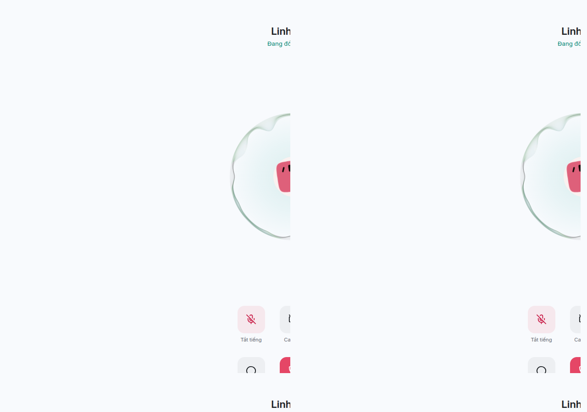

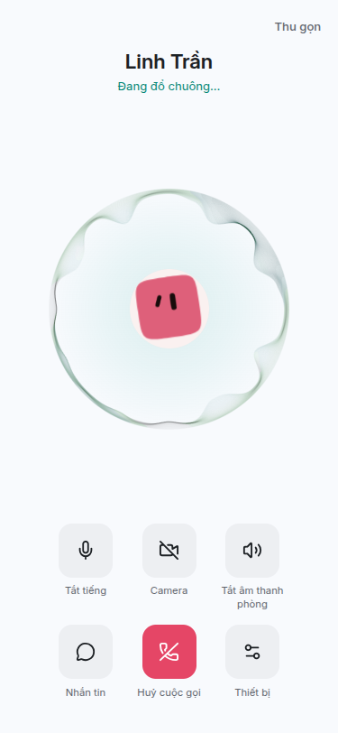

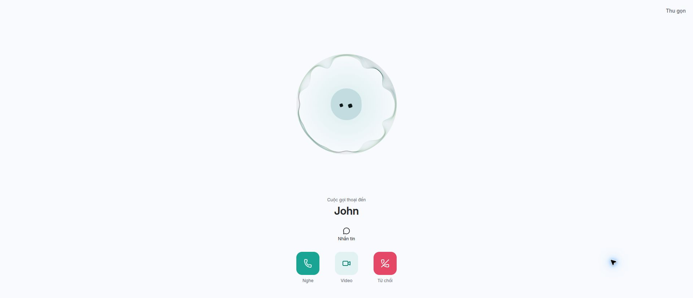

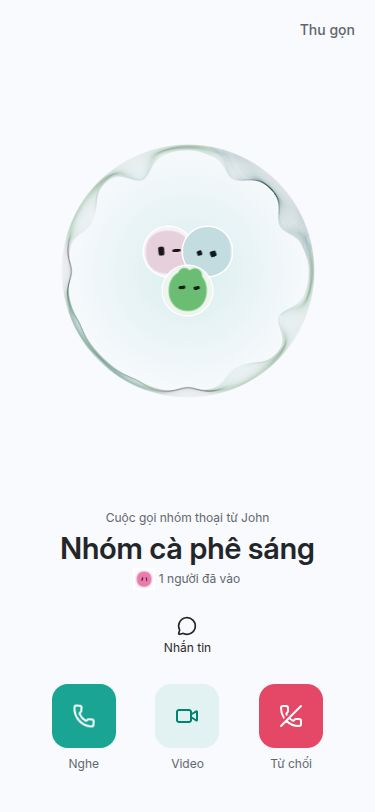

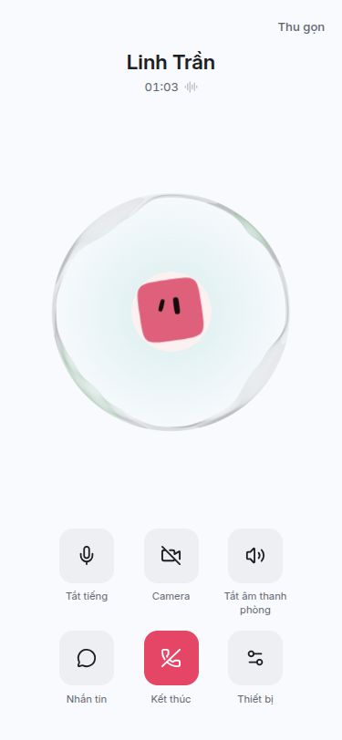

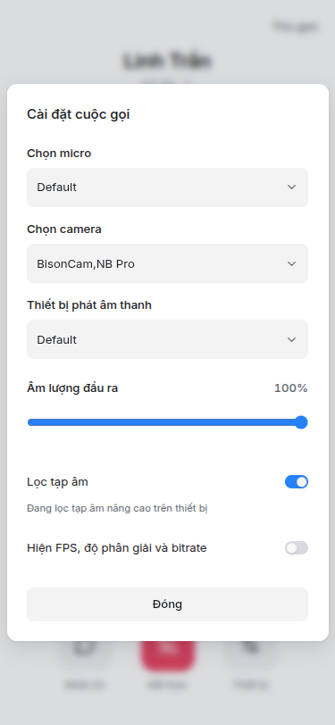

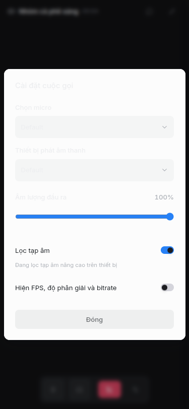

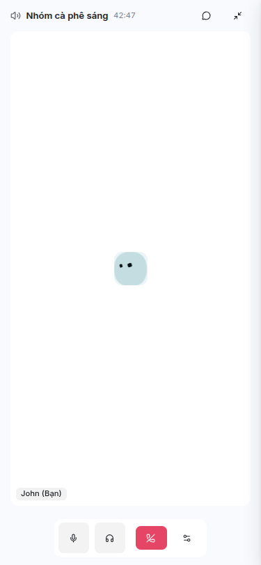

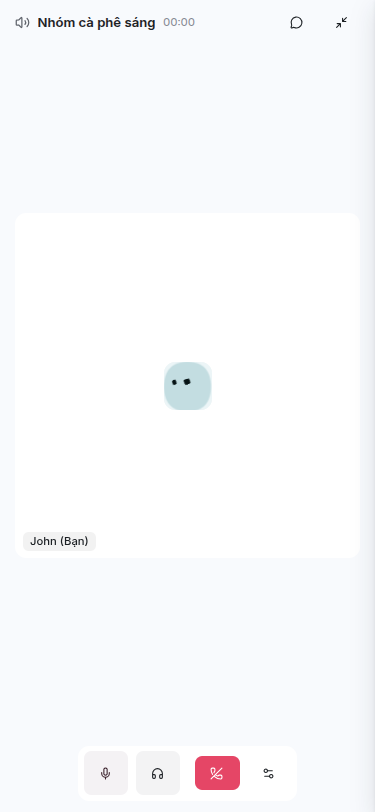

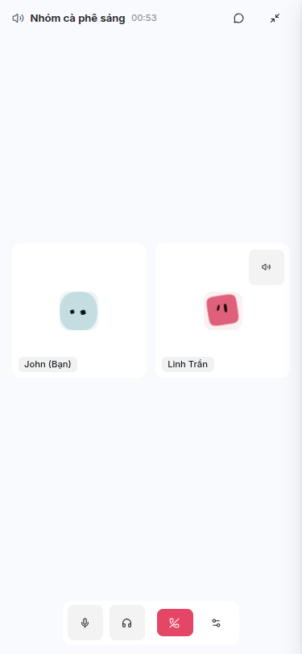

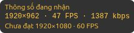

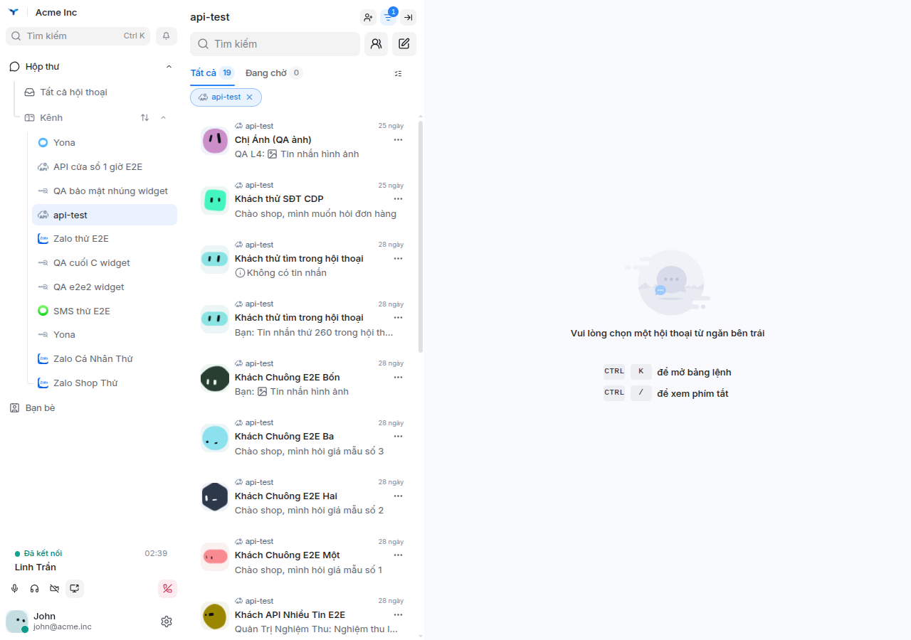
