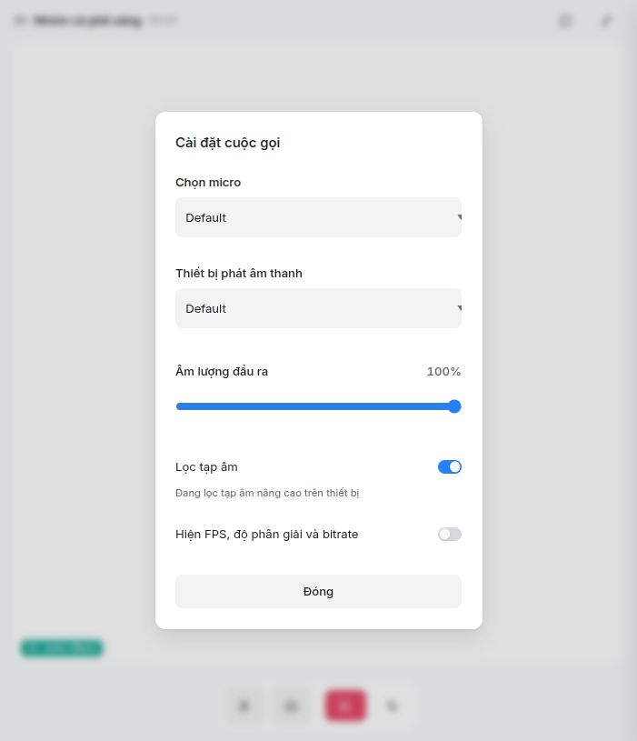
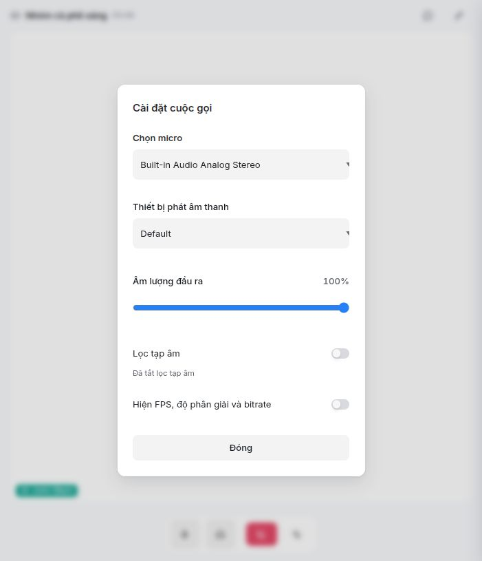
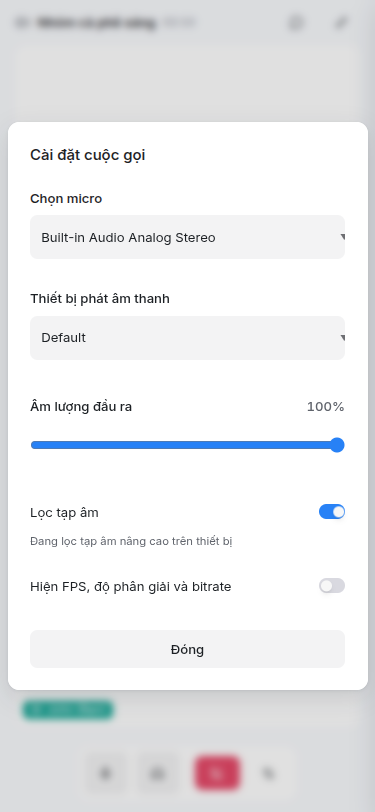

# Sửa lỗi mất micro khi đổi bộ lọc

Ngày 22/10/2026. Đã sửa và nghiệm thu trên local; chưa commit, push hoặc deploy.

## Thay đổi

`resources/js/calls/LiveKitSession.tsx` có một hàm `restartMicrophone()` dùng cho cả bốn nhánh: tắt lọc, bật RNNoise, fallback khi khởi tạo lỗi và fallback khi worklet báo lỗi. Hàm giữ constraints hiện có, ưu tiên `deviceId` của track, sau đó thiết bị capture thực tế và cuối cùng `default`. AEC/AGC, mono và 48 kHz được áp dụng thống nhất.

Đối chiếu SDK đang cài: `livekit-client` 2.22.3, `LocalAudioTrack.restartTrack()` chuyển options thành constraints mới; `LocalTrack.restart()` dùng `audio: true` khi thiếu `deviceId`, làm mất cả lựa chọn micro và các yêu cầu lọc âm. Không thay đổi dependency.

## Nghiệm thu bằng UI và micro thật

Chạy phòng thoại local, không đổ chuông hay bật camera. Chọn mục thiết bị cụ thể thay cho `Default`, sau đó đổi chế độ qua UI trên desktop và khung 375×812. DevTools chỉ quan sát constraints và `MediaStreamTrack.getSettings()`, không ghi nội dung tiếng/hình và không lưu mã thiết bị vào báo cáo.

| Nhánh | Kết quả thực tế |
|---|---|
| Chọn micro khi RNNoise đang bật | UI giữ mục thiết bị vừa chọn; thiết bị capture khớp yêu cầu sau khi cấu hình lại |
| Tắt lọc | Giữ thiết bị; `noiseSuppression=false` trong cả yêu cầu và settings thực tế |
| Bật RNNoise | Giữ thiết bị; UI báo lọc nâng cao; `noiseSuppression=false` ở browser |
| Khởi tạo RNNoise thất bại | Gây lỗi tạm khi tạo audio destination bằng DevTools; UI chuyển về bộ lọc browser, giữ thiết bị, `noiseSuppression=true` |
| Worklet báo lỗi | Phát `processorerror` vào worklet đang chạy bằng DevTools; fallback giữ thiết bị, `noiseSuppression=true` |

Các nhánh đã quan sát giữ AEC/AGC bật, sample rate 48000. Hai mục `Default` và thiết bị cụ thể trên máy hiện tại trỏ cùng một micro vật lý; chưa nghiệm thu chuyển giữa hai micro vật lý khác nhau. Không dùng lần kiểm tra này để kết luận chất lượng khử ồn nghe được hoặc hiệu năng game.

Sau nghiệm thu đã rời phòng, xác nhận không còn capture track sống, phục hồi các API browser đã gắn chẩn đoán và kích thước viewport. LiveKit local được bật tạm loopback candidate để kết nối trên máy này theo [cấu hình chính thức](https://github.com/livekit/livekit/blob/master/config-sample.yaml); đã khôi phục bằng `services/livekit/dev.sh` gốc, không đổi file cấu hình.

## Kiểm tra mã

- `pnpm tsc`: đạt.
- `pnpm build`: đạt cả app và SDK.
- Pint trên các file PHP tracked đang thay đổi: đạt.
- `make i18n-check` và `git diff --check`: đạt.
- Pint toàn repo còn lỗi định dạng ở `plans/261020-group-calls-livekit/reports/spike/spike-group.php`, ngoài phạm vi bản sửa này; không sửa file đó.
- Không thêm hoặc chạy test tự động.

## Bằng chứng

Ảnh trước/sau dưới đây là trước/sau thao tác đổi thiết bị trên bản đã sửa, không phải ảnh tái hiện bản lỗi cũ.

